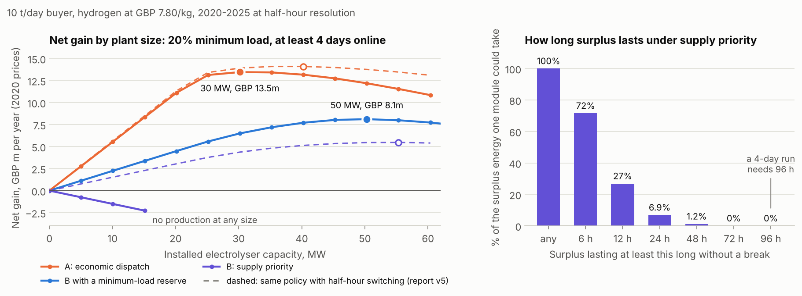

# Tier 1 main results at the recommended scale, with the electrolyser's operating limits in the main case

中文版：[REVISION_ZH.md](REVISION_ZH.md)

23 November 2026 · Julian · MMCS Group 15 · Proposed replacement for parts of chapter II and appendices B and C of report v5. Draft for review: personal work, not a group decision.

Every figure uses the group's conventions: the v7 half-hour record for 2020–25, 2020 pounds, 5% real, hydrogen at £7.80/kg, ITM NEPTUNE V modules, no grid imports and no hydrogen storage. Results were obtained with HiGHS through SciPy and have not been run in Xpress.

## What changes

1. **The main results table shows what the report recommends.** Table II.3 of v5 reports £1,690m and £118m a year for 4,251 MW and 1,821 MW of electrolysis sized to the whole UK hydrogen market, while section 5.4 recommends sizing to a secured buyer, and those figures sit in appendix Table C.1. The replacement table is at the recommended scale. The UK-wide case appears once, as an upper bound.
2. **The electrolyser's operating limits are in the main case.** v5 lets every module switch each half-hour and run down to 12.5% of load. The brief gives a 20% minimum, and the Q&A of 16 November said an electrolyser is not switched daily and stays on for at least four or five days. v5 tests a four-day run only as a sensitivity. The main case here is a 20% minimum load, starts and stops at UTC midnight, and at least four days online after a start.

Results for a 10 t/day buyer:

| | A: economic dispatch | B: supply priority |
|---|---|---|
| Electrolyser in v5 | 40.2 MW, +£14.10m a year | 55.3 MW, +£5.48m a year |
| Electrolyser under the main rule | 30.2 MW, +£13.46m a year, payback 2.6 years | none: it cannot run |
| One battery block, full foresight | +£5.64m a year (v5: +£2.891m) | +£1.64m a year (v5: +£0.964m) |
| One battery block, simple rule | +£1.66m a year (v5: −£2.605m) | +£1.64m a year (v5: −£0.938m) |

- **A changes little.** The best plant is six modules instead of eight, and the gain falls by £0.64m a year (4.5%).
- **B changes completely.** Generation left after demand covers one module's minimum load for at most 56 hours at a stretch, so a started module can never complete a four-day run. No size of plant produces anything.
- **B is restored only by relaxing it.** If online modules may draw their minimum load ahead of demand, the best plant is 50.3 MW and earns £8.11m a year. 59% of its electricity is still unused generation, and demand served falls by 0.02 percentage points. This changes the definition of the policy and is for the group to decide.
- **The battery is worth more beside a small electrolyser**, because the UK-wide plant of v5 took most of the surplus. v5's statement that the simple rule loses money does not hold at this scale. The value remains concentrated in 2022.



## 1. Main results table

### 1.1 Replacement for Table II.3

**Table II.3. Six-year mean outcomes at the recommended scale: electrolysis sized to a 10 t/day buyer and one 100 MW / 400 MWh battery block. Gains are relative to direct sales within each policy.**

| Plan | A: gain £m/yr | A: demand served % | A: unused GWh/yr | B: gain £m/yr | B: demand served % | B: unused GWh/yr |
|---|---:|---:|---:|---:|---:|---:|
| No additions | 0.00 | 89.66 | 8,647 | 0.00 | 91.03 | 5,165 |
| Electrolysis only | 13.46 | 89.61 | 8,582 | 0.00 | 91.03 | 5,165 |
| Electrolysis and one battery block, simple rule | 15.12 | 89.64 | 8,505 | 1.64 | 91.06 | 5,089 |
| Electrolysis and one battery block, full foresight | 19.10 | 89.63 | 8,506 | 1.64 | 91.06 | 5,090 |
| Upper bound: UK-wide hydrogen market, half-hour switching, electrolysis only | 1,689.96 | 80.57 | 4,142 | 118.38 | 91.03 | 2,353 |

Under the main rule the electrolysis is six NEPTUNE V modules (30.2 MW) in A and none in B, so the B battery rows are the battery alone. Each battery row adds one block to the electrolysis-only row. The last row is v5's common equipment case, reproduced here: 845 modules in A and 362 in B with a 1,559 t/day ceiling. It needs a market the client does not have. Under the main rule B cannot reach it at any scale, and v5's own sensitivities take about £27m and a further £14m off the A figure.

### 1.2 The electrolyser at the recommended scale (new table)

**Table II.4. Electrolysis for a 10 t/day buyer under the main operating rule.**

|  | A: economic dispatch | B: supply priority | B with a minimum-load reserve |
|---|---:|---:|---:|
| Modules / capacity | 6 / 30.2 MW | none | 10 / 50.3 MW |
| Capital, £m | 44.1 | 0 | 73.5 |
| Net gain, £m/yr | 13.46 | 0.00 | 8.11 |
| Simple payback, years | 2.6 | – | 5.1 |
| Hydrogen, t/yr | 3,406 | 0 | 2,640 |
| Electricity used, GWh/yr | 190.4 | 0 | 147.5 |
| of which from unused generation | 34% | – | 59% |
| taken ahead of sales, GWh/yr | 125.4 | 0 | 61.2 |
| Change in demand served, percentage points | −0.049 | 0 | −0.024 |
| Days delivering at least 95% of the buyer's limit | 85% | – | 37% |
| Net gain by year, lowest to highest, £m | 8.67 to 19.84 | – | 4.47 to 13.48 |
| Days with a module online | 97% | 0% | 96% |

The third column is described in section 2.4.

### 1.3 Replacement text for section 5.1

> For a 10 t/day buyer the main operating rule selects six NEPTUNE V modules (30.2 MW) under A and no electrolyser under B. The A plant costs £44.1m, produces 3,406 t of hydrogen a year and earns £13.46m a year over direct sales, a simple payback of 2.6 years. It delivers at least 95% of the buyer's limit on 85% of days, and its yearly gain ranges from £8.67m in 2022 to £19.84m in 2020. Unused generation supplies 34% of its electricity. The rest is diverted from sales, which lowers demand served by 0.05 percentage points. Under B, generation left after demand covers one module's minimum load for at most 56 hours at a stretch, so a started module cannot complete a four-day run and the best choice is to build nothing (Table II.4).
>
> Table II.3 adds one 100 MW / 400 MWh block. With full foresight the block earns a further £5.64m a year in A and £1.64m in B after its £4.695m annual cost. With the simple rule, which charges from unused generation and sells into the next shortfall, it earns £1.66m and £1.64m. Under B stored energy must go to the next shortfall at once, so foresight adds almost nothing. Under A, 51% of what the fully informed plan charges is generation that would otherwise have been sold at a low price, which the simple rule never uses. The last row gives the UK-wide case as an upper bound. With 845 and 362 modules, half-hour switching and a 1,559 t/day ceiling, electrolysis alone would earn £1,689.96m and £118.38m a year. Neither is available without that market, and the B figure cannot be reached under the main rule.

### 1.4 Other passages that carry the old figures

- **Abstract.** Replace the two sentences from "A common 100 MW / 400 MWh block" to "the scale of investment" with: "Electrolysers are modelled with a 20% minimum load and a four-day minimum run. For a 10 t/day buyer, economic dispatch supports 30.2 MW of electrolysis, earning £13.46m a year with a payback of 2.6 years. Under supply priority no electrolyser can operate, because surplus never lasts longer than 56 hours. One 100 MW / 400 MWh battery block adds £5.64m and £1.64m a year with full foresight."
- **Section 5.2, last paragraph.** "Buyer size changes the scale of electrolysis. A 4 t/day contract supports 15.1 MW in A, earning £5.33m a year, and 10 t/day supports 30.2 MW and £13.46m. At £5/kg the 10 t/day gain falls to £4.31m. At £10/kg it rises to £21.14m with 35.2 MW. B builds nothing in any of these cases (Table C.1)." The sentences on the UK-wide runs can stay.
- **Section 5.3, break-even and Figure II.1.** At this scale the block breaks even at installed costs of about £213 per nominal kWh in A with full foresight, £131 in A with the simple rule and £131 in B. The industry midpoint is £173. Yearly values for a redrawn Figure II.1 are in section 2.6.
- **Section 5.4.** Replacement text is in section 2.7.

## 2. Operating assumption

### 2.1 Replacement wording for section 2 and section 3

- **Table II.2.** "Load / energy use: 12.5–100% / 55.9 kWh/kg" becomes "Load when online / energy use: 20–100% / 55.9 kWh/kg". Add a row "Starts and stops / minimum run: UTC midnight / 4 days".
- **Text under Table II.2.** "We retain the same usable range. NEPTUNE V is rated down to 12.5% of load. We apply the brief's 20% minimum and, following the course guidance that an electrolyser is not switched daily, a four-day minimum run."
- **Assumptions.** Replace "Each operating electrolyser uses its rated specific consumption at part load. We test changes to the minimum-run assumption separately." with "Each online module uses its rated specific consumption at part load and takes at least 20% of its rated input in every half-hour. Modules start and stop at UTC midnight and stay online for at least four days once started. Half-hour switching is kept as a comparison."

### 2.2 Addition to the model, after constraint (II.6)

With $\bar z_{jd}$ the modules of type $j$ online on UTC day $d$, $y_{jd}$ the modules started on day $d$ and $R=4$ the minimum run in days:

$$
z_{jt}=\bar z_{jd}\ \ (t\in T_d),\qquad y_{jd}\ge \bar z_{jd}-\bar z_{j,d-1},\qquad \sum_{k=d-R+1}^{d} y_{jk}\le \bar z_{jd},\qquad y_{jd}\ge 0 .
$$

The number online is constant within a day, starts are counted, and every module started in the last $R$ days is still online. The minimum load in (II.6) uses $\alpha_j=0.2$. All modules are off before the first day, and no module starts so late that its run would pass the end of the record.

### 2.3 What each part of the rule costs

At the sizes v5 selected (eight modules in A, eleven in B), 10 t/day, £7.80/kg:

| Operating rule | A, 40.2 MW: net gain £m/yr | A: hydrogen t/yr | B, 55.3 MW: net gain £m/yr | B: hydrogen t/yr |
|---|---:|---:|---:|---:|
| Half-hour switching, 12.5% minimum load (report v5) | 14.100 | 3,432 | 5.478 | 1,769 |
| Half-hour switching, 20% minimum load | 14.100 | 3,432 | 5.478 | 1,769 |
| Starts and stops at UTC midnight, 20% minimum load | 13.181 | 3,483 | −8.140 | 23 |
| At least 4 days online, 20% minimum load (main rule) | 13.164 | 3,489 | −8.322 | 0 |
| At least 5 days online, 20% minimum load | 13.155 | 3,494 | −8.322 | 0 |
| Main rule, plant re-sized | 13.460 (30.2 MW) | 3,406 | 0.000 (no plant) | 0 |

- Raising the minimum load from 12.5% to 20% has no visible effect while modules can switch every half-hour.
- In A, moving starts and stops to midnight costs £0.92m a year, because online modules must then hold minimum load through high-price half-hours. The four-day run costs a further £0.02m. Re-sizing from eight modules to six recovers £0.30m. A five-day run gives the same size and £13.45m.
- With the manufacturer's 12.5% minimum and the four-day run, the eight-module A plant would earn £13.53m instead of £13.16m.
- Eight modules remain a defensible choice if the buyer values delivery: they earn £13.16m, cost £58.8m and reach 95% of the limit on 91% of days against 85% for six.

### 2.4 Why supply priority cannot run, and what would let it

Under B the electrolyser may use only generation left after demand. Surplus large enough for one module's minimum load occurs in 24.7% of half-hours, but in 2,890 separate stretches over six years (482 a year) with a mean length of 4.5 hours.

| Surplus lasting at least | Stretches in six years | Share of the surplus energy one module could take |
|---|---:|---:|
| any length | 2,890 | 100% |
| 6 hours | 902 | 72% |
| 12 hours | 195 | 27% |
| 24 hours | 26 | 6.9% |
| 48 hours | 3 | 1.2% |
| 72 hours | 0 | 0% |
| 96 hours | 0 | 0% |

The longest stretch is 56 hours, and only 14 whole UTC days in six years are covered from midnight to midnight. A plant that must stay on for four days therefore never starts. The battery block cannot bridge the gaps, because under B stored energy must be discharged to demand as soon as a shortfall begins.

Three things would let an electrolyser run under supply priority:

1. **A minimum-load reserve.** Online modules draw from generation ahead of demand only what they need to reach minimum load, and take everything else from surplus. In the notation of (II.7), direct sales become $q_t=\min(G_t,D_t)-m_t$ with $m_t=\big(\alpha\Delta P^{H}\bar z_d-(G_t-D_t)_+\big)_+$. The best plant is then ten modules (50.3 MW), earning £8.11m a year with a payback of 5.1 years (Table II.4). It takes 61.2 GWh a year ahead of sales, which lowers demand served by 0.02 percentage points, and 59% of its electricity is unused generation. Six modules would earn £6.50m and eleven £7.99m. A five-day run gives £8.10m.
2. **A firm purchase of the same energy** from outside the modelled system. The model has no grid imports, so this is not costed. It would add network charges to the price used above.
3. **A plant that can cycle within hours.** With half-hour switching B earns £5.48m at 55.3 MW, as in v5. This depends on the supplier confirming that such operation is acceptable.

### 2.5 Replacement for Table C.1

**Table C.1. Electrolysis-only site appraisal under the main operating rule. Annual gains are above direct sales, after equipment charges. The last two columns give v5's values with half-hour switching, which this study reproduces.**

| Limit t/day | £/kg | A: MW | A: gain £m/yr | B | B with reserve: MW | B with reserve: gain £m/yr | v5 A: MW / gain | v5 B: MW / gain |
|---:|---:|---:|---:|---|---:|---:|---:|---:|
| 4 | 7.80 | 15.1 | 5.33 | none | 20.1 | 3.24 | 15.1 / 5.66 | 20.1 / 2.21 |
| 10 | 5.00 | 30.2 | 4.31 | none | 35.2 | 1.55 | 35.2 / 4.96 | 35.2 / 1.19 |
| 10 | 7.80 | 30.2 | 13.46 | none | 50.3 | 8.11 | 40.2 / 14.10 | 55.3 / 5.48 |
| 10 | 10.00 | 35.2 | 21.14 | none | 55.3 | 14.15 | 40.2 / 21.79 | 60.4 / 9.49 |

At £5/kg the reserve variant has 2 loss-making years of six.

### 2.6 The battery block at the recommended scale

| One battery block, net gain £m | 2020 | 2021 | 2022 | 2023 | 2024 | 2025 | Mean |
|---|---:|---:|---:|---:|---:|---:|---:|
| A, full foresight | 0.35 | 9.41 | 17.58 | 3.17 | 0.97 | 2.34 | 5.64 |
| A, simple rule | −1.47 | 2.79 | 11.42 | −0.92 | −2.10 | 0.21 | 1.66 |
| B, simple rule | −1.48 | 2.85 | 11.51 | −1.06 | −2.22 | 0.23 | 1.64 |
| B, full foresight | −1.46 | 2.85 | 11.49 | −1.05 | −2.22 | 0.22 | 1.64 |

- **A, full foresight.** Gross operating value £10.33m a year, payback 4.1 years, positive in every year (£0.35m to £17.58m). The annual discharge budget is used in full. Without 2022 the mean is £3.25m.
- **A, simple rule.** Gross £6.35m, payback 7.2 years, a loss in 3 years of six. Without 2022 the mean is −£0.30m.
- **B.** The simple rule earns gross £6.33m and serves an extra 68 GWh of demand a year. The best fully informed charging plan adds less than £0.01m to that. If stored energy could be held back for higher prices the value would be £7.99m, which the policy does not allow. A loss in 3 years of six; without 2022 the mean is −£0.34m.

v5's battery figures were measured beside 845 and 362 modules, which absorb most of the surplus a battery would charge from. This study reproduces v5's simple-rule results at that scale (−£2.605m and −£0.938m), so the difference comes from the scale of the electrolysis and not from the method.

### 2.7 Replacement text for the last paragraph of 5.3, for 5.4 and for appendix B 3.1

> **5.3, last paragraph.** The operating rule matters more for B than for A. With half-hour switching and the manufacturer's 12.5% minimum, the 10 t/day case would support 40.2 MW and £14.10m a year in A and 55.3 MW and £5.48m in B. In A, moving starts and stops to midnight costs £0.92m a year at that size and the four-day run a further £0.02m. Re-sizing to 30.2 MW recovers £0.30m. A five-day run gives the same size and £13.45m. In B the plant cannot run under either minimum run. Start-up energy and wear are not modelled and need the supplier's confirmation [16, 18].
>
> **5.4. Size electrolysis to secured offtake, and settle the dispatch policy first.** Under economic dispatch, plan for about 30 MW for each 10 t/day of secured offtake (£44.1m, payback 2.6 years). Under strict supply priority do not invest in electrolysis. If the client wants supply priority, the plant needs a firm source for its minimum load. Letting online modules draw 20% of their rating ahead of demand supports 50.3 MW (£73.5m, payback 5.1 years) and lowers demand served by 0.02 percentage points. Confirm the minimum run, start-up energy and minimum load with the supplier before sizing.
>
> **5.4. Quote one battery block, then test rollout.** Beside a site-scale electrolyser the block earns £5.64m a year in A and £1.64m in B with full foresight, simple paybacks of 4.1 and 7.2 years, and breaks even at installed costs of about £213 and £131 per nominal kWh against an industry midpoint of £173. Without foresight the simple rule earns £1.66m and £1.64m and loses money in three of the six years, and 2022 supplies most of the gain. Require a quote below the break-even for the operating rule the client can actually run, and validate dispatch value on later data before purchase.
>
> **Appendix B 3.1.** The base model applies the brief's 20% minimum load, starts and stops at UTC midnight and a four-day minimum run. The manufacturer rates NEPTUNE V down to 12.5%. With that minimum and the four-day run the A gain at 40.2 MW would be £13.53m a year instead of £13.16m. With half-hour switching the minimum load makes no difference at this scale. The four- and five-day durations come from the class discussion. The manufacturer's cold-start energy, wear and operational minimum-run requirements need separate confirmation.

## 3. Checks

`python site_run.py` runs 33 checks, all of which pass (`results/checks.json`).

- **Published figures reproduced with independent code.** All eight entries of v5 Table C.1 (capacity exactly, gain to the two decimals printed). The no-additions and electrolysis-only rows of v5 Table II.3 (£1,689.96m, 80.57%, 4,142 GWh in A; £118.38m, 91.03%, 2,353 GWh in B). v5's simple-rule battery results at that scale (−£2.605m and −£0.938m).
- **Earlier work in this folder reproduced.** The site-scale operating sensitivity under `codex/` (22 November) gives the same A results to six decimals: at eight modules for daily starts and for the four- and five-day runs, and at six modules for the four- and five-day runs. It also gives the same 56-hour figure for B.
- **Minimum-run programmes** are solved to optimality with zero gap, and every commitment path is replayed by a separate first-in-first-out check of each module's run.
- **Battery schedules** are audited for stock balance, stock and power limits, closing stock, charging and discharging in the same half-hour, and, under B, stored energy held back during a shortfall.
- **Bounds.** Full foresight is never below the simple rule. Under B it lies between the simple rule (£6.33m) and the bound with holding back (£7.99m).
- **Dispatch formula.** For 2022 and for 2023 the closed-form electrolysis dispatch equals a linear programme of the same problem to within £0.01.

New in this study: the battery beside a site-scale electrolyser, the minimum-load reserve, Table C.1 under the main rule, and the table of surplus stretches. Confirmed from earlier work: the A sizes and gains under a minimum run, and the 56-hour limit.

## 4. Limits and points for the group

- **Full foresight is hindsight**, as in v5. It is an upper limit on what an operator earns.
- **The battery is scheduled with the electrolyser plan held fixed.** At the UK-wide scale this gives a gross value of £7.23m in A against v5's jointly optimised £7.586m. At site scale the electrolyser is 141 times smaller, so the two hardly compete for the same energy. Scheduling them together for 2022 and for 2023 raises the battery's value by £0.11m and £0.01m, so the simplification is small and on the cautious side.
- **B with full foresight** is found by a dynamic programme on a 0.5 MWh stock grid and then replayed exactly. The replay is the reported figure.
- **Table II.4 of v5 (joint sizing by window) and Figure II.1** were also computed beside UK-wide electrolysis and have not been redone here.
- **The minimum-load reserve is a different policy from B as v5 defines it.** The energy is priced at the sale forgone. Whether it enters the report as a third case or as a condition in the recommendation is for the group.
- **Starts and stops are at UTC midnight only.** Start-up energy and a cost per start are not modelled.
- **Four or five days.** The difference at the chosen size is under £0.02m a year in either policy. Four days matches v5's existing test.
- **The UK-wide figures under the main rule were not recomputed.** The text cites v5's own sensitivities for A.
- **Solver.** v5 states that the shared equipment case was re-optimised with Xpress. These cases were solved with HiGHS and would need the same treatment before that sentence can stand.

## 5. Files and reproduction

- `site_model.py`: data, dispatch under each policy, minimum-run commitment, metrics.
- `site_battery.py`: the battery block (simple rule, full foresight under A, dynamic programme under B, audit).
- `site_run.py`: every case and check. `site_figures.py`: the figure.
- `results/`: `main_table.csv`, `sizing.csv`, `sizing_v5_rule.csv`, `operating_rules.csv`, `contract_cases.csv`, `battery.csv`, `surplus_runs.csv`, `national_scale_test.csv`, `joint_test.csv`, `checks.json`, `fig_size_and_surplus.png`.

The inputs are the group's frozen v7 study and are not copied. Their SHA-256 values are recorded in `results/checks.json`.

```sh
python site_run.py --study-dir /path/to/tier1-halfhour-20261113-v7 --output results    # about 7 minutes
python site_figures.py results
```

Run with Python 3.13, numpy 2.5, pandas 3.0, scipy 1.18 and matplotlib 3.11.

## Sources

- Report v5, `Tier1/workspaces/mocry/codex/technical-report-latex/20261122-v5/report.pdf`: Tables II.2, II.3 and C.1, sections 5.1 to 5.4, appendix B 3.1.
- v7 half-hour study, `Tier1/workspaces/mocry/codex/work-history/20261113-v1/studies/tier1-halfhour-20261113-v7`: data, configuration and model.
- Battery specification, `Tier1/public/findings/battery-entry-and-tier2b-handoff-20261119`.
- Site-scale operating sensitivity, `Tier1/workspaces/julian/codex/electrolyser-sensitivity/20261122-v1`.
- Project brief (20% minimum load) and the Q&A of 16 November 2026 (minimum run of four or five days).
