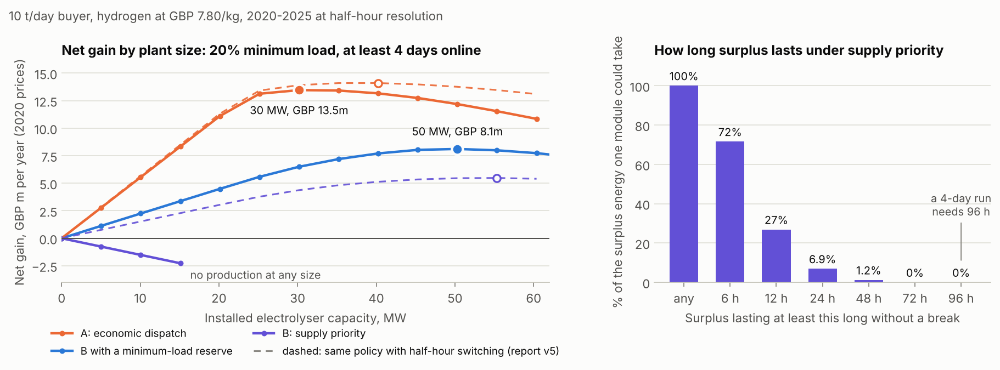

# 推荐规模下的 Tier 1 主结果，并把电解槽的运行限制写进主情景

English version: [REVISION.md](REVISION.md)

2026-11-23 · Julian · MMCS Group 15 · 针对报告 v5 第 II 章和附录 B、C 部分内容的替换稿。供审阅的草稿：个人工作，不是小组决定。

所有数字都用小组的口径：v7 半小时数据（2020–25 年）、2020 年英镑、实际折现率 5%、氢价 £7.80/kg、ITM NEPTUNE V 模块、不外购电、不储氢。金额沿用报告的写法，£13.46m 表示 1,346 万英镑。结果由 SciPy 自带的 HiGHS 求出，没有用 Xpress 运行。可直接粘贴进报告的英文替换文字在英文版里，本稿给出对应的中文。

## 改了什么

1. **主结果表改为报告实际推荐的方案。** v5 的表 II.3 给出的是按全英氢市场选出的 4,251 MW 和 1,821 MW 电解槽，年收益 £1,690m 和 £118m；而 5.4 节的建议是按已落实的买方规模来建，对应的数字放在附录表 C.1。替换后的主表按推荐规模给出，全英规模只出现一次，作为上界。
2. **电解槽的运行限制进入主情景。** v5 允许每个模块每半小时开关一次，负荷可以低到 12.5%。题面给的最低负荷是 20%；11 月 16 日答疑课说电解槽不会每天开关，至少连续运行 4 到 5 天。v5 只在敏感性分析里测了连续 4 天。这里的主情景是：最低负荷 20%，只在 UTC 零点开停，启动后至少连续在线 4 天。

每天 10 吨买方情形下的结果：

| | A：经济调度 | B：供电优先 |
|---|---|---|
| v5 的电解槽 | 40.2 MW，每年 +£14.10m | 55.3 MW，每年 +£5.48m |
| 主规则下的电解槽 | 30.2 MW，每年 +£13.46m，回收期 2.6 年 | 不建：无法运行 |
| 一组电池，完全预知 | 每年 +£5.64m（v5：+£2.891m） | 每年 +£1.64m（v5：+£0.964m） |
| 一组电池，简单规则 | 每年 +£1.66m（v5：−£2.605m） | 每年 +£1.64m（v5：−£0.938m） |

- **A 变化不大。** 最优规模从 8 个模块变成 6 个，年收益减少 £0.64m（4.5%）。
- **B 完全改变。** 满足需求后剩下的发电，够一个模块维持最低负荷的时间最长只连续 56 小时，启动的模块永远跑不满 4 天。任何规模都产不出氢。
- **只有放宽 B 才能恢复。** 如果允许在线模块先于需求取用最低负荷所需的电，最优规模是 50.3 MW，每年赚 £8.11m。它用的电仍有 59% 是未利用电量，需求满足率下降 0.02 个百分点。这改变了策略的定义，要由小组决定。
- **电解槽规模小的时候，电池更值钱**，因为 v5 的全英规模电解槽吃掉了大部分余电。v5 所说的"简单规则亏钱"在这个规模下不成立。电池的价值仍然集中在 2022 年。



## 1. 主结果表

### 1.1 表 II.3 的替换稿

**表 II.3　推荐规模下的六年平均结果：按每天 10 吨买方选定的电解槽，加一组 100 MW / 400 MWh 电池。收益相对于各策略下只卖电的情形。**

| 方案 | A：收益（百万英镑/年） | A：需求满足率 % | A：未利用电量 GWh/年 | B：收益（百万英镑/年） | B：需求满足率 % | B：未利用电量 GWh/年 |
|---|---:|---:|---:|---:|---:|---:|
| 不新增设备 | 0.00 | 89.66 | 8,647 | 0.00 | 91.03 | 5,165 |
| 只建电解槽 | 13.46 | 89.61 | 8,582 | 0.00 | 91.03 | 5,165 |
| 电解槽加一组电池，简单规则 | 15.12 | 89.64 | 8,505 | 1.64 | 91.06 | 5,089 |
| 电解槽加一组电池，完全预知 | 19.10 | 89.63 | 8,506 | 1.64 | 91.06 | 5,090 |
| 上界：全英氢市场、每半小时自由开关、只建电解槽 | 1,689.96 | 80.57 | 4,142 | 118.38 | 91.03 | 2,353 |

主规则下，A 的电解槽是 6 个 NEPTUNE V 模块（30.2 MW），B 不建，所以 B 的两行电池结果就是电池单独的结果。每一行电池结果是在"只建电解槽"那一行上加一组电池。最后一行是 v5 的共同设备情形，本稿已复现：A 845 个模块、B 362 个模块，上限每天 1,559 吨。它需要一个客户并不拥有的市场。主规则下 B 在任何规模都达不到这个数；对 A，v5 自己的敏感性分析要扣掉约 £27m，再扣约 £14m。

### 1.2 推荐规模下的电解槽（新增表）

**表 II.4　主运行规则下，每天 10 吨买方情形的电解槽。**

|  | A：经济调度 | B：供电优先 | B 加最低负荷保留 |
|---|---:|---:|---:|
| 模块数 / 容量 | 6 / 30.2 MW | 不建 | 10 / 50.3 MW |
| 投资（百万英镑） | 44.1 | 0 | 73.5 |
| 年净收益（百万英镑） | 13.46 | 0.00 | 8.11 |
| 简单回收期（年） | 2.6 | – | 5.1 |
| 氢产量（吨/年） | 3,406 | 0 | 2,640 |
| 用电量（GWh/年） | 190.4 | 0 | 147.5 |
| 其中来自未利用电量 | 34% | – | 59% |
| 先于售电取用的电（GWh/年） | 125.4 | 0 | 61.2 |
| 需求满足率变化（百分点） | −0.049 | 0 | −0.024 |
| 交付量达到买方上限 95% 的天数 | 85% | – | 37% |
| 各年净收益，最低到最高（百万英镑） | 8.67 至 19.84 | – | 4.47 至 13.48 |
| 有模块在线的天数 | 97% | 0% | 96% |

第三列的含义见 2.4 节。

### 1.3 5.1 节的替换文字

> 对每天 10 吨的买方，主运行规则在 A 下选出 6 个 NEPTUNE V 模块（30.2 MW），在 B 下不建电解槽。A 的电解槽投资 £44.1m，每年产氢 3,406 吨，相对只卖电每年多赚 £13.46m，简单回收期 2.6 年。有 85% 的天数交付量达到买方上限的 95%，各年收益在 £8.67m（2022 年）到 £19.84m（2020 年）之间。它用的电有 34% 是未利用电量，其余来自原本可以卖出的电，需求满足率因此下降 0.05 个百分点。B 下，满足需求后剩下的发电够一个模块维持最低负荷的时间最长只连续 56 小时，启动的模块跑不满 4 天，最优选择是不建（表 II.4）。
>
> 表 II.3 再加一组 100 MW / 400 MWh 电池。完全预知时，扣除每年 £4.695m 的成本后，这组电池在 A 下每年多赚 £5.64m，在 B 下多赚 £1.64m。按简单规则（用未利用电量充电，在下一次缺口时卖出）分别是 £1.66m 和 £1.64m。B 下存的电必须在下一次缺口时立即放出，所以预知未来几乎没有额外价值。A 下，完全预知的计划充入的电有 51% 来自原本会在低价时卖出的发电，简单规则从不这样做。最后一行给出全英规模作为上界：845 和 362 个模块、每半小时自由开关、上限每天 1,559 吨时，只建电解槽每年可赚 £1,689.96m 和 £118.38m。没有那样的市场，两个数都拿不到；B 的那个数在主规则下根本达不到。

### 1.4 其他带有旧数字的段落

- **摘要。** 把从 "A common 100 MW / 400 MWh block" 到 "the scale of investment" 的两句换成：电解槽按最低负荷 20%、最短连续运行 4 天建模。对每天 10 吨的买方，经济调度支持 30.2 MW 电解槽，每年赚 £13.46m，回收期 2.6 年。供电优先下没有电解槽能运行，因为余电连续时间从不超过 56 小时。一组 100 MW / 400 MWh 电池在完全预知时每年分别多赚 £5.64m 和 £1.64m。
- **5.2 节最后一段。** 买方规模决定电解槽规模。每天 4 吨的合同在 A 下支持 15.1 MW，每年赚 £5.33m；每天 10 吨支持 30.2 MW 和 £13.46m。氢价 £5/kg 时，10 吨情形的收益降到 £4.31m；£10/kg 时升到 £21.14m，规模 35.2 MW。这些情形下 B 都不建（表 C.1）。关于全英规模运行结果的句子可以保留。
- **5.3 节的盈亏平衡造价和图 II.1。** 在这个规模下，这组电池的盈亏平衡安装造价约为：A 完全预知每名义 kWh £213，A 简单规则 £131，B £131。行业中位数是 £173。重画图 II.1 所需的分年数据见 2.6 节。
- **5.4 节。** 替换文字见 2.7 节。

## 2. 运行假设

### 2.1 第 2 节和第 3 节的替换措辞

- **表 II.2。** "Load / energy use: 12.5–100% / 55.9 kWh/kg" 改为"在线时的负荷 / 电耗：20–100% / 55.9 kWh/kg"，并增加一行"开停时刻 / 最短运行：UTC 零点 / 4 天"。
- **表 II.2 下方的文字。** 我们保留相同的可用区间。NEPTUNE V 的额定最低负荷是 12.5%。我们采用题面的 20% 最低负荷，并按课程关于电解槽不会每天开关的说明，采用 4 天的最短连续运行。
- **假设。** 把 "Each operating electrolyser uses its rated specific consumption at part load. We test changes to the minimum-run assumption separately." 换成：每个在线模块在部分负荷下按额定电耗运行，每半小时至少取用额定输入的 20%。模块只在 UTC 零点开停，启动后至少连续在线 4 天。每半小时自由开关的情形保留作为对照。

### 2.2 模型的补充，放在约束 (II.6) 之后

记 $\bar z_{jd}$ 为 UTC 第 $d$ 天在线的 $j$ 型模块数，$y_{jd}$ 为第 $d$ 天启动的模块数，$R=4$ 为最短运行天数：

$$
z_{jt}=\bar z_{jd}\ \ (t\in T_d),\qquad y_{jd}\ge \bar z_{jd}-\bar z_{j,d-1},\qquad \sum_{k=d-R+1}^{d} y_{jk}\le \bar z_{jd},\qquad y_{jd}\ge 0 .
$$

一天之内在线模块数不变；启动数被计入；最近 $R$ 天内启动的模块都仍然在线。(II.6) 里的最低负荷取 $\alpha_j=0.2$。第一天之前所有模块都关着，也不允许在运行期会超出数据末尾时启动。

### 2.3 规则的每一部分各花多少钱

按 v5 选出的规模（A 8 个模块，B 11 个模块），每天 10 吨，£7.80/kg：

| 运行规则 | A，40.2 MW：年净收益（百万英镑） | A：氢产量（吨/年） | B，55.3 MW：年净收益（百万英镑） | B：氢产量（吨/年） |
|---|---:|---:|---:|---:|
| 每半小时自由开关，最低负荷 12.5%（报告 v5） | 14.100 | 3,432 | 5.478 | 1,769 |
| 每半小时自由开关，最低负荷 20% | 14.100 | 3,432 | 5.478 | 1,769 |
| 只在 UTC 零点开停，最低负荷 20% | 13.181 | 3,483 | −8.140 | 23 |
| 至少连续在线 4 天，最低负荷 20%（主规则） | 13.164 | 3,489 | −8.322 | 0 |
| 至少连续在线 5 天，最低负荷 20% | 13.155 | 3,494 | −8.322 | 0 |
| 主规则，重新选规模 | 13.460 (30.2 MW) | 3,406 | 0.000（不建） | 0 |

- 只要模块可以每半小时开关，把最低负荷从 12.5% 提到 20% 看不出影响。
- A 下，把开停挪到零点每年少赚 £0.92m，因为在线模块在高电价的半小时也必须维持最低负荷。连续 4 天再少 £0.02m。把规模从 8 个模块调到 6 个，追回 £0.30m。连续 5 天时规模相同，收益 £13.45m。
- 如果用厂家的 12.5% 最低负荷加连续 4 天，8 个模块的 A 方案能赚 £13.53m，而不是 £13.16m。
- 如果买方看重交付，8 个模块仍然说得过去：收益 £13.16m，投资 £58.8m，有 91% 的天数达到上限的 95%，6 个模块是 85%。

### 2.4 供电优先为什么跑不起来，怎样才能跑

B 下电解槽只能用满足需求后剩下的发电。够一个模块维持最低负荷的余电出现在 24.7% 的半小时里，但六年里分成 2,890 段（每年 482 段），平均每段 4.5 小时。

| 余电至少连续 | 六年内的段数 | 占一个模块可用余电量的比例 |
|---|---:|---:|
| 任意长度 | 2,890 | 100% |
| 6 小时 | 902 | 72% |
| 12 小时 | 195 | 27% |
| 24 小时 | 26 | 6.9% |
| 48 小时 | 3 | 1.2% |
| 72 小时 | 0 | 0% |
| 96 小时 | 0 | 0% |

最长的一段是 56 小时；六年里从零点到零点全天都有余电的只有 14 天。必须连续开 4 天的电解槽因此永远不会启动。那组电池也补不上这些缺口，因为 B 下只要出现缺口，存的电就必须立即放给需求。

有三种办法能让电解槽在供电优先下运行：

1. **最低负荷保留。** 在线模块只为达到最低负荷而先于需求取电，其余全部来自余电。用 (II.7) 的记号，直接售电变为 $q_t=\min(G_t,D_t)-m_t$，其中 $m_t=\big(\alpha\Delta P^{H}\bar z_d-(G_t-D_t)_+\big)_+$。这时最优规模是 10 个模块（50.3 MW），每年赚 £8.11m，回收期 5.1 年（表 II.4）。它每年先于售电取用 61.2 GWh，需求满足率下降 0.02 个百分点，用的电有 59% 是未利用电量。6 个模块赚 £6.50m，11 个模块赚 £7.99m。连续 5 天时是 £8.10m。
2. **从模型之外的系统稳定购入同样的电量。** 模型没有外购电，所以没有算这一项的成本。它会在上面用的电价之外再加网络费用。
3. **能在几小时内启停的设备。** 每半小时自由开关时，B 在 55.3 MW 下赚 £5.48m，与 v5 相同。这取决于厂家确认可以这样运行。

### 2.5 表 C.1 的替换稿

**表 C.1　主运行规则下只建电解槽的场站评估。年收益相对于只卖电，已扣设备费用。最后两列是 v5 在每半小时自由开关下的数值，本稿已复现。**

| 上限 吨/天 | 英镑/kg | A：MW | A：收益（百万英镑/年） | B | B 加保留：MW | B 加保留：收益（百万英镑/年） | v5 的 A：MW / 收益 | v5 的 B：MW / 收益 |
|---:|---:|---:|---:|---|---:|---:|---:|---:|
| 4 | 7.80 | 15.1 | 5.33 | 不建 | 20.1 | 3.24 | 15.1 / 5.66 | 20.1 / 2.21 |
| 10 | 5.00 | 30.2 | 4.31 | 不建 | 35.2 | 1.55 | 35.2 / 4.96 | 35.2 / 1.19 |
| 10 | 7.80 | 30.2 | 13.46 | 不建 | 50.3 | 8.11 | 40.2 / 14.10 | 55.3 / 5.48 |
| 10 | 10.00 | 35.2 | 21.14 | 不建 | 55.3 | 14.15 | 40.2 / 21.79 | 60.4 / 9.49 |

氢价 £5/kg 时，保留方案在六年里有 2 年亏损。

### 2.6 推荐规模下的电池

| 一组电池的净收益（百万英镑） | 2020 | 2021 | 2022 | 2023 | 2024 | 2025 | 平均 |
|---|---:|---:|---:|---:|---:|---:|---:|
| A，完全预知 | 0.35 | 9.41 | 17.58 | 3.17 | 0.97 | 2.34 | 5.64 |
| A，简单规则 | −1.47 | 2.79 | 11.42 | −0.92 | −2.10 | 0.21 | 1.66 |
| B，简单规则 | −1.48 | 2.85 | 11.51 | −1.06 | −2.22 | 0.23 | 1.64 |
| B，完全预知 | −1.46 | 2.85 | 11.49 | −1.05 | −2.22 | 0.22 | 1.64 |

- **A，完全预知。** 年运营毛收益 £10.33m，回收期 4.1 年，每一年都为正（£0.35m 到 £17.58m）。年放电额度全部用完。去掉 2022 年后平均为 £3.25m。
- **A，简单规则。** 毛收益 £6.35m，回收期 7.2 年，六年里有 3 年亏损。去掉 2022 年后平均为 −£0.30m。
- **B。** 简单规则毛收益 £6.33m，每年多满足 68 GWh 需求。完全预知下最好的充电计划只比它多不到 £0.01m。如果允许把存的电留到高价时再卖，价值会是 £7.99m，但策略不允许。六年里有 3 年亏损；去掉 2022 年后平均为 −£0.34m。

v5 的电池数字是在 845 和 362 个模块旁边测出来的，这些电解槽吃掉了电池本来可以用来充电的大部分余电。本稿在那个规模上复现了 v5 的简单规则结果（−£2.605m 和 −£0.938m），所以差别来自电解槽的规模，不是来自方法。

### 2.7 5.3 节最后一段、5.4 节和附录 B 3.1 的替换文字

> **5.3 节最后一段。** 运行规则对 B 的影响比对 A 大。在每半小时自由开关、厂家 12.5% 最低负荷下，每天 10 吨的情形在 A 下支持 40.2 MW、每年 £14.10m，在 B 下支持 55.3 MW、£5.48m。A 下，把开停挪到零点在该规模上每年少赚 £0.92m，连续 4 天再少 £0.02m。把规模调到 30.2 MW 追回 £0.30m。连续 5 天时规模相同，收益 £13.45m。B 下，两种最短运行都使电解槽无法运行。启动能耗和损耗没有建模，需要厂家确认 [16, 18]。
>
> **5.4　按已落实的承购量确定电解槽规模，并先定调度策略。** 经济调度下，每落实每天 10 吨的承购量，按约 30 MW 规划（£44.1m，回收期 2.6 年）。严格的供电优先下不要投资电解槽。如果客户要供电优先，电解槽的最低负荷需要一个稳定的电源。允许在线模块先于需求取用额定功率的 20%，可以支持 50.3 MW（£73.5m，回收期 5.1 年），需求满足率下降 0.02 个百分点。定规模之前，先向厂家确认最短运行、启动能耗和最低负荷。
>
> **5.4　先为一组电池询价，再考虑扩大。** 在场站规模的电解槽旁边，这组电池在完全预知时 A 下每年赚 £5.64m、B 下 £1.64m，简单回收期 4.1 年和 7.2 年，盈亏平衡安装造价约为每名义 kWh £213 和 £131，行业中位数是 £173。不预知未来时，简单规则赚 £1.66m 和 £1.64m，六年里有三年亏损，大部分收益来自 2022 年。报价应低于客户实际能执行的运行规则所对应的盈亏平衡造价，并在购买前用更新的数据验证调度价值。
>
> **附录 B 3.1。** 基础模型采用题面的 20% 最低负荷、UTC 零点开停和 4 天最短连续运行。厂家给 NEPTUNE V 的额定最低负荷是 12.5%。用这个最低负荷加连续 4 天，40.2 MW 的 A 方案每年收益是 £13.53m，而不是 £13.16m。每半小时自由开关时，最低负荷在这个规模上没有影响。4 天和 5 天来自课堂讨论。厂家的冷启动能耗、损耗和运行上的最短连续运行要求需要另行确认。

## 3. 核对

`python site_run.py` 运行 33 项检查，全部通过（`results/checks.json`）。

- **用独立代码复现了已发表的数字。** v5 表 C.1 的全部 8 项（容量完全一致，收益与印出的两位小数一致）。v5 表 II.3 的"不新增"和"只建电解槽"两行（A：£1,689.96m、80.57%、4,142 GWh；B：£118.38m、91.03%、2,353 GWh）。v5 在那个规模上的电池简单规则结果（−£2.605m 和 −£0.938m）。
- **复现了本文件夹里更早的工作。** `codex/` 下的场站级运行敏感性（11 月 22 日）与本稿的 A 结果在六位小数上一致：8 个模块时的按日开停、连续 4 天和连续 5 天，6 个模块时的连续 4 天和连续 5 天；B 的 56 小时也一致。
- **最短运行规划**都解到最优，间隙为零；每条开停路径都另用先开先停的规则逐模块重放检查。
- **电池调度**逐项检查了电量平衡、电量和功率上下限、期末电量、同一半小时内既充又放，以及 B 下在缺口期间留着电不放。
- **界。** 完全预知从不低于简单规则。B 下它落在简单规则（£6.33m）和允许留电时的上界（£7.99m）之间。
- **调度公式。** 对 2022 年和 2023 年，电解槽调度的闭式解与同一问题的线性规划结果相差不到 £0.01。

本稿新做的：场站规模电解槽旁边的电池、最低负荷保留、主规则下的表 C.1、余电连续时长表。由此前工作得到确认的：最短运行下 A 的规模和收益，以及 56 小时这个上限。

## 4. 局限和需要小组决定的事

- **完全预知是事后结果**，与 v5 相同，是运营者所能赚到的上限。
- **电池是在电解槽计划固定的前提下排的。** 在全英规模上，这种做法得到 A 的毛收益 £7.23m，v5 联合优化的结果是 £7.586m。场站规模的电解槽小 141 倍，两者几乎不争同一份电。把 2022 年和 2023 年的电池与电解槽放在一起联合求解，电池的价值只多 £0.11m 和 £0.01m，所以这个简化影响很小，而且偏保守。
- **B 的完全预知**用 0.5 MWh 电量网格上的动态规划求出，再精确重放。报告的是重放结果。
- **v5 的表 II.4（分时间窗的联合选型）和图 II.1** 同样是在全英规模电解槽旁边算的，这里没有重做。
- **最低负荷保留与 v5 定义的 B 不是同一个策略。** 这部分电按放弃的售电收入计价。它是作为第三种情形写进报告，还是作为建议里的一个条件，由小组决定。
- **只在 UTC 零点开停。** 启动能耗和每次启动的成本没有建模。
- **4 天还是 5 天。** 在选定规模上，两种策略下的差别都不到每年 £0.02m。4 天与 v5 已有的测试一致。
- **主规则下的全英规模数字没有重算。** 文中引用的是 v5 自己对 A 的敏感性结果。
- **求解器。** v5 写明共同设备情形用 Xpress 重新优化过。这些情形是用 HiGHS 解的，要保留那句话就得做同样的处理。

## 5. 文件和复算

- `site_model.py`：数据、各策略下的调度、带最短运行的开停、指标。
- `site_battery.py`：电池（简单规则、A 下的完全预知、B 下的动态规划、检查）。
- `site_run.py`：全部情形和检查。`site_figures.py`：图。
- `results/`：`main_table.csv`、`sizing.csv`、`sizing_v5_rule.csv`、`operating_rules.csv`、`contract_cases.csv`、`battery.csv`、`surplus_runs.csv`、`national_scale_test.csv`、`joint_test.csv`、`checks.json`、`fig_size_and_surplus.png`。

输入是小组冻结的 v7 研究，没有复制。它们的 SHA-256 记录在 `results/checks.json` 里。

```sh
python site_run.py --study-dir /path/to/tier1-halfhour-20261113-v7 --output results    # 约 7 分钟
python site_figures.py results
```

运行环境：Python 3.13，numpy 2.5，pandas 3.0，scipy 1.18，matplotlib 3.11。

## 来源

- 报告 v5，`Tier1/workspaces/mocry/codex/technical-report-latex/20261122-v5/report.pdf`：表 II.2、II.3、C.1，5.1 至 5.4 节，附录 B 3.1。
- v7 半小时研究，`Tier1/workspaces/mocry/codex/work-history/20261113-v1/studies/tier1-halfhour-20261113-v7`：数据、配置和模型。
- 电池规格，`Tier1/public/findings/battery-entry-and-tier2b-handoff-20261119`。
- 场站级运行敏感性，`Tier1/workspaces/julian/codex/electrolyser-sensitivity/20261122-v1`。
- 题面（最低负荷 20%）和 2026 年 11 月 16 日答疑课（最短连续运行 4 到 5 天）。
