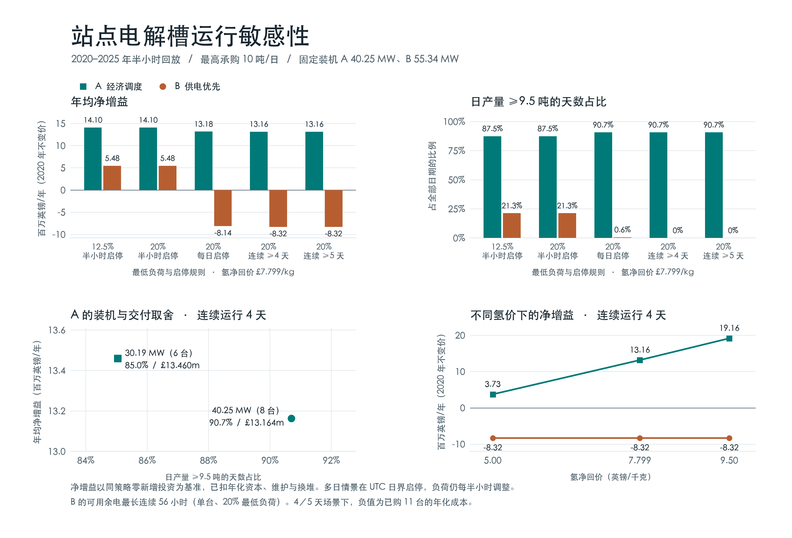

# Tier 1 site-scale electrolyser operating sensitivity

[中文版](README_ZH.md)

22 November 2026 · Julian · MMCS Group 15 workspace research

The study tests the 10 t/day hydrogen offtake scenario used in the Tier 1 v5 site appraisal. It fixes eight ITM NEPTUNE V modules in A (40.248 MW) and eleven in B (55.341 MW), then changes the minimum load and commitment rules. It uses the 2020–2025 v7 half-hour chronology and the same unit cost and £7.799027/kg hydrogen netback. A may divert saleable electricity. B reserves generation for demand and uses the remaining power for hydrogen. The cases cover electrolysis-only investment, with no power imports or hydrogen inventory.

## Main results

| Operating rule | A net gain, £m/year | A simple payback, years | B net gain, £m/year | B simple payback, years |
| --- | ---: | ---: | ---: | ---: |
| 12.5% minimum load, half-hour switching | 14.100 | 3.08 | 5.478 | 6.53 |
| 20% minimum load, half-hour switching | 14.100 | 3.08 | 5.478 | 6.53 |
| 20% minimum load, daily switching | 13.181 | 3.23 | −8.140 | — |
| 20% minimum load, at least four days online | 13.164 | 3.23 | −8.322 | — |
| 20% minimum load, at least five days online | 13.155 | 3.24 | −8.322 | — |

Money is in 2020 real GBP. Gains are measured against the same-policy no-additions case, after annual-equivalent capital, fixed maintenance and stack replacements. Simple payback uses the mean historical operating contribution less fixed maintenance, before future stack replacements. The daily and multi-day cases schedule starts and stops at UTC midnight and modulate load every half hour.



[Vector PDF](results/electrolyser-operating-sensitivity.pdf)

- **A.** At the reference netback, shifting starts and stops to UTC midnight accounts for about £0.919m/year of the reduction. Requiring four days online reduces gain by a further £0.017m/year. With the four-day rule, resizing to six modules (30.186 MW) increases mean net gain to £13.460m/year. The share of days producing at least 9.5 t falls from 90.7% to 85.0%.
- **B.** Surplus sufficient to support one module at 20% load lasts at most 56 continuous hours. Neither the 96-hour nor the 120-hour requirement can be met, even with arbitrary half-hour starting times. The negative value is the annualized cost of the fixed eleven-module configuration. Zero new modules is optimal under these constraints. The £5.00 and £9.50/kg comparisons use the same cap and real price convention.

The daily acceptance cap is an upper bound. The delivery-frequency metric shows how often production approaches that cap. A binding daily delivery minimum would require a separate contract case.

## Evidence and reproduction

- [Scenario totals](results/site_sensitivity.csv), [year-by-year results](results/site_annual_results.csv), [A sizing results](results/A_sizing_results.csv) and [A sizing bounds](results/A_sizing_bounds.csv).
- [Model and checks](MODEL.md), [input checksums and cost assumptions](assumptions.json) and [reproduction script](run_analysis.py).
- [V5 site appraisal, Table C.1](https://github.com/MocryMin/mmcs-group15-project/blob/98b316f90736554a20ad5eab1e07cb7562eee3ba/Tier1/workspaces/mocry/codex/technical-report-latex/20261122-v5/report.pdf) and [frozen v7 data, configuration and model](https://github.com/MocryMin/mmcs-group15-project/tree/b0377299dc452bf01f387c0dd60f6e7f6510e1a2/Tier1/workspaces/mocry/codex/work-history/20261113-v1/studies/tier1-halfhour-20261113-v7).

Use Python 3.12 and install [requirements.txt](requirements.txt). Set the study directory to the v7 folder above. The run uses `inputs/halfhour.csv.gz`, `configuration.json` and `model.py` there. Compare their SHA-256 values with `assumptions.json`. Run from this directory and direct the outputs to a fresh output directory.

```sh
python -m pip install -r requirements.txt
python run_analysis.py --study-dir /path/to/tier1-halfhour-20261113-v7 --output ./reproduction
```
