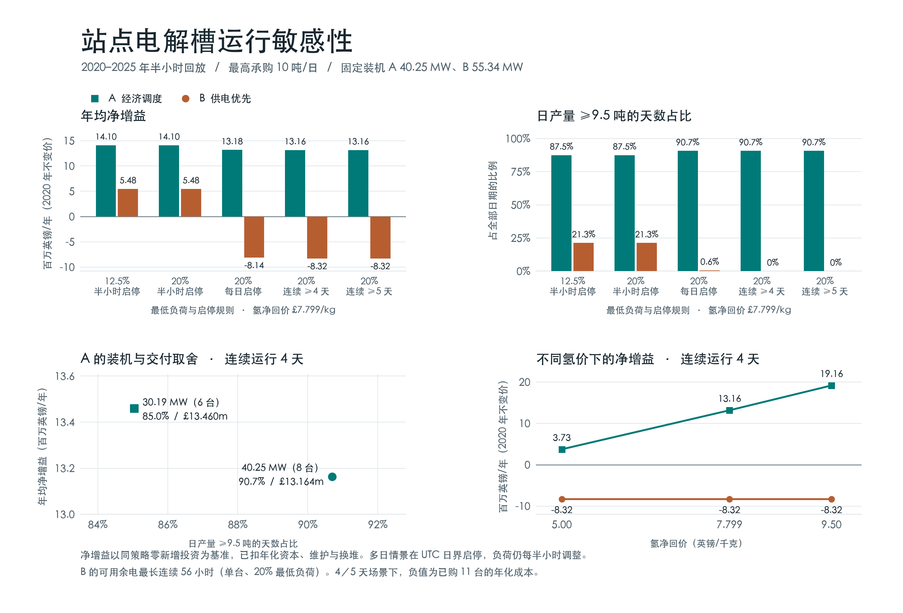

# Tier 1：站点电解槽运行敏感性

[English](README.md)

2026-11-22 · Julian · MMCS Group 15 个人工作区研究

沿用 Tier 1 v5 的 10 吨/日氢气承购上限，固定 A 的 8 台 ITM NEPTUNE V（40.248 MW）和 B 的 11 台（55.341 MW），对照最低负荷与连续运行要求。2020–2025 年的半小时数据与设备成本来自 v7。主情景氢净回价为 £7.799027/kg。A 可以在售电与制氢间分配电量，B 优先供电、只用余电制氢。本次评估电解槽单独投资，使用已有发电，无外购电和氢库存。

## 主要结果

| 运行规则 | A 年均净增益（百万英镑） | A 简单回收期（年） | B 年均净增益（百万英镑） | B 简单回收期（年） |
| --- | ---: | ---: | ---: | ---: |
| 最低负荷 12.5%，半小时可启停 | 14.100 | 3.08 | 5.478 | 6.53 |
| 最低负荷 20%，半小时可启停 | 14.100 | 3.08 | 5.478 | 6.53 |
| 最低负荷 20%，每天可启停 | 13.181 | 3.23 | −8.140 | — |
| 最低负荷 20%，连续运行至少 4 天 | 13.164 | 3.23 | −8.322 | — |
| 最低负荷 20%，连续运行至少 5 天 | 13.155 | 3.24 | −8.322 | — |

金额为 2020 年不变价。净增益相对同一策略的零新增投资方案，已扣除资本年金、固定维护和换堆成本。简单回收期用初始资本除以六年平均运营增量减固定维护后的现金流，计算中未扣未来换堆。每日及多日情景均在 UTC 日界启停，负荷在半小时时段内可调。

[矢量 PDF](results/electrolyser-operating-sensitivity.pdf)

- **A。** 改为每日启停使年均净增益减少约 £0.919m。在此基础上，4 天最短运行再减少约 £0.017m/年。4 天情景下重新定容，6 台（30.186 MW）可获得 £13.460m/年。日产量达到 9.5 吨的天数占比从 8 台的 90.7% 降至 6 台的 85.0%。
- **B。** 按单台 20% 最低负荷核对余电，最长连续可运行 56 小时，无法达到 96 或 120 小时的要求。固定 11 台时，负收益为年化设备成本。若允许重新决定投资，这两个连续运行情景均选择 0 台。同口径的 £5.00 与 £9.50/kg 情景也保存于结果表。

10 吨/日是接受上限。达到 9.5 吨的天数用于描述供氢频率。如果合同规定每日最低交付量，需要在定容时加入该约束。

## 复算与文件

[情景汇总](results/site_sensitivity.csv) · [逐年结果](results/site_annual_results.csv) · [A 重新定容](results/A_sizing_results.csv) · [定容上界](results/A_sizing_bounds.csv) · [模型与核验](MODEL.md) · [成本和源文件校验值](assumptions.json)

使用 Python 3.12，从本目录安装 [依赖](requirements.txt)，将 `--study-dir` 指向冻结的 v7 文件夹，然后运行 [复算脚本](run_analysis.py)。命令见[英文说明](README.md#evidence-and-reproduction)。

基准见 [v5 表 C.1](https://github.com/MocryMin/mmcs-group15-project/blob/98b316f90736554a20ad5eab1e07cb7562eee3ba/Tier1/workspaces/mocry/codex/technical-report-latex/20261122-v5/report.pdf)。数据、配置和设备成本见 [v7 冻结快照](https://github.com/MocryMin/mmcs-group15-project/tree/b0377299dc452bf01f387c0dd60f6e7f6510e1a2/Tier1/workspaces/mocry/codex/work-history/20261113-v1/studies/tier1-halfhour-20261113-v7)。
