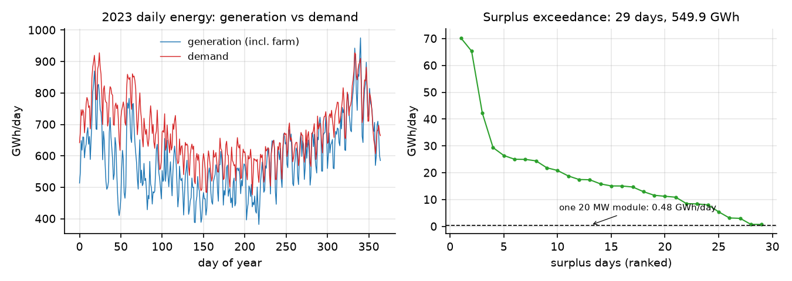
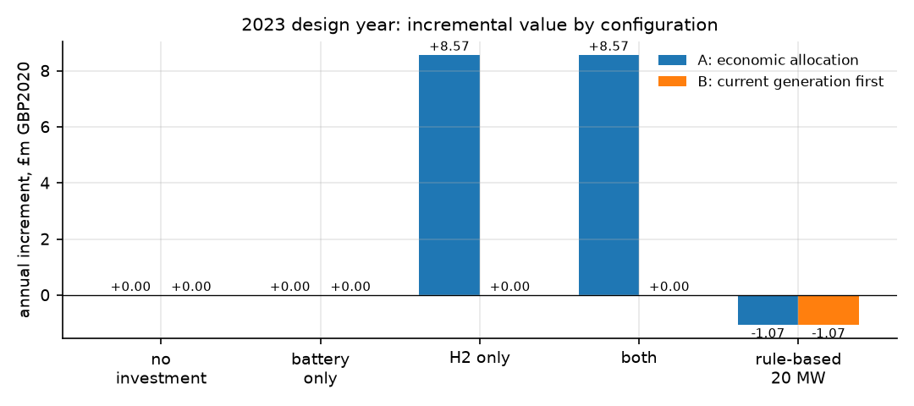
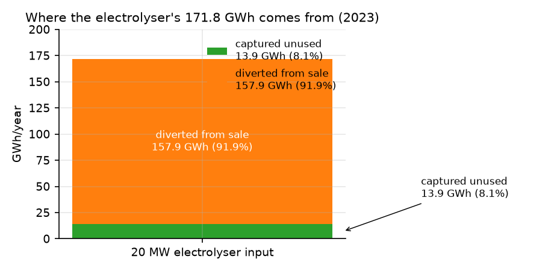
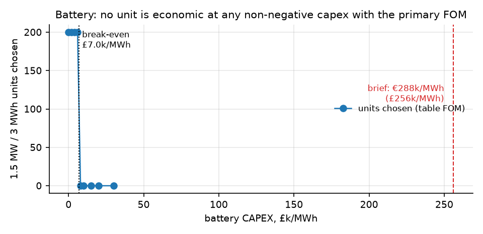
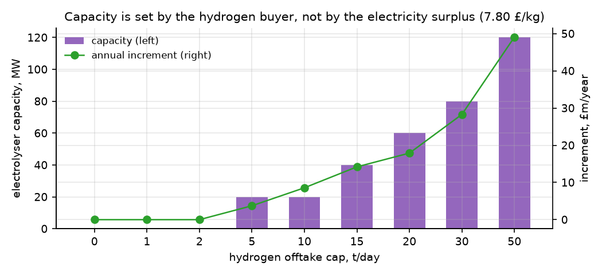
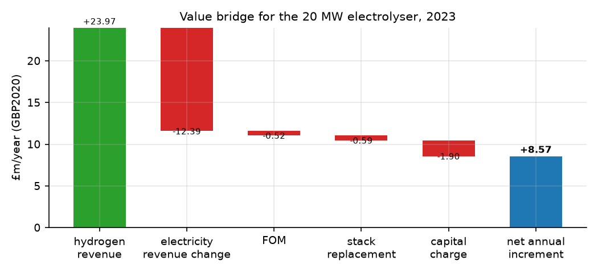
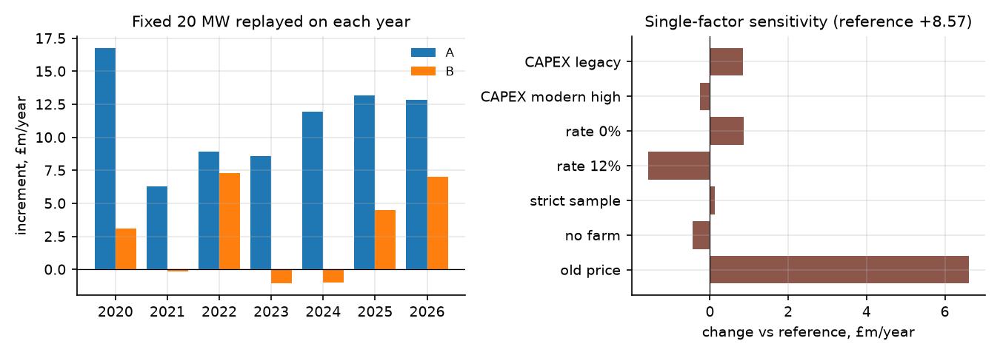
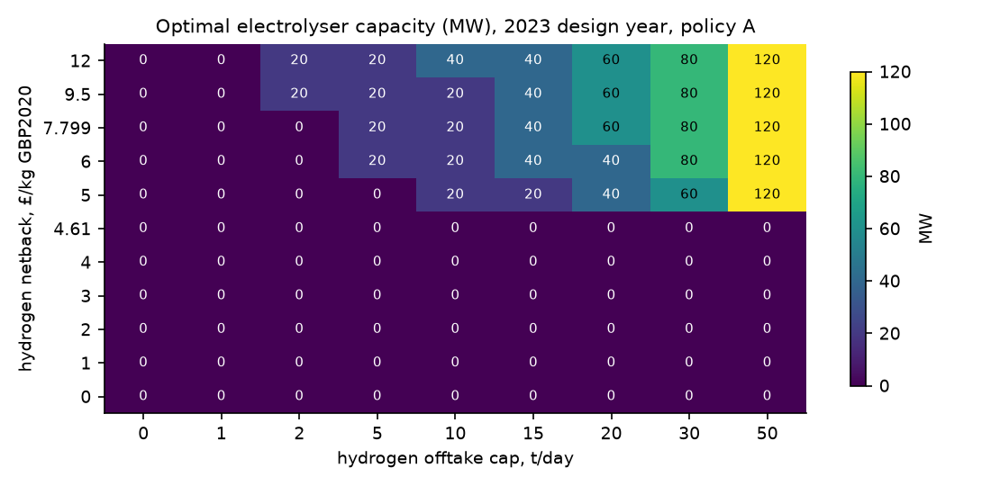

# Tier 1 technical report — Making use of surplus renewable energy

**Group 15 · working draft prepared by `mocry-cleveruser` · 5 November 2026**

Status: independent CU build for discussion. It is not a group-adopted result and does not supersede Baseline 1104 or the v1.1 research release; it is a complete, reproducible Tier 1 package that the group can adopt, challenge or trim.

---

## Executive summary

**Question.** Given the supplied generation, demand and prices, how much battery and/or electrolyser capacity should the client add, how much otherwise unused renewable electricity would it capture, and is the added value enough to justify the investment?

**Answer for the 2023 design year (constant 2020 GBP, 5% real discount rate, repaired price series).**

| Decision | Recommendation | Value |
|---|---|---|
| Battery | **None.** No unit is economic at any non-negative capital cost with the primary FOM convention; even the optimistic annual-pool representation values a 1.5 MW unit at £13.2k/year against £96k/year of annual cost. | £0 |
| Electrolyser | **20 MW, conditional on a hydrogen offtake of at least ~2.2 t/day at £7.80/kg (or ~1.7 t/day at £9.5/kg) and on the client being free to divert 0.07% of current electricity sales.** | **+£8.57m/year** |
| Capital | £29.2m; annual equivalent cost £3.01m (capital £1.90m, FOM £0.52m, stack reserve £0.59m) | |
| Returns | Simple payback 2.6 years before stack replacement (2.8 years with the stack reserve); ROI 29%/year; 30-year NPV +£132m at 5% real on constant reference-year operation | |
| Captured unused energy | 13.9 GWh/year — 8.1% of the electrolyser's 171.8 GWh input and 2.5% of the 549.9 GWh annual surplus. The other 157.9 GWh (91.9%) is electricity diverted from sale. | |
| Supply rule | Under "current generation serves current demand first" (B) the same 20 MW loses £1.07m/year in 2023 and £1.00m in 2024. | |

**What this means commercially.** This is a hydrogen-contract investment, not a surplus-electricity investment. The 20 MW size is set by the assumed 10 t/day buyer cap, not by the size of the surplus: at 50 t/day the model builds 120 MW (+£49.1m/year). The value disappears if the netback falls below £4.62/kg, if the buyer takes less than ~2.2 t/day, or if the client insists on selling 100% of its current electricity. The recommendation should therefore be negotiated as a contract-conditioned, staged investment: secure the offtake first, build 20 MW, and expand only when the contract expands.

---

## 1. The client's position and the question

The client holds the generation portfolio represented by the supplied data plus the specified independent wind farm. In 2023 this portfolio produced 215.7 TWh against 245.8 TWh of demand: it covers 87.7% of demand in energy terms, and 87.5% can actually be sold into the demand cap. On 29 days generation exceeds demand; those days hold 549.9 GWh of surplus, at most 70.3 GWh in a single day. Daily mismatch, not annual shortage, is the resource the client is asking us to use.

The Tier 1 question is deliberately narrow: how much battery and/or electrolyser capacity is worth adding, and how much *otherwise unused* electricity do those assets capture? The brief allows a simplified treatment of time; the model below uses a daily energy pool with one usable battery window per day and an annual battery energy balance.

## 2. Data, boundaries and conventions

**Inputs.** The five supplied tables, in the independently repaired release `20261104-v2` (2,452 days, 2020-01-01 to 2026-09-17). The course originals are retained unchanged. The repair is material: the original wholesale price includes zero-volume placeholder providers and is roughly half the repaired value; the original demand series is truncated on the last day of each weekly query. Using the un-repaired price would raise the 20 MW incremental value from £8.57m to £15.19m and would change the apparent size of the surplus. Both versions are therefore reported, and only the repaired series is used for decisions.

**Boundary.** The supplied generation plus the specified farm is a constructed system, not observed Scottish curtailment. Demand is treated as the system absorption cap; there are no purchases, no additional export route and no curtailment compensation. The study is a perfect-foresight, daily, single-region energy model. It does not model network constraints, intraday prices, ancillary services or hydrogen storage.

**Units and price basis.** Daily mean MW × 24 h / 1000 = GWh/day. All money is constant 2020 GBP; nominal prices are deflated by the ONS D7BT monthly CPI (2015 = 100, 2020 annual = 108.7). The battery is the brief's 2-hour reference module (1.5 MW / 3 MWh), 90% round-trip, 20–80% usable window; the electrolyser is the 20 MW PEM module, 20–100% of a 24 h day, 55.9 kWh/kg. The hydrogen reference value is £7.799/kg GBP2020, the policy-supported strike value rebased from £175/MWh; the brief's £9.5/kg (2023 nominal) is £7.91 in 2020 money, so the two are consistent within 1.5%.

## 3. Model

For each day \(t\): generation \(G_t\), demand \(D_t\), price \(p_t\). Decision variables are direct sale \(q_t\), battery charge \(c_t\), battery discharge \(d_t\) (sold), electrolyser input \(h_t\), unused energy \(u_t\), operating modules \(z_t\), and installed units \(n_B, n_H\).

\[
\max \Pi=\frac{1}{Y}\sum_t\left[p_t(q_t+d_t)/1000 + v\,h_t/55.9\right]-a_B n_B-a_H n_H
\]

subject to

\[
q_t+c_t+h_t+u_t=G_t,\qquad q_t+d_t\le D_t,
\]
\[
0\le c_t\le \frac{0.6\cdot 3\,n_B}{1000\eta},\qquad 0\le d_t\le \frac{\eta\,0.6\cdot 3\,n_B}{1000},
\]
\[
0.096\,z_t\le h_t\le 0.48\,z_t,\qquad z_t\le n_H,\qquad h_t\le 55.9L/10^6,
\]
\[
\sum_t d_t=\eta^2\sum_t c_t,\qquad \eta=\sqrt{0.9}.
\]

Policy A lets the model allocate each day's generation among sale, storage, hydrogen and unused energy. Policy B adds the contractual rule \(q_t=\min(G_t,D_t)\): current generation serves current demand first.

Annual costs use a capital recovery factor by asset life (battery 15 years, electrolyser 30 years), fixed O&M and the stack replacement at years 11 and 22 discounted and annualised. The battery's minimum-SOC commissioning charge is included as a one-off cost. The annual battery balance is the Tier 1 time simplification; it is a relaxation and therefore an upper bound on battery value. No selected configuration uses a battery, so the relaxation cannot change the recommended capacities.

**Implementation and solver evidence.** Python 3.14 with FICO Xpress 9.9.1. One design-year case has 2,556 rows and 2,192 columns, solves to proven optimality in 0.02–0.06 s, and 185 optimisation cases plus 2 rule-based comparators were run (reference, sensitivity, trigger grid, battery sweep, supply frontier). The full grid and case list are in the package; 20 independent checks (energy balance, demand cap, charge/discharge caps, module limits, offtake cap, annual balance, integer units, finance recomputation, reference values) all pass.

## 4. Current position (2023)

| Metric | Value |
|---|---|
| Generation (incl. specified farm) | 215.7 TWh |
| Demand | 245.8 TWh |
| Annual deficit | 30.1 TWh |
| Electricity sold / demand (coverage) | 87.51% |
| Surplus days / annual surplus | 29 days / 549.9 GWh |
| Largest / median surplus day | 70.3 / 15.1 GWh |
| Wholesale price (GBP2020/MWh), min / median / max | 2.4 / 75.5 / 157.1 |
| Renewable share of generation (all days / surplus days) | 38.7% / 52.7% |

**Figure 1.** The system is short in energy over the year but long on 29 days. A single 20 MW module can absorb at most 0.48 GWh/day, so even the largest surplus day needs either a much larger electrolyser or a buyer willing to take the output.

## 5. Results

### 5.1 Configuration comparison

| | No investment | Battery only | H2 only | Both | Rule-based 20 MW |
|---|---|---|---|---|---|
| A: economic allocation, £m/year | 0 | 0 | **+8.57** | +8.57 | −1.07 |
| B: current generation first, £m/year | 0 | 0 | 0 | 0 | −1.07 |

Two results matter. First, the battery is never chosen. Second, the same 20 MW asset is worth £9.64m/year more when dispatched economically than when a simple "sell first, then make hydrogen" rule is used (−£1.07m becomes +£8.57m). That difference is the value of dispatch, and it is the answer to the brief's question about why the recommendation beats a simpler strategy.

### 5.2 Where the electrolyser's electricity comes from

| Item | GWh/year | Share of input |
|---|---|---|
| Electrolyser input | 171.84 | 100% |
| Reduction in otherwise unused electricity | 13.92 | 8.1% |
| Electricity diverted from direct sale | 157.92 | 91.9% |
| Identity gap | 0.00 | — |

The energy account closes exactly: \(F=(u^0-u)+(q^0-q)\). Only 13.9 GWh of the input is electricity that would otherwise have gone unused; the remaining 157.9 GWh is sold today and converted instead. On the 29 surplus days the renewable share of generation is 52.7%, so a pro-rata attribution of the captured energy is about 7.3 GWh; the strict daily-resolution bound is 0–13.9 GWh, because at daily granularity the pool cannot prove that a captured MWh was renewable. The honest headline is therefore **8% of the hydrogen input is avoided waste; 92% is an alternative use of saleable electricity**.

### 5.3 Why not batteries

At zero capital cost and zero FOM, a 1.5 MW / 3 MWh unit is worth £13.25k/year (identical for 50, 100 and 200 units, so the value is linear at this scale). The primary FOM assumption is £14.86k/MW/year, or £22.3k per unit, which already exceeds the unit's value before any capital charge. With the lower, table-based FOM (£7.43k/MW/year) the break-even capital cost is £7.0k/MWh, against the brief's indicative €288k/MWh (£256k/MWh) — a factor of about 37.

This is a statement about the Tier 1 time representation, not about batteries in general. A daily model with one usable window per day cannot see intraday arbitrage, frequency response, capacity payments or firming value. The correct conclusion is: **at the supplied daily data and the brief's cost, a battery is not justified in Tier 1; if the client wants a storage case, it belongs in Tier 2B with intraday resolution and an explicit ancillary-revenue assumption.** Because the annual-pool model is an upper bound on battery value, this conclusion is robust to the time simplification.

### 5.4 Why 20 MW, and not 40 MW

The 20 MW module produces at most 8.59 t/day, just under the 10 t/day buyer cap; a second module would add £3.0m/year of cost for at most 1.4 t/day of extra sales. The optimum is therefore the smallest module that can serve the contract, not an interior economic optimum. The capacity ladder shows this directly:

| Offtake cap, t/day | 0 | 1 | 2 | 5 | 10 | 15 | 20 | 30 | 50 |
|---|---|---|---|---|---|---|---|---|---|
| Capacity, MW | 0 | 0 | 0 | 20 | 20 | 40 | 60 | 80 | 120 |
| Increment, £m/year | 0 | 0 | 0 | 3.74 | 8.57 | 14.20 | 17.90 | 28.30 | 49.09 |

Thresholds from the model: at 10 t/day the investment switches on at a netback of **£4.62/kg**; at £7.80/kg it switches on at **2,230 kg/day**; at £9.5/kg at **1,717 kg/day**.

### 5.5 Financial case and value bridge

| Item | £m/year |
|---|---|
| Hydrogen revenue (3,074 t at £7.80/kg) | +23.97 |
| Electricity revenue forgone | −12.39 |
| Fixed O&M | −0.52 |
| Stack replacement reserve (years 11, 22) | −0.59 |
| Capital charge (30 years at 5%) | −1.90 |
| **Net annual increment** | **+8.57** |

The module runs at 98% of its maximum annual energy (171.8 of 175.2 GWh) and produces 8.42 t/day on average against the 10 t/day cap. Simple payback is 2.6 years before the stack replacement and 2.8 years with the reserve; ROI is 29%/year. The 30-year NPV of +£132m assumes the reference year repeats unchanged, with no hydrogen-price decay, no degradation and no terminal value; it is a scenario value, not a forecast. If the buyer cap rises to 50 t/day, the model builds 120 MW and the annual increment rises to £49.1m, but the capital requirement rises to £175m.

### 5.6 Cross-year robustness

The 20 MW size, fixed once, is replayed on every year with perfect foresight:

| Year | 2020 | 2021 | 2022 | 2023 | 2024 | 2025 | 2026* |
|---|---|---|---|---|---|---|---|
| A, £m/year | 16.78 | 6.29 | 8.91 | 8.57 | 11.95 | 13.17 | 12.85 |
| B, £m/year | 3.12 | −0.13 | 7.31 | −1.07 | −1.00 | 4.48 | 7.01 |

\*2026 covers 1 January to 17 September only.

Under A the investment is positive in every year, with 2021 the weakest (a high-price year in which the electricity forgone is expensive). Under B the investment loses money in 2023 and 2024, when little electricity is left after the supply-first rule. The spread is a business risk, not a modelling error: the asset's value depends on the client's freedom to allocate generation.

### 5.7 What changes the recommendation

| Lever | Range tested | Effect on 20 MW case |
|---|---|---|
| Electrolyser CAPEX | £816k–£1,651k/MW (legacy, modern low/high) | +£9.41m to +£8.33m; capacity unchanged at 20 MW |
| Real discount rate | 0–12% | +£9.44m to +£6.99m; capacity unchanged |
| Hydrogen netback | £4.62–£12/kg | Switches off below £4.62 at 10 t/day; 40 MW at £12 |
| Offtake cap | 2–50 t/day | Switches off below 2.23 t/day; 120 MW at 50 t/day |
| Supply obligation | 98–100% of current sales | Full 20 MW at ≤99.9%; zero at 100% |
| Data sample | strict 2023 (280 days) | +£8.69m |
| Price series | course original | +£15.19m (not used for decisions) |
| Asset boundary | no independent farm | +£8.13m |

**Figure 5.** Optimal capacity as a function of the hydrogen netback and the buyer's offtake cap. The investment region is a contract region: below £4.62/kg nothing is built at any offtake; above it, capacity is driven almost entirely by the offtake cap.

The supply-obligation test is the sharpest business result. The 20 MW case gives up 157.9 GWh of electricity sales, 0.073% of the 215.1 TWh sold in 2023. If the client insists on 100% of current sales, the electrolyser is excluded. At 99.99% (a 21 GWh reduction) a 20 MW module is still viable but produces only 35 GWh of hydrogen and adds £1.04m; at 99.9% the full £8.57m is available. The negotiation is therefore about a very small operational concession, not about the size of the plant.

## 6. Validation and limitations

**What was checked.** Daily energy balances close to machine precision in every stored plan; demand caps, battery charge/discharge caps, module limits, the offtake cap, integer unit counts and the annual battery balance all pass; revenues and costs are recomputed from the plans and from the parameter file; the reference cases reproduce the independently built Baseline 1104 package (A0 17,139.332; A 20 MW 17,147.905 and +8.572; B fixed 20 MW −1.065; simple rule −1.065; 2024 +11.951; old price +15.188), which is arithmetic agreement between two separate implementations, not an endorsement of every shared assumption.

**Limitations.** Daily averages remove intraday prices and storage value; the annual battery balance is a relaxation (an upper bound on battery value); the model is perfect-foresight and does not claim a causal operating policy; the hydrogen netback is a policy-supported reference, not a contract; the electrolyser CAPEX is a modern non-China installed midpoint while FOM and stack replacement use older UK absolute proxies; no degradation, no hydrogen storage, no network constraints, no ancillary markets; 125 days have imputed fuel composition (85 in 2023), so the renewable attribution is conditional on the repair; 2026 is partial and is used only as a replay year.

## 7. Recommendation

1. **Do not invest in batteries in Tier 1.** At the brief's cost the annual cost of a 1.5 MW unit is about seven times its modelled value. Re-open the battery case only with intraday/ancillary revenue (Tier 2B) or a capital cost below roughly £7k/MWh.
2. **Negotiate the hydrogen contract before committing capital.** The 20 MW module needs at least ~2.2 t/day at £7.80/kg (or ~1.7 t/day at £9.5/kg) to break even. Below £4.62/kg, do not build.
3. **Build 20 MW if, and only if, the contract and the operating mandate are in place.** Required conditions: a buyer for at least 2.2 t/day; freedom to divert about 0.07% of current electricity sales; a delivery/netback arrangement consistent with £7.8/kg on site.
4. **Stage the expansion.** 20 MW is the right size for a 10 t/day contract; 120 MW is the right size for 50 t/day. Do not pre-build for a contract that does not exist.
5. **Report the capture honestly.** The investment captures 13.9 GWh of otherwise unused electricity (8% of its input); the remaining 92% is a different use of electricity that would otherwise be sold. The client should not be told that this is a surplus-energy project.
6. **Keep the supply-first alternative visible.** Under B the same asset loses money in 2023–24. If the client's licence or contracts require current-generation-first supply, the Tier 1 answer is "no investment".

## Appendix A — parameters used

| Parameter | Value | Source / status |
|---|---|---|
| Battery module | 1.5 MW / 3 MWh, 2 h | Brief p3/p6; DEA reference module |
| Battery CAPEX | £256,234.78/MWh GBP2020 | €288k/MWh × 0.8897 GBP/EUR2020 |
| Battery FOM | £14,861.62/MW/year (primary); £7,430.81 (sensitivity) | v1.1 R2/R4; source label conflict retained |
| Battery life / RTE / window | 15 years / 90% / 20–80% | v1.1 R2; brief |
| Electrolyser module | 20 MW PEM, 20–100% of 24 h, 55.9 kWh/kg | Brief p3/p6; ITM Poseidon |
| Electrolyser CAPEX | £1,460,439.72/MW GBP2020 (modern midpoint); £816k legacy, £1,270k/£1,651k modern low/high | v1.1 R3/R4; IEA 2025 and BEIS |
| Electrolyser FOM / stack | £25,861.65/MW/year; £489,609.26/MW at years 11 and 22 | v1.1 R4 absolute proxies |
| Hydrogen value | £7.799/kg GBP2020 | £175/MWh × 39.4 kWh/kg, rebased |
| Offtake cap | 10 t/day reference; 0/1/2/5/15/20/30/50 tested | Analyst scenario, not a contract |
| Discount rate | 5% real; 0/3/8/12 tested | Analyst choice |
| Price basis | GBP2020, ONS D7BT CPI | ONS, release 21 October 2026 |

## Appendix B — case coverage

185 optimisation solves plus 2 rule-based comparators: 10 reference cases (8 optimised, 2 rule-based); 14 fixed-size cross-year replays; 18 single-factor and data sensitivities; 99 trigger-map cells (11 netbacks × 9 offtake caps); 39 battery-cost points (two FOM conventions); 7 supply-obligation floors; plus bisection solves for the four thresholds (netback, two offtake caps, battery break-even). Reference, sensitivity and replay cases store their daily plans; grid and sweep cases store aggregates.

## Appendix C — verification

`VERIFICATION.json`: 20 checks, 20 passed. Reference values against Baseline 1104: A0 17,139.332 (match), A 20 MW 17,147.905 and +8.572 (match), B fixed 20 MW −1.065 (match), simple rule −1.065 (match), 2024 +11.951 (match), old price +15.188 (match), netback threshold 4.623 vs 4.61 (0.3% difference). Model size 2,556 rows × 2,192 columns; all optimisation cases optimal.

## References

1. Project brief, *Optimisation Models for Renewable Energy Investment and Flexibility*, MMCS 2026/27.
2. Group 15, *Baseline 1103* package and teacher clarifications (TC-03, TC-08, TC-09, TC-10, TC-11).
3. Controller research release `20261103-v1.1`, including BASELINE_CANDIDATE and R1–R4 reports.
4. Baseline 1104 calculation package (independent comparison, not adopted).
5. Full data repair `20261104-v2` and its validation.
6. ONS, CPI index D7BT (2015 = 100), release 21 October 2026.
7. IEA, *Global Hydrogen Review 2025* (electrolyser installed cost range).
8. BEIS/UK hydrogen cost references (legacy CAPEX, FOM and stack replacement proxies).
9. Danish Energy Agency, *Energy Storage* data sheet (battery reference module and cost).
10. Elexon MID (used in the price repair, not in this model).
