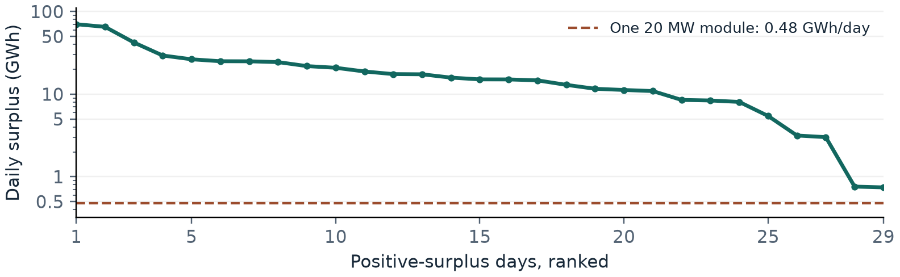

# Tier 1. Investment in flexibility

MMCS final project  |  Group 15  |  Technical report section

> **2023 investment decision.** With economic dispatch and a buyer taking up to 10 t/day at £7.799/kg, add 20 MW of electrolysis and no battery for an annual gain of £8.57m. Under daily electricity priority, add neither. Verify the buyer's terms and the operator's freedom to redirect electricity before committing capital.

## 1. System boundary and opportunity

We use the brief's constructed system [1]. Daily supply combines reported generation and the separately provided simulated wind farm. Demand limits total electricity sales. Existing generation is fixed, electricity imports are excluded, and unused energy has zero value. The objective is incremental project value against the same policy's zero-investment schedule. A wind-farm-only boundary is tested in Section 4.

Repaired input v2 contains 2,452 aligned days from January 2020 to September 2026 [2]. Fuel components reconcile to reported generation. Daily mean MW is multiplied by 24 h. Prices use the repaired £/MWh series, deflated by monthly CPI. The price repair excludes zero-volume records that previously depressed the wholesale series. Design uses all 365 days of 2023.

**Figure 1.** 2023 surplus duration. Only 29 days have a positive physical surplus. Their total is 549.94 GWh and their median is 15.09 GWh. All 336 other days have zero surplus and are omitted from this logarithmic plot.

### Reference assumptions in 2020 pounds

| Input | Assumption used |
| --- | --- |
| Battery | 1.5 MW / 3 MWh modules, 20-80% state of charge, 90% round-trip efficiency, £256k/MWh installed, £14.9k/MW-year fixed costs, 15-year life. |
| Electrolyser | 20 MW modules, 20-100% online loading, 55.9 kWh/kg. £29.21m per module, £0.52m/year fixed costs, £9.79m stack proxy in years 11 and 22, 30-year life. |
| Economics | 5% real discount rate. £7.799/kg netback with a 10 t/day offtake limit is a policy-supported reference scenario. Market terms and access to support remain investment conditions. |

Installed electrolyser cost uses the converted midpoint of the IEA benchmark. Fixed operating and stack costs use separate UK legacy proxies. The underlying cost ranges and conversion assumptions are documented in [3].

## 2. Investment model and matched comparison

Choose integer battery and electrolyser counts *b* and *n*. For day *t*, let *q*, *c*, *r* and *h* denote direct sale, charge, discharge and electrolysis input in MWh. Supply is *G* and demand is *D*. *z* counts online electrolyser modules and *L* caps daily hydrogen sales in kg. The core mixed-integer linear program is implemented in Python/FICO Xpress.

Maximise Σt[pt(qt + rt) + vht/0.0559] − aBb − aHn.

qt + ct + ht ≤ Gt &nbsp;&nbsp; and &nbsp;&nbsp; qt + rt ≤ Dt.

96zt ≤ ht ≤ 480zt, &nbsp; zt integer, &nbsp; 0 ≤ zt ≤ n, &nbsp; ht/0.0559 ≤ L.

ct ≤ 1.8b/η, &nbsp; rt ≤ 1.8bη, &nbsp; Σrt = 0.90Σct, &nbsp; η = √0.90.

In the annual objective, *p* is £/MWh, *v* is £/kg, and *a*B, *a*H are annualised costs per module. Policy **A** allows economic allocation. Policy **B** fixes direct sales to min(G, D), including on negative-price days. Flows are nonnegative. The Tier 1 annual pool relaxes the ordering of storage transfers. Fixed battery schedules are checked with chronological stock and empty initial and terminal usable inventory.

| 2023 portfolio | A BESS/H2 MW | A Δ £m/yr | B BESS/H2 MW | B Δ £m/yr |
| --- | ---: | ---: | ---: | ---: |
| No investment | 0 / 0 | +0.00 | 0 / 0 | +0.00 |
| Battery only | 0 / 0 | +0.00 | 0 / 0 | +0.00 |
| Hydrogen only | 0 / 20 | +8.57 | 0 / 0 | +0.00 |
| Joint choice | 0 / 20 | +8.57 | 0 / 0 | +0.00 |
| Fixed reference module | 0 / 20 | +8.57 | 0 / 20 | -1.07 |

**Table 1.** BESS denotes battery energy storage system. Gains use the policy-matched zero-investment reference and equivalent annual costs, in 2020 pounds.

The same 20 MW module run by a simple sale-first rule loses £1.07m/year in 2023. Optimising its use in A improves the result by £9.64m/year. Both use the same day data and capital cost. With no battery, this improvement comes from how today's power is allocated.

### Battery economics and physical check

Without a sales floor, removing a battery leaves direct sales and hydrogen feasible and deletes only its discharge revenue. At full discharge every positive-price day, even free charging yields at most £48.7k per module in 2023, below its £96.4k annual cost. This rules out storage in A and B in 2023-25 under the daily throughput assumption.

Forcing one module in A earns £13.3k in extra operating revenue after charging in the annual pool, or £4.3k with chronological stock. The stock result falls below even the lower fixed-cost assumption of £11.1k/year per module. These daily cases leave intraday and ancillary services for separate analysis.

## 3. What changes the investment decision?

In A, the selected electrolyser consumes 171.84 GWh and produces 3,074 t of hydrogen. Relative to no investment, 13.92 GWh comes from reduced unused electricity and 157.92 GWh from displaced direct sales. Only 8.1% of the input can be assigned to physical surplus under a surplus-first convention, capturing 2.53% of annual surplus.

Daily fuel totals allow 0-13.92 GWh of the captured surplus to come from wind and solar, depending on allocation. Including biomass and run-of-river hydro leaves that interval unchanged. Verifying the renewable share requires tracing the source of the electricity used.

**Figure 2.** 2023 investment trigger map. Each cell selects the number of 20 MW modules with greatest annual gain, including zero. Gold diamonds mark the reference netback and offtake limit. Positive-price sellable electricity carries its full opportunity cost.

At 10 t/day, the break-even netback for 20 MW is £4.61/kg in A and £12.08/kg in B. In A a second module can sell more hydrogen, yet cuts gain to £7.47m/year. At 50 t/day, A selects 120 MW and gains £49.09m/year on £175.25m of initial capital. Expansion depends on securing the larger contract.

### Price of retaining electricity sales

| Minimum sales retained | Sales given up (GWh) | H2 MW | Δ £m/year |
| --- | ---: | ---: | ---: |
| 99.9266% | 157.92 | 20 | +8.57 |
| 99.9633% | 78.96 | 20 | +5.19 |
| 99.9900% | 21.51 | 20 | +1.04 |
| 100.0000% | 0.00 | 0 | +0.00 |

**Table 2.** Retention is relative to the 215.1 TWh sold without investment. Retaining half of the 157.92 GWh diverted by free dispatch preserves £5.19m/year. These annual floors let the operator choose which days to preserve sales. Policy B gives electricity priority each day.

## 4. Robustness and investment recommendation

A fixed 20 MW module is evaluated on each historical year at identical cost and offtake assumptions. The site boundary assigns background generation first to demand, makes only residual demand available to the wind farm and restricts device input to its wind output. These are matched incremental comparisons within each boundary.

| Fixed 20 MW replay | A Δ £m/year | B Δ £m/year |
| --- | ---: | ---: |
| 2022 | +8.91 | +7.31 |
| 2023 | +8.57 | -1.07 |
| 2024 | +11.95 | -1.00 |
| 2025 | +13.17 | +4.48 |
| 2025, £4/kg and 5 t/day | -0.24 | -0.77 |
| 2023, wind site boundary | +8.17 | -1.07 |

B's 2025 break-even netback falls to £3.13/kg at 10 t/day as surplus opportunities increase. The 2025 contract downside reverses both investment cases. A's 2023 gain remains £7.29m/year at 25% higher installed cost and an 8% real discount rate. Reoptimising the 280 strict-quality days retains the 2023 capacity choices. Fixed-capacity replays assess performance on known historical conditions.

### Cash flow of the 2023 economic case

| Annual component | £2020m/year |
| --- | ---: |
| Hydrogen netback receipts | +23.97 |
| Foregone direct electricity receipts | -12.39 |
| Fixed operating cost | −0.52 |
| Equivalent cost of initial capital and stack renewals | −2.49 |
| Equivalent incremental gain | +8.57 |

Against £29.21m paid upfront, £11.06m annual operating cash flow gives simple payback in 2.64 years, or 2.90 years at 5% real discount. Repeating 2023 operating cash flow for 30 years, with stack renewals in years 11 and 22 and zero terminal value, gives £131.78m net present value.

> **Client action.** Retain the current assets while verifying delivered hydrogen netback, daily acceptance and electricity sales obligations. Consider one 20 MW module if the agreed terms clear the corresponding contract boundary and the site can supply it. Evaluate a battery only when an additional paid service or a different throughput and cost basis can bridge the quantified revenue gap.

**Validation.** 42 optimal Xpress schedules and two rule schedules reconcile flows and cash within 0.001 MWh for the physical checks. Eight trigger cells, the two sizing cases and the sales floors were checked with Xpress. An independent implementation agrees on all 18 matched capacities and gains to the precision of its published table.

**Sources.** [1] MMCS 2026/27 Project Brief, pp. 2-3, 5-6, and project briefing. [2] Course datasets, repaired release 20261104-v2 and its audit, with ONS monthly CPI D7BT. [3] Danish Energy Agency storage catalogue, IEA *Global Hydrogen Review 2025*, BEIS *Hydrogen Production Costs 2021* and DESNZ HAR1 results, as transcribed and converted in the project R2-R4 parameter research.
