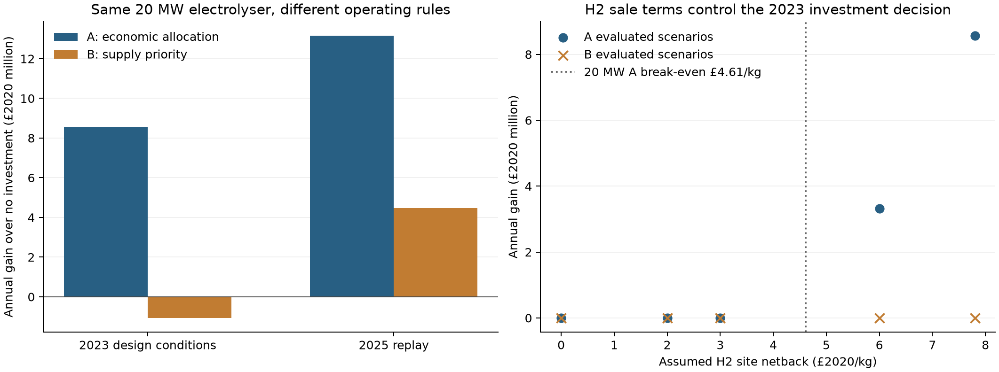

# Tier1 Baseline 1104

2026 年 11 月 4 日。Ran Min 的本地候选版本。

Baseline 1104 已把 1103 的 A/B 假设族、审核后的研究参数和完整修复数据接成可运行模型。参考情景在 2023 年设计，A 选择一套 20 MW 电解槽，B 不新增设备，二者均不选择电池。这个差别来自供电规则和氢气净回值。它为小组提供一套可比较的起点，尚未发布为小组共同版本。

## 1 本次固定的定义

| 项目 | Baseline 1104 |
|---|---|
| 发电和需求 | 课程总发电加独立风场，需求是共同售电上限；给定发电不可调节。 |
| 数据版本 | 完整修复 20261104-v2，2020-01-01 至 2026-09-17，共 2,452 个 UTC 日。保留修复方法与质量标记。 |
| 单位和电价 | 日均 MW 乘 24 转能量；修复后的批发日价，按 ONS 月 CPI 折为 GBP2020。 |
| A | 直接售电、储能和制氢自由竞争，没有完整供电保证。 |
| B | 当前发电先售出 min(G,D)，仅剩余发电可充电或制氢。 |
| 交易 | 不购电，无给定需求之外的售电渠道。未利用发电没有补偿或罚款。 |
| 目标 | 最大化年度等价净收益，并报告对同政策零投资方案的增量。既有不变成本不进入比较。 |
| 投资 | 零投资、仅电池、仅电解槽、两者联合均可选择。设备数量只在设计阶段决定。 |
| 电池 | 3 MWh / 1.5 MW 分析单元的整数倍，20%—80% SOC，90% 往返效率，每日最多一个可用窗口。 |
| 电解槽 | 20 MW 参考模块的整数倍，逐模块启停，运行时全天 20%—100%，55.9 kWh/kg。 |
| 氢气出口 | 同日产出并在场站出口交付。净回值扣除未另列的水、处理、压缩、储运及销售等非电力变动费用。 |
| 时间 | Tier1 采用年度储能能量池，另做真实跨日库存检查。忽略自放电。 |
| 设计和评价 | 2023 年设计，2024、2025 年固定设备回放。另有 2025 单年 oracle、全样本 oracle 和其他年份压力测试。 |

电力销售与满足这列需求是同一业务，不能重复计算经济收益。时间简化的能量池没有保证先充后放，只能作为储能收益上界；本轮实际所选方案的电池数为零，跨日检查给出相同设备选择。

## 2 参考参数和仍需条件化的业务项

| 参数 | 采用值 | 依据或含义 |
|---|---:|---|
| 电池安装成本 | £256,234.78/MWh | DEA 安装参考，统一为 GBP2020；按名义容量计价。 |
| 电池固定运维 | £14,861.62/MW/year | 采用来源脚注较高口径，较低口径另测。 |
| 电池寿命 | 15 年 | 来源参考寿命。 |
| 电解槽安装成本 | £1,460,439.72/MW | IEA 现代安装成本中点换算，通用设备代理。 |
| 电解槽固定运维 | £25,861.65/MW/year | 旧英国参考的绝对费用代理。 |
| 堆更换 | 第 11、22 年，每次 £489,609.26/MW | 明示的旧绝对费用代理，先折现后年化。 |
| 电解槽寿命 | 30 年 | 财务参考期。 |
| 实质贴现率 | 5.00% | 分析选择，另测 0%、3%、8%、12%。 |
| 氢气净回值 | £7.7990/kg | 政策支持价值换算后的高价值参考情景。将其当场站净回值是本版情景假设，并非已有合同或支持资格。 |
| 氢气承购上限 | 10,000 kg/day | 分析场景，另测 0、2,000、50,000 kg/day。 |

现代安装成本已包括所述工程安装费用，不再加同一 EPC。运维与更换不重复计提。最低 SOC 缓冲的初次充电按设计年平均电价的非负部分计一次性费用。把 £7.7990/kg 全数视为扣除上述变动费用后的净回值，是高价值情景假设。净回值与承购量决定可声称的商业结论。混合发电池不自动符合绿色氢或政策支持资格。

## 3 参考情景结果

金额均为百万 GBP2020。2024、2025 年保持 2023 年选出的设备数量。

| 政策及方案 | 电池 MW | 电解槽 MW | 新增投资 | 2023 净收益增量 | 2024 增量 | 2025 增量 |
|---|---:|---:|---:|---:|---:|---:|
| A 经济分配 | 0.00 | 20.00 | 29.209 | 8.572 | 11.951 | 13.169 |
| B 优先供电 | 0.00 | 0.00 | 0.000 | 0.000 | 0.000 | 0.000 |

| 年份 | A 年度净收益 | 同年零投资净收益 | A 氢产量，百万 kg | A 需求覆盖 |
|---|---:|---:|---:|---:|
| 2023 | 17,147.905 | 17,139.332 | 3.074 | 87.45% |
| 2024 | 12,315.187 | 12,303.235 | 3.134 | 83.64% |
| 2025 | 15,514.952 | 15,501.783 | 3.126 | 94.98% |

这里的净收益是给定构造系统、既有不变成本抵消后的比较口径，不是某家现实公司的已核实利润。A 的 20 MW 安装成本约 £29.209 million，年度等价设备费用约 £3.008 million。简单回收期只作附表，未用它替代折现、运维和更换的目标核算。

## 4 结果为什么不同

2023 年只有 29 个当日供大于求的日期，合计约 549.944 GWh 盈余。20 MW 电解槽每天最多处理 0.480 GWh，能从这些日期捕获约 13.920 GWh。A 全年用于制氢的电量为 171.840 GWh，其中另外 157.920 GWh 是本来可以售出的电。约 8.1% 来自当期盈余，其余来自主动改变用途。

A 的利润增加伴随需求覆盖从 87.512% 降至 87.448%。这是目标明确允许的交易选择，不能把它解释成同时改善了所有供电指标。B 不允许这项替代，因此 2023 年只靠盈余运行 20 MW 电解槽会亏损约 £1.065 million/year，最优选择为不投资。

## 5 简单策略、时间检查和年度变化

简单规则采用相同设备，先售当日电，剩余电先制氢，再充电，之后用已有库存补正电价日的缺口。规则只读取当日信息。未被使用的年末充电从计划中删除，避免免费库存。

| 固定 20 MW 电解槽 | 2023 增量，百万 GBP2020 | 2025 增量，百万 GBP2020 |
|---|---:|---:|
| A 联合优化用途 | 8.572 | 13.169 |
| 简单的供电优先规则 | -1.065 | 4.478 |

2025 年的 B 单年 oracle 选择 20 MW，而 2023 年设计选择零。全样本 B oracle 也选择 20 MW，历史年化增量约 £2.638 million。这说明 B 的不投资结论依赖设计年的盈余分布，不能外推为永远不应投资。全样本 oracle 只作后验参考，不能替代早年设计方案的测试收益。

A、B 的 2023 年跨日检查给出与能量池相同的最优数量。2024、2025 年的固定设备跨日运营也与该简化的收益一致，因为实际方案没有电池。独立构造的非零电池例子确认模型既能实现先充后放，也会拒绝尚未充电就提前卖电。

## 6 决策敏感性

| 改动，其他条件固定 | 2023 年结果 |
|---|---|
| 氢净回值 £0、£2、£3/kg | A、B 均不新增设备。 |
| 氢净回值 £6/kg | A 选 20 MW，增量约 £3.326 million/year；B 不投资。 |
| 承购上限为 0 或 2,000 kg/day | 两政策均不投资。20 MW 离散设备在小承购量下利用不足。 |
| 承购上限 50,000 kg/day | A 选 120 MW，B 仍不投资，规模对承购条件敏感。 |
| 贴现率、现代成本范围、旧成本或较低电池运维 | 参考情景 A 仍选 20 MW、B 仍为零，收益数值变化。 |
| 不加独立风场、仅严格无补值日期重新设计 | 本轮所选设备数量不变。质量筛选改变样本分布，仅作敏感性。 |

按 2023 年与 10 吨/日承购上限，固定 20 MW 的盈亏平衡净回值约为 A 的 £4.61/kg、B 的 £12.08/kg。该门槛随年度可用电和费用变化，不能当作合同报价。

只替换价格、保持其余输入及日期相同，A 的增量从旧价下 £15.188 million/year 降为修复价下 £8.572 million/year，下降 43.6%。新价格提高了制氢的售电机会成本，不能沿用旧价收益。

本轮在所有实际情景都未选电池。日均价格、每天至多一个可用窗口及本版成本无法支持盈利的电池投资。这不评价日内套利、辅助服务或不同交易合同的商业价值。



## 7 验证与后续重点

已核对 82 个优化或规则案例的能量、需求、设备、启停、整数数量与财务等式。所有实际方案均无电池，其电解槽调度另以有限枚举独立核算；规则方案检查不超过相同设备的最优值。非零电池反例和顺序可行例通过，两个求解器对反例的最优值一致。详见 [验证结果](VERIFICATION.json)。

可以据此把 Baseline 1104 作为可复算的条件化起点。业务上最有用的下一步是确定可接受的氢气净回值、可稳定承购的量，以及 A 或 B 的供电政策。技术上保留年度盈余变化和价格版本的影响；若要研究电池日内价值，再引入匹配的细粒度数据与运营规则。这里的年度外回放使用全知运营和已重建数据，不称为未知未来的因果策略测试。

## 8 文件与复算

- [完整数学定义](MODEL.md)
- [本轮参数](parameters.json)
- [全部案例结果](results.csv)和[带参数的精确结果](results.json)
- [每日计划](outputs/)
- [输入版本与运行记录](RUN_MANIFEST.json)
- [来源研究](../../group-collaboration/Tier1/workspaces/mocry/codex/baseline-1104/20261104-v1/inputs/research/README.md)
- [修复数据与方法](../../group-collaboration/Tier1/workspaces/mocry/codex/baseline-1104/20261104-v1/inputs/data_repair/README.md)

核心模型使用 Python/Xpress。一次完整运行后执行独立校验：

```text
python run_baseline.py
python verify_baseline.py
python build_summary.py
```

本机使用已有的 independent-study-20261102/.venv。单年核心与跨日模型控制在本地 Community 的规模内。全样本 oracle 超过其规模，用 SciPy/HiGHS 作为参考求解；它不替代课程的 Xpress 核心实现。安装许可证不随文件分发。
