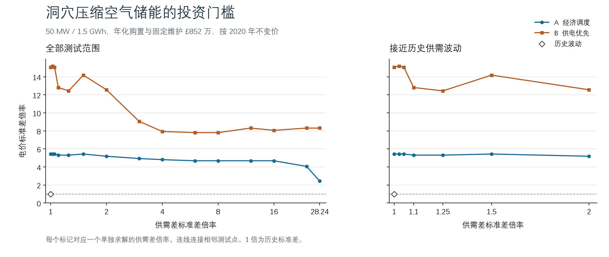

# 洞穴压缩空气储能投资门槛

MMCS Final Project · Tier 1 · 2026-11-12

完整数据见 [门槛区间](entry-envelope.csv)、[求解采样点](scenario-points.csv)和[经济参数](economics.json)。每一档供需差用点表示，折线用于连接相邻档位。

## 设备与年成本

采用英国拟建 TeesCAES 的 50 MW、30 小时及 62% 往返效率作为物理规格参考。模型取充放电功率均为 50 MW，可输出库存容量为 1,500 MWh。每天最多输入 1,200 MWh、输出 1,200 MWh。纯电运行，跨日保存库存，首末库存为零。库存等式为

$$
s_t=s_{t-1}+0.62\,c_t-y_t-h_t,
$$

其中 $c_t$ 为输入电量，$y_t$ 为放电售电量，$h_t$ 为放电制氢用电量。充电由当期发电供给。A 按经济价值分配，B 先用当期发电满足需求，出现缺口时再在可用库存和功率限额内优先放电供电。[Ofgem 项目参数附录](https://consult.ofgem.gov.uk/energy-generation/ldes-window-1-minded-to-decision/supporting_documents/window-1-minded-to-decisions-long-duration-electricity-storage-consultationpdf#page=70) · [TeesCAES 开发商说明](https://storelectric.com/teescaes-ofgem-ldes-cap-and-floor-results-minded-to-decision/)

PNNL 的同为 100 MW、10 小时对照中，压缩空气储能安装资本为 1.125 亿美元，磷酸铁锂电池为 3.491 亿美元，比值约 32.2%。本轮采用题给电池每 MWh 成本的三分之一作为压缩空气站的购置安装单价，并按 PNNL 压缩空气参考案例的固定维护占比和 60 年寿命估算。PNNL 成本对照的技术路线涉及放电燃料，本轮仅将其比值、维护占比与寿命用作财务情景。具体场址的资本预算、燃料、补贴和辅助服务未计入本轮。金额为 2020 年不变英镑。[PNNL 储能成本数据库](https://www.pnnl.gov/projects/esgc-cost-performance/download-reports) · [课程本地成本对照](../nonbattery-storage-research-20261111/REPORT_ZH.md)

| 经济输入 | 金额 |
|:--|--:|
| 一次性购置及安装 | £128,117,388 |
| 年化购置，实际折现率 5% | £6,768,209/年 |
| 固定维护，购置成本的约 1.37% | £1,756,686/年 |
| **投资门槛所需的新增年度运营价值** | **£8,524,895/年** |

## 波动设置和门槛

取 Tier 1 v6 的 2020–2025 年 2,192 个逐日数据。以 $x_t=G_t-D_t$ 表示供需差，分别作中心放缩

$$
x_t'=\bar x+k_x(x_t-\bar x),qquad
p_t'=\bar p+k_p(p_t-\bar p).
$$

历史供需差标准差为 62.67 GWh/日，历史电价标准差为 £65.24/MWh。图轴用标准差倍率，方差倍率为其平方。日期顺序保留，发电量、需求量和价格的样本均值保持原值。以共同电量和供需差正负部分重建逐日发电与需求，两者均非负。在这个构造中供需差倍率可达到约 28.24 倍。

每档分别求解装一座压缩空气站和零储能两种最优方案，均重新优化电解槽规格组合与运行。保留 v6 氢价、承购上限和电解槽经济输入。年度投资净增益为两种方案的年最优利润差，扣除 £8,524,895。首次出现正净增益的电价标准差倍率就是进入门槛。

### 原始供需差下的结果

| 策略 | 历史波动下运营增益 | 扣年成本后的净增益 | 首次进入的电价标准差倍率 | 对应电价标准差 |
|:--|--:|--:|--:|--:|
| A 经济调度 | £1.375m/年 | −£7.150m/年 | 5.375–5.500 | £351–359/MWh |
| B 供电优先 | £2.348m/年 | −£6.177m/年 | 15.000–15.125 | £979–987/MWh |

在所列区间的低端，最优选择为零储能，在高端建站产生正净增益。

在电价波动保持历史水平时，15 档供需差下的两种策略均选择零储能。A 在供需差放大 6–16 倍的各测试点需要电价波动达到 4.625–4.750 倍，在 28.24 倍极端档位降至 2.375–2.500 倍。B 的最低测试门槛是 7.750–7.875 倍，出现在供需差放大 6 和 8 倍的档位。在这两档之间及更高倍率的未测试点，图中的连线仅连接计算结果。

供需差更大时，盈缺的大小、盈缺日期与高低价的对应都会变化，设备每天仍最多充入及放出各 1.2 GWh。B 需要在缺口日优先放电，不能自由将同一库存留到之后的高价日。两种策略的门槛均有局部回升。

### 计算核验

按固定供需差逐段扫描电价倍率，再细化首次进入区间。对固定供需差，任意可行调度的目标随价格倍率仿射变化，因此装站最优值的上界可取自两个已解端点的连线。用不装站的可行调度给出利润下界，从而排除早于报告区间的盈利段。A 进一步按共同电解槽配置下可独立复用的逐日计划收紧这个下界。逐日核验库存平衡、充放电功率、能量平衡和 B 的优先供电限制。

两种策略合计 30 条供需差切片、316 个情景点。全部门槛区间宽度不超过 0.125 倍，端点的投资选择由年净增益上下界分别确定。
