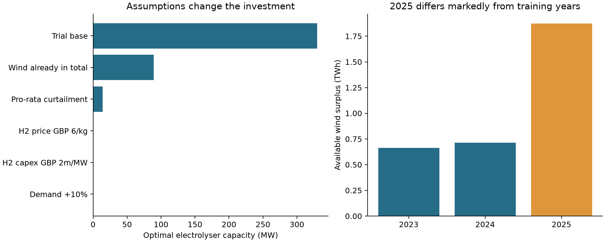
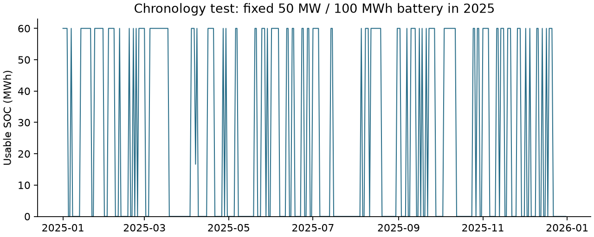

# MMCS Final Project：独立试算汇报

2026-11-02｜由本课助手单独完成，未派遣其他 agent。依据已归档的本年度 brief、五份原始 CSV 和项目说明课字幕。本轮完成数据核查、建模、求解和验证；尚未形成小组最终方案或正式提交稿。

## 项目描述与本次路线

为已有可再生能源基础设施选择新增电池和电解槽容量，并决定剩余电力如何使用，使新增收益能够覆盖投资与运行成本。题目要求先完成 Tier 1 基础模型，再选一条扩展路线。本次采用 **Tier 1 + Tier 2B**：先以年度能量汇总建立简化模型，再保留每日顺序、储能结转和不同年份的供需变化。

来源：[官方 brief，第 2–5 页](../../../materials/sync-20261023/MMCS%202026-2027%20-%20Project%20Brief.pdf)；[说明课证据索引](../LAUNCH_EVIDENCE.md)。原始 brief 允许团队选择目标与模型结构；下面的试算假设不是教师已确认的规则。

## 已经完成

- 核查五份 CSV 的日期、重复键、空值、单位关系及数值范围。日期并集 2,453 天，完整交集 2,406 天；47 个不完整日期未填零。各燃料发电之和与总发电完全一致，价格两列满足 24 倍关系。
- 选完整的 **2023–2024 年设计容量，2025 年检验固定容量**，没有让 2025 年重新选出的容量冒充事前决策。全样本存在异常低值，尤其 2022 年需求最小值 636，未擅自修正；该年未进入本次设计与检验窗口。
- 建立并运行 Python + Xpress 模型：**21 个优化算例、2 个运营规则模拟、3 个小型验证问题**。优化器均返回最优状态；回算供需、容量、荷电状态和财务约束通过。
- 另用制氢收益的分段线性拐点枚举复算，最优容量和净收益与 Xpress 一致。两日反例确认逐日模型不能借用未来能量，充放电损失满足 90% 往返效率。
- 保存逐日运行结果、全部情景表和两张图；图已检查，没有截断或重叠。

代码、运行入口见 [README](README.md)，全部情景见 [results.csv](results.csv)，核查结果见 [verification.json](verification.json)。这些是助手实际运行的结果，不代表本人或小组已经完成项目。

## 试算假设与结果

基准暂按“总发电为背景系统、风电场在其之外；背景电力优先满足需求，风电承担剩余弃电”处理，只利用这座风电场未能即时出售的电力。电池只用这部分电充电，不从电网购电；放电受剩余需求限制。负电价时允许风电弃电。

采用题目给定的两小时电池、20%–80% 荷电范围和 90% 往返效率。电解槽关闭或以装机的 20%–100% 运行；基准将此范围施加到整日平均功率，另跑了允许日内开停的比较情景。日数据暂按平均 MW 解释，乘 24 换算为 MWh。

**本轮成本为试算假设，未做公开成本文献调研：**电解槽 £1m/MW；折现率 8%、寿命 15 年；汇率 £0.85/€；电池和电解槽年固定运维分别取投资的 1% 和 3%。氢价以题目允许的 £9.5/kg 起步，假设产品可全部出售，尚未计入水、压缩、储运等变动成本。收益为相对现有风电即时售电基线的增量，已减新增资本的年化成本及固定运维。

| 情景；其余保持基准设定 | 最优电池 MW | 最优电解槽 MW | 年化净增量 £m/年 |
|---|---:|---:|---:|
| 基准：风电额外加入、背景电力优先 | 0.00 | 329.65 | 10.60 |
| 风电已经包含在总发电中 | 0.00 | 89.00 | 0.61 |
| 风电额外加入，但按发电比例分担弃电 | 0.00 | 14.09 | 0.41 |
| 氢价降至 £6/kg | 0.00 | 0.00 | 0.00 |
| 电解槽投资升至 £2m/MW | 0.00 | 0.00 | 0.00 |
| 需求提高 10% | 0.00 | 0.00 | 0.00 |

基准投资约 **£329.65m**，年产氢约 **6.21 百万 kg**，消纳约 **347,201 MWh/年**，即本模型可利用剩余风电的 **50.41%**。年新增销售收入 £59.01m，资本年化及固定运维 £48.40m，差额 £10.60m。这个容量是上述边界与价格、成本假设下的解，不能直接作为投资建议。

## 分析与完成程度

**最大的影响来自模型如何划定系统范围和分配弃电。**仅改变风电是否计入总量，最优电解槽已从 329.65 MW 降到 89.00 MW；改成按比例弃电又降至 14.09 MW。因此优先澄清基础设施关系，比继续细调求解器更有价值。

制氢盈利也依赖经济假设。保持本轮其他设定，出现正收益制氢投资的氢价临界值约 **£6.33/kg**；这不是维持 329.65 MW 容量的临界值，也不是实际氢市场报价。题目的 £9.5/kg 是政策支持基准，应继续测试实际销售安排和成本。

固定基准容量用于 2025 年，年化净增量达到 £100.95m，远高于训练期。原因之一是本模型的剩余风电由训练期年均 0.689 TWh 增至 1.873 TWh，约 **2.72 倍**。这说明年份选择十分重要，不能把单个有利年份当作稳定长期回报。

**电池零投资只说明当前日尺度、单次可用充放循环、剩余风电充电及剩余需求售电设定下不划算。**日均数据无法揭示两小时电池的日内价值。基准没有电池，使 Tier 1、逐日完美预知模型与简单运营规则恰好得到相同结果，因此目前的 Tier 2B 还需要更有解释力的运营分析。

为检查这一点，另固定 50 MW / 100 MWh 电池：2025 年年度汇总模型比逐日模型高估约 £0.169m，逐日完美预知模型比“只看当日、不看未来日”的规则多约 £0.011m。规则仍假设当日聚合供需和价格在决策时已知，不是已经完成预测的实时运营方案。还有一个将电池成本压至基准 1% 的纯诊断情景，确认程序能够选择正电池容量；该成本不用于投资建议。

## 最值得问清楚的三个问题

1. **客户究竟拥有哪些发电设施？**独立的 `wind_farm_generation` 是否已包含在 `daily_generation_total`？Tier 1 是以这座风电场为客户资产，其余发电作为背景，还是以全部发电组合作为客户资产？两者不能混用。
2. **系统发电超过需求时，怎样判断客户可以拿到的剩余可再生电量？**是否应假设背景电力先供、风电承担弃电；还是需要区分可调节的燃气等发电，并由团队选择弃电分配规则？若这是开放的建模选择，我们会明示并比较两种解释。
3. **日数据的准确口径是什么？**需求列是否也是每日平均 MW？采用两小时电池时，是否接受一天一次可用循环的近似，还是希望使用/构造更细时间序列？后半句是对模型预期深度的确认，不是要求老师替团队确定模型。

不必把折现率、寿命、运维费、氢气销售上限和储运成本都当作题目缺漏交给老师裁定；它们主要是团队应查来源、选择并做敏感性的事项。电解槽 20% 最低负荷在 brief 附录中已限定为“运行时”，不需要再问是否强制全年不停机；但用日平均近似这一运行条件会损失日内灵活性，需要解释。

## 尚未完成及技术障碍

本轮已解决 Python API 与现有 Xpress 9.9 许可版本不匹配的问题，并通过去掉可证明冗余的逐日限制，将最大算例控制在 Community 的规模上限内。现有许可证文件未改，学校完整许可和 VPN 未启用。

当前没有阻止原型求解的技术障碍。完成正式方案仍需：确定上述系统范围，取得可引用的电解槽与相关成本，深化一个能体现时间及信息约束的 Tier 2B 分析，检查其他年份/季节/连续低风期，并写成正式报告和商业展示。小组路线、正式 rubric、参考文献/附录计页、上传要求及展示场次仍沿用已有待核状态；本轮没有联网核新公告，也没有提交或外联。

## 可追溯材料

- [官方 brief](../../../materials/sync-20261023/MMCS%202026-2027%20-%20Project%20Brief.pdf)及[五份 CSV 原件清单](../../../materials/sync-20261030/manifest.json)。原件均未改动。
- [数据核查与原件哈希](data_audit.json)、[本轮假设](assumptions.json)、[全部情景与逐日文件说明](README.md)。
- [本轮来源记录](../../../materials/SOURCE-20261102-PROJECT-INDEPENDENT-PILOT.json)。结果是本次本地计算，不是教师确认、真实电网弃电测量或市场预测。
