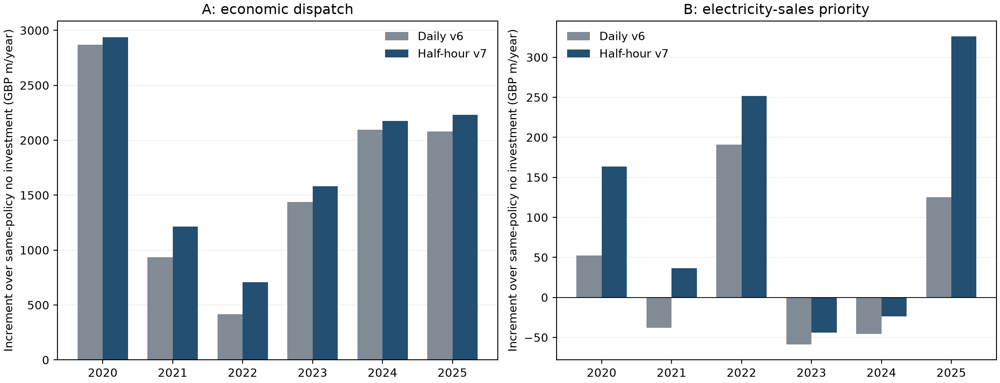

# Tier 1 v7：半小时投资与调度

2026-11-13 · Ran Min · 本地计算版本。采用2020–2025年完整六年、105,216个连续UTC半小时。设备一次购入，各期运行随后共同优化。使用原v6的四款电池、八款电解槽和同口径经济输入。

## 主要结果

| 策略 | 日模型v6电池 MWh | 半小时v7电池 MWh | v6电解槽 MW | v7电解槽 MW | v6年均净增益 £m | v7年均净增益 £m |
|:--|--:|--:|--:|--:|--:|--:|
| A：经济调度 | 0 | 0 | 3,631.341 | 4,251.195 | 1,638.660 | 1,807.615 |
| B：供电优先 | 0 | 0 | 739.557 | 1,821.222 | 37.712 | 118.378 |

`£m`为百万英镑，全部采用2020年实值。净增益相对各自时间粒度、同一策略的零投资方案，已经扣除资本年金、固定维护和换堆成本。既有发电设备不另计增量购置费。主情景继续采用氢净回价£7.799027/kg及1,558.969吨/日的宽松市场情景；后者不是客户已签订单。

保存的整数可行组合为A的845台、B的362台ITM NEPTUNE V，每台交流输入5.031 MW。型号间存在同效率、同单位成本的替代组合，具体台数不是独一无二的厂商采购结论。A/B初始设备投资分别为£6,208.614m、£2,659.785m，年等价设备费用分别为£639.274m、£273.866m。年产氢约501,441和50,294吨。

## 最优性核验

没有把“求解器暂时没有选电池”直接当作结论。先求连续容量、放宽最低负荷和B电池优先规则的模型上界，再对四款电池各自完整六年的运行轨迹求最优边际价值。该放宽问题仍然选择零电池。

| 核验 | A | B |
|:--|--:|--:|
| 连续放宽后的年增益上界 £ | 1,807,615,574.84 | 118,378,319.25 |
| 满足原整数/运行约束的年增益 £ | 1,807,615,343.35 | 118,378,271.66 |
| 距离全局上界最多 £/年 | 231.49 | 47.59 |
| 最便宜的正整数电池进入所对应的对偶惩罚 £/年 | 2,125.69 | 1,941.01 |

每款电池的降低目标值幅度均为正，而且大于上界与零电池整数可行方案之间的差距。因此，在这组数据与参数下，任意正整数电池采购都无法超过已有零电池方案。零电池投资结论得到数值证书支持；电解槽组合距全局最优的利润差距至多为表中金额，不宣称某一具体组合是唯一精确最优。上界与证书见[global_certificates.json](results/global_certificates.json)，公式与求解逻辑见[MODEL.md](MODEL.md)。

## 为什么电解槽结果改变

逐日净额会抵消同一天内部的供电缺口和余电。使用半小时记录，年均正向供需差从2,276.157 GWh增加到5,164.674 GWh，总发电量和总需求没有改变。B可以利用的余电时段因此明显增加。A还可以在半小时电价较低时集中制氢，每日氢接收额度不要求平均分到48期。

本轮同时改变了时间数据、最低运行负荷的作用区间和电池日内操作自由度，表中的差异是这些相应调整共同产生的。售电收入使用同一期电价和售电量相乘，不用日均价代替各时段成交价值。

B的需求覆盖率从日模型的92.17%变成91.03%，不是计算损失了发电，而是日模型内部抵消过的缺口现在被显式识别。B在2023和2024年的设备投资增量收益仍为负，分别约−£43.923m、−£23.580m。六年平均正收益不能解释为每年都赚钱。

完整年度现金与能量指标见[annual_results.csv](results/annual_results.csv)，两版比较见[comparison.csv](results/comparison.csv)。

## 数据与假设

使用此前归档的Elexon AGPT/FUELHH发电、VD需求、MID电价及NESO辅助记录恢复日内形状。每种燃料、需求和价格分别锚定至v6已修复的每日均值，保证重聚合后与v6一致。需求的五分钟接口记录先按半小时汇总。全部输入统一UTC，不把英国夏令时下的本地结算日强行当作48期。

- 2,114天有完整有效半小时电价；缺失的78天使用已记录的短缺口插值或邻近同星期日形状估计，并保留v6的每日平均价。
- 1,825天的11类发电都有完整原始时段记录；不足的日期沿用同源插值或FUELHH/NESO形状迁移。
- 2,043天的需求无需修补五分钟时段。
- 三组时段记录同时完整的日期共1,692天。所有来源/插值/估计标签保存在[day_quality.csv](inputs/day_quality.csv)。

课程独立风场只有日模拟量。主算把当日平均功率保持48期，明确属于日内形状假设。另以英国风电日内曲线按比例分配独立风场相同的日总量作敏感性情景。两种策略在该情景仍不买电池；整数可行方案的A/B年净增益约£1,811.383m/£124.065m，B电解槽约1,866.501 MW。这个曲线迁移也不是该风场的实测记录。

设备效率继续采用固定额定值，SOC为20%–80%，主算无显式静置自放电。未新增分钟级冷启动、热待机或爬坡曲线。这是半小时恒定运行量模型，不是设备控制器仿真。原有无外购电、无氢库存、无缺口罚金和固定氢净回价假设保留。

## 本轮调整

1. 功率乘以0.5小时形成每期输入/输出电量上限。
2. 电池逐半小时结转，允许同一天内多次充放循环，同一型号每半小时仍只能选择一个方向；取消整天只能充/放的限制。
3. 放电售电与放电制氢共享同一输出功率上限。
4. 电解槽最低/最高在线负荷作用于半小时，在线模块数可以跨期改变。
5. 氢接收上限仍是每日累计，未乘48、也未新增每半小时等额配额。
6. B的电池优先供电同时受期初可用电量和半小时放电功率限制。
7. 自放电率按期长换算，投资与维护年化保持原口径。

## 复算与文件

在本目录安装`requirements.txt`后运行`python run_all.py`。它重算两策略上界、从上界容量向上取整生成可行整数设备配置、重新优化运行、检查所有约束并重建汇总。`python prepare_data.py`从本包`source_data/`归档原件重新构建输入。`python behaviour_tests.py`检查半小时功率、同日充放、B优先供电及全天共享氢额度。

`model.py`保留全规模混合整数模型；直接展开约263万变量、284万约束。主算以完整时序的连续模型上界和电池轨迹分解完成证书，不抽样、不截短六年。求解器为CPU上的HiGHS 1.16.0。当前数据的证书重跑约A一分钟、B二十秒；固定整数配置的运行优化只需数秒。初次实现中尝试整体求解耗时更长，不能把这些重跑时间说成全部开发与核验耗时。

`results/full_A_candidate_schedule.csv.gz`和`full_B_candidate_schedule.csv.gz`是完整105,216行运行计划；对应JSON记录投资与现金。`certificate_A/B`保存连续上界、每款电池的边际定价与数值残差，`*_audit.json`是独立导出计划核验。所有数据原件、派生输入、代码和主结果均含在本地包内。

本轮没有发布到GitHub，没有更新正式LaTeX报告或GUI数据。GUI现有逐日版本仍在 https://mmcs-energy-data-explorer-ran.mocrymin.chatgpt.site 。
