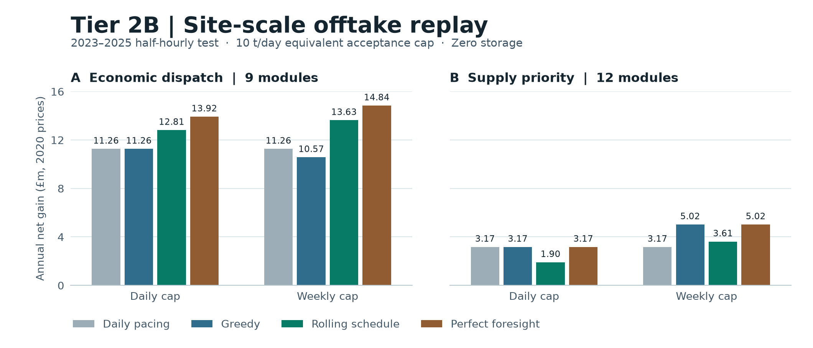

# Tier 2B site-scale offtake backtest

[中文版](README_ZH.md)

23 November 2026 · Julian · MMCS Group 15 research result

At the fixed, zero-battery site, rolling scheduling is the best deployable policy tested for **A (economic dispatch)**. A weekly acceptance window earns **£13.63m/year**, up **£0.82m/year** from daily rolling scheduling. For **B (supply priority)**, **weekly greedy** earns **£5.02m/year**, equals the perfect-foresight result at the pre-test size and delivers only **49.5%** of the available quota. Weekly settlement is a buyer negotiation case with flexible delivery timing.



[Vector PDF](results/site-backtest.pdf)

## Matched results

The primary design freezes **9 modules in A (45.279 MW)** and **12 in B (60.372 MW)** using only 2020–2022. All operating rules are replayed over the same 52,608 half-hours in 2023–2025. Net gains are annual averages in £m at 2020 prices, relative to the same A or B electricity-only reference. Equipment charges are £6.809m/year in A and £9.078m/year in B.

| Policy | Acceptance window | Daily pacing | Greedy | Rolling scheduling | Perfect foresight |
|---|---|---:|---:|---:|---:|
| A | 10 t/day | 11.265 | 11.265 | 12.815 | 13.924 |
| A | 70 t/week | 11.265 | 10.572 | **13.630** | 14.838 |
| B | 10 t/day | 3.171 | **3.171** | 1.904 | 3.171 |
| B | 70 t/week | 3.171 | **5.024** | 3.614 | 5.024 |

- **A.** On the weekly contract, rolling scheduling adds £2.365m/year over daily pacing. The extra value of weekly versus daily rolling scheduling was positive in each test year (£0.37m, £0.92m and £1.15m). Weekly rolling uses 99.8% of the total quota and reaches at least 95% of quota in 98.7% of settlement windows. Its gap to weekly perfect foresight is £1.208m/year.
- **B.** At a uniform hydrogen netback, production from realized surplus has zero foregone sales. The physical demand-priority interlock makes greedy operation effective. Weekly greedy adds £1.852m/year over daily greedy, but reaches 95% of the weekly quota in just 21.7% of windows. Rolling scheduling misses available surplus when its forecasts are low. A firm delivery floor would need its own feasibility and commercial appraisal.

### Check at the existing v5 client sizing

The published v5 site appraisal uses **8 modules in A (40.248 MW)** and **11 in B (55.341 MW)**, selected on the full 2020–2025 record. The same 2023–2025 replay at these nameplates gives the same ranking. The rows are useful for comparison with the client appraisal and share years with its sizing study.

| Policy and selected deployable rule | Daily, £m/year | Weekly, £m/year | Weekly gain, £m/year |
|---|---:|---:|---:|
| A rolling scheduling | 13.248 | 13.893 | +0.645 |
| B greedy | 3.334 | 5.029 | +1.695 |

## Common experimental conditions

- **Design and physical limits.** Under the historical 10 t/day daily acceptance case, choose the whole number of 5.031 MW NEPTUNE V units that maximises net gain in 2020–2022 for each policy. Freeze both choices before replay and keep the same nameplate for daily and weekly cases. The 12.5% minimum is for an operating module, half-hour switching is allowed and there is no start charge. Use the v7 flat wind case and no grid imports. B serves electricity demand first and permits hydrogen from remaining generation.
- **Contract and terminal state.** The acceptance cap is 10,000 kg per UTC day or 70,000 kg per seven-day block. Weekly blocks are anchored at the start of the holdout, 1 January 2023 00:00 UTC. The final four-day block receives a 40,000 kg cap. The buyer accepts direct deliveries within each block. Unused acceptance expires at block close with zero value. Neither electricity nor hydrogen is stored, so both opening and terminal physical inventory are zero. There is no delivery floor or shortfall penalty.
- **Information and execution.** At each half-hour, feasible policies know the contract balance and observations through the previous half-hour. The A rules use the same first-slot forecast. Forecasts average the four preceding observations at the same weekday and slot, adjusted for the last observed deviation with a two-hour half-life. This rule is fixed across the test. The schedule requests electrolysis before the current half-hour resolves. An identical executor clips requests to realized eligible power, quota and module operating limits. Actual market prices score electricity sales foregone under the v7 reference convention. Perfect foresight alone uses the full realized path to determine production.
- **Rule definitions.** Daily pacing reserves up to one day's quota each day, including under the weekly contract. Greedy uses the remaining window quota and requests profitable volume at the first-slot forecast in A. In B, the simple rules request nameplate power within the quota and the supply-priority interlock limits realization to actual surplus. Rolling scheduling solves the remaining block using forecast power and prices, executes only the first request and replans at the next slot. Perfect foresight performs the same remaining-quota allocation with realized inputs over the full block. For rolling and perfect foresight, lowest-cost-first continuous solutions are optimal when they obey the minimum load, with exact HiGHS window solves for exceptions.
- **Cash.** Operating gain is hydrogen at £7.799027/kg less foregone real electricity receipts. Net gain deducts £756,537 per module per year for annualised capital, fixed maintenance and stack replacements. The electricity-only reference, prices, costs and physical rules are common within each policy. The v7 price and volume paths are historically reconstructed. No auction-price or operational forecast availability is assumed.

## Conditional battery assessment

The group's **100 MW / 400 MWh** case belongs in the investment sensitivity. It assumes a separately costed asset with 240 MWh of usable inventory and a zero opening and terminal usable level. Its reference £4.695m/year storage charge (low capital, 2.5% O&M plus augmentation) and broad-market electrolysers (845 A and 362 B) apply to that separate case. The archived six-year low-cost appraisal has positive storage gains, and joint re-sizing on 2024–2025 selected zero in both policies. The site-scale results above estimate contract timing value. A battery purchase would require a matched dispatch and cost appraisal at the secured buyer volume. [Battery investment and Tier 2B handoff](https://github.com/MocryMin/mmcs-group15-project/tree/f8f5cc04ed71034a51e3c89db1aea40202cf815b/Tier1/public/findings/battery-entry-and-tier2b-handoff-20261119)

## Delivery stress and backup supply

- [Delivery stress test](delivery-stress/README.md) compares A and B in the highest-price and zero-surplus weeks and measures how often B can meet a weekly floor.
- [Policy B storage and backup supply](delivery-options/README.md) estimates the attainable weekly floor with storage and the backup volumes needed for stronger commitments.

## Evidence and reproduction

[File inventory and SHA-256 checksums](MANIFEST.json)

- [Main summary](results/summary.csv) and [annual detail](results/annual.csv) give net and operating gains, equipment costs and hydrogen delivery. The summary includes quota use and the fraction of that contract's windows reaching 95% of cap.
- [Contract-window results](results/contract_windows.csv) record accepted quantity, expired quota, electricity diverted from sales in GBP, input energy and operating gain. [Design search](results/train_sizing.csv) records upper bounds and exact objectives for competitive capacities. [Audit](results/audit.json) records the frozen design, file hashes and feasibility checks. Perfect foresight is verified to match or exceed every feasible rule in each settlement window. A change to current and future actuals leaves the first limited-information request unchanged.
- Method sources are the [v7 model and half-hour observations](https://github.com/MocryMin/mmcs-group15-project/tree/b0377299dc452bf01f387c0dd60f6e7f6510e1a2/Tier1/workspaces/mocry/codex/work-history/20261113-v1/studies/tier1-halfhour-20261113-v7), [v5 site appraisal, Table C.1](https://github.com/MocryMin/mmcs-group15-project/blob/98b316f90736554a20ad5eab1e07cb7562eee3ba/Tier1/workspaces/mocry/codex/technical-report-latex/20261122-v5/report.pdf) and [Julian's original settlement-window model](https://github.com/MocryMin/mmcs-group15-project/tree/447ec3010dd9c1f52292cbebd3bbb6c0b0790f53/Tier2/workspaces/julian/claude/tier2-models/20261116-v1).

With Python 3.12, install [requirements.txt](requirements.txt). Point the replay to the frozen v7 directory and use a fresh output directory.

```sh
python -m pip install -r requirements.txt
python run_backtest.py --study-dir /path/to/tier1-halfhour-20261113-v7 --output ./reproduction
python plot_results.py ./reproduction
```
