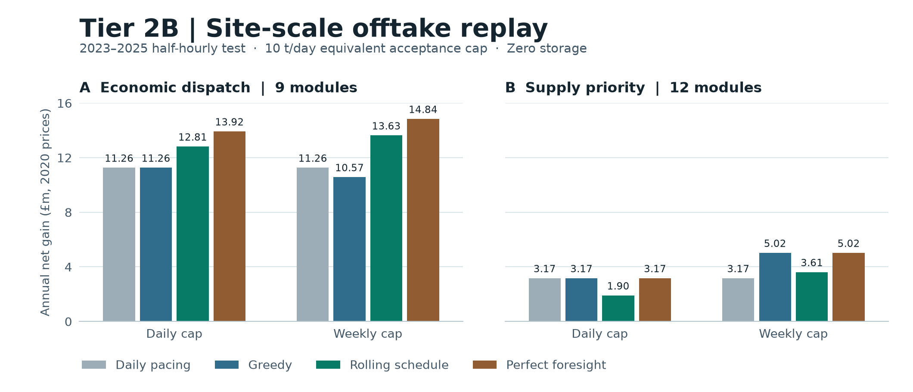

# Tier 2B 站点承购窗口同口径回测

[English](README.md)

2026 年 11 月 23 日 · Julian · MMCS 第 15 组研究结果

**A 经济调度**采用周承购窗口与滚动调度，2023–2025 年平均净增益为 **£13.63m/年**，比采用相同滚动调度的日窗口高 **£0.82m/年**。**B 供电优先**采用周窗口与简单贪心，平均净增益为 **£5.02m/年**，达到该装机下的完美预见收益，但只交付总承购上限的 **49.5%**。能否采用周窗口，取决于买方是否接受交付时点的弹性。

[矢量 PDF](results/site-backtest.pdf)

## 同口径结果

主回测只用 **2020–2022 年**选择装机，冻结 A 的 **9 台（45.279 MW）**和 B 的 **12 台（60.372 MW）**。用 **2023–2025 年同一批 52,608 个半小时**测试各规则。下表为相对同策略纯售电基准的年均净增益，单位为 2020 年不变价百万英镑。A、B 的设备年化费用分别为 £6.809m 和 £9.078m。

| 策略 | 承购窗口 | 按日分配 | 贪心生产 | 滚动调度 | 完美预见 |
|---|---|---:|---:|---:|---:|
| A | 10 吨/日 | 11.265 | 11.265 | 12.815 | 13.924 |
| A | 70 吨/周 | 11.265 | 10.572 | **13.630** | 14.838 |
| B | 10 吨/日 | 3.171 | **3.171** | 1.904 | 3.171 |
| B | 70 吨/周 | 3.171 | **5.024** | 3.614 | 5.024 |

- **A。** 在周窗口内，滚动调度比按日分配多赚 £2.365m/年。与日窗口滚动调度相比，三个测试年的周窗口收益分别增加 £0.37m、£0.92m 和 £1.15m。周窗口滚动使用了 99.8% 的总承购额度，98.7% 的窗口达到各自上限的 95%。距离周窗口完美预见还有 £1.208m/年。
- **B。** 供电优先后，制氢用的是原本无法出售的剩余电量，氢气单位净收入固定。周窗口允许在有余电时多产，贪心相对日窗口增加 £1.852m/年。只有 21.7% 的周窗口达到各自上限的 95%。滚动调度低估余电时会错过生产机会。如果买方要求保底交付，需要另行核算可交付量和短供成本。

### 按 v5 客户建议装机复算

v5 站点报告采用 A **8 台（40.248 MW）**、B **11 台（55.341 MW）**，装机选择使用了 2020–2025 年全样本。在原建议装机下复跑同一测试期，策略排序一致。由于装机选择和测试共享年份，这组结果用于对接原站点报告。

| 策略和同一运营规则 | 日窗口（£m/年） | 周窗口（£m/年） | 周窗口增益（£m/年） |
|---|---:|---:|---:|
| A 滚动调度 | 13.248 | 13.893 | +0.645 |
| B 贪心生产 | 3.334 | 5.029 | +1.695 |

## 模型口径

- **装机与物理约束。** 在 2020–2022 年按 10 吨/日的协议选择整数台 NEPTUNE V。每台 5.031 MW，在线模块最低负荷 12.5%，每半小时可启停，启停费用设为零。各策略与日／周合同共用同一组装机、v7 平坦风电情景及无外购电约束。B 在满足当期电力需求后才能制氢。
- **承购与期末。** 日窗口上限 10,000 kg，周窗口按自 2023 年 1 月 1 日 00:00 UTC 起的连续七天计算，上限 70,000 kg。最后四天按 40,000 kg 核算。当期制氢直接交付，窗口末未用额度作废、残值为零。电池和氢库存均为零，期初和期末一致。合同设接受上限，未设交付下限或短供罚金。
- **信息与执行。** 简单规则和滚动调度只使用已结束半小时的实绩及已知合同状态。预测以过去四周同星期、同时段均值为基础，用上一期偏差修正，半衰期为两小时。A 的简单规则与滚动调度用同一首槽预测。B 的简单规则发出额度允许的满负荷请求，由执行器按当期实际供电后余量裁剪。所有规则按同一物理约束执行并用同一实际价格结算。只有完美预见能用全窗口实绩决定请求。
- **规则。** 按日分配每天最多使用 10 吨额度，贪心使用当前结算窗口剩余额度。滚动调度每半小时优化窗口剩余时段并只执行首个请求。完美预见在同一承购约束下用实际路径求解整个窗口。滚动和完美预见均先按成本排序分配，遇到最低负荷冲突时用 HiGHS 求解。
- **成本。** 氢气净收入 £7.799027/kg，按实际被挤占的售电收入扣减。每台设备每年扣 £756,537，含年化资本、固定维护与堆栈更换。使用同一政策下的 v7 纯售电基准，货币为 2020 年英镑。半小时实绩序列含数据修复和重建，以统一口径用于所有策略。

## 大电池的条件性投资评估

组内 100 MW／400 MWh 电池实验继续作为独立投资敏感性证据。该实验对应 240 MWh 可用库存，期初和期末可用库存均为零，低资本、2.5% 运维及增容情景年化费用约 £4.695m，并配有系统尺度的电解槽装机（A 845 台、B 362 台）。六年低成本情景曾出现正收益，2024–2025 年单独重新选型时两种策略均选择零电池。若有采购报价和已落实的承购条件，再用对应站点方案评估这一投资。 [电池投资与 Tier 2B 交接记录](https://github.com/MocryMin/mmcs-group15-project/tree/f8f5cc04ed71034a51e3c89db1aea40202cf815b/Tier1/public/findings/battery-entry-and-tier2b-handoff-20261119)

## 可复核成果

[文件清单与 SHA-256 校验值](MANIFEST.json)

- [汇总结果](results/summary.csv)、[分年结果](results/annual.csv)和[逐结算窗口结果](results/contract_windows.csv)。汇总含年化毛增益、设备费、净增益及两类额度使用指标。逐窗口表记录交付、过期额度、售电机会成本和能耗。
- [训练期选型记录](results/train_sizing.csv)和[约束核对及输入校验值](results/audit.json)。逐窗口检查请求量、可用电量、最低负荷和承购上限，并验证每个窗口的完美预见收益不低于可执行策略。
- [英文 README 中的复算命令与来源](README.md#evidence-and-reproduction)。
