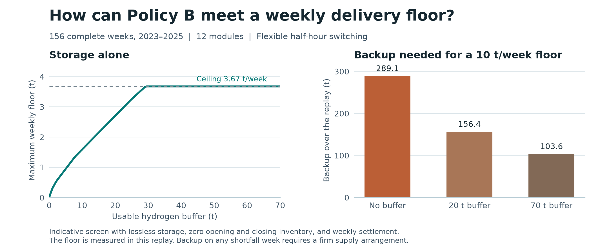

# Policy B delivery options

[中文版](README_ZH.md) · [Delivery stress test](../delivery-stress/README.md)

The zero-inventory replay is the reference case. Keeping the same 12 electrolyser modules, supply-priority rule, half-hour output limits and 70 t weekly acceptance cap, this extension tests an inter-week hydrogen buffer and a firm call-off supply. It uses the same 156 complete UTC settlement weeks from 2023 to 2025. The four-day final settlement window is excluded throughout.



[Vector figure](delivery-options-en.pdf) · [Scenario results](delivery_options.csv) · [Storage-only curve](storage_floor_curve.csv)

## What changes the feasible delivery floor

A buffer can support **at most 3.674 t/week in this replay**, even if unlimited capacity were available. The first 13 weeks provide 47.765 t of eligible production, with no opening stock, which bounds any common weekly floor. About **29.18 t of usable inventory** is sufficient to attain that ceiling under the model. A 20 t buffer supports **2.70 t/week**. The screen assumes lossless usable inventory and sufficient intraweek transfer and flexible delivery capability.

A **10 t/week** minimum can be covered with backup purchases triggered by the actual weekly shortfall under those same conditions.

| Usable buffer | Backup over 156 weeks | Maximum backup in one week |
|---|---:|---:|
| 0 t | 289.12 t | 10.00 t |
| 20 t | 156.43 t | 10.00 t |
| 70 t | 103.57 t | 10.00 t |

The 70 t buffer cuts bought volume by about **64%**. It still leaves weeks in which the supplier must deliver the full 10 t. A larger floor would raise the supplier exposure. For example, with a 70 t buffer, a 35 t floor requires about **1,481 t** of backup across the same weeks.

## Economics and plant conditions

Suppose that backup hydrogen costs **£5/kg more than the net revenue actually realised on bought hydrogen**, in 2020 prices. Relative to backup alone at a 10 t floor, the 20 t buffer improves net cash by **£0.234m/year before tank fees**, giving a break-even annual tank charge of **£11.72 per usable kg**. The corresponding break-even for 70 t is **£4.61 per usable kg per year**. These scenario thresholds compare with the previous Julian study's illustrative steel-vessel cost of about £185 per usable kg per year. A buyer and supplier agreement would determine the actual product eligibility, delivered purchase cost, availability charge and shortfall penalties. [Earlier Julian tank-cost screen](https://github.com/MocryMin/mmcs-group15-project/blob/2dc9b95/Tier2/workspaces/julian/claude/tier2-models/20261116-v1/RESULTS_2B.md)

The buffer and backup comparison assumes flexible half-hour switching. Under the separate 20% minimum-load test, the longest eligible surplus run is **56 hours**. If operation requires 96 or 120 consecutive hours, the plant cannot start from surplus alone. A hydrogen buffer cannot supply the missing electricity. Under that physical constraint, a delivery contract would need an independent hydrogen source or a redesign of the electricity supply. [Minimum-run sensitivity](https://github.com/MocryMin/mmcs-group15-project/tree/7e798e4/Tier1/workspaces/julian/codex/electrolyser-sensitivity/20261122-v1)

## Modelling and checks

Aggregate eligible half-hour production at the existing B nameplate. With a buffer, production above the weekly sales cap can be stored for later delivery. At each settlement, use site production and stored stock to meet the floor, buy only the remaining deficit, keep eligible excess up to the tank limit, and sell additional output up to the existing 70 t cap. Both opening and closing inventories are zero. Compression, leakage, equipment outages and limits on the timing of supplier deliveries are outside this screening model.

The supply-only optimisation bounds a common floor by the available hydrogen over every contiguous block of weeks. A block beginning at the start of the replay has zero opening stock. A later block can open with at most the tank capacity. For every tabulated floor and tank size, an independent linear programme with full foresight returned the same minimum purchase volume as the weekly policy. Clipping the eligible production to the weekly cap reproduced the archived zero-buffer deliveries to within one gram. [Frozen site backtest](https://github.com/MocryMin/mmcs-group15-project/tree/91d3b27/Tier2/workspaces/julian/codex/studies/tier2b-site-backtest/20261123-v1)

## Reproduction

Use the [backtest's Python dependencies](../requirements.txt) and the frozen v7 half-hour input. From this directory, run the following command. The optional `--verify-lp` flag checks the minimum backup volume in all 20 scenarios against the independent linear programme.

```sh
python screen_delivery_options.py --weekly ../delivery-stress/weekly_stress_metrics.csv \
  --audit ../results/audit.json --halfhour /path/to/tier1-halfhour-20261113-v7/inputs/halfhour.csv.gz \
  --output . --verify-lp
```
