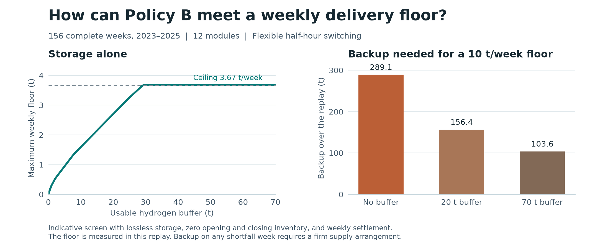

# B 方案储氢与备用补供优化

[English](README.md) · [交付压力测试](../delivery-stress/README_ZH.md)

以零库存回测为基准，保持现有 **12 台电解槽**、供电优先、半小时出力约束和 **70 吨／周**的承购上限，分别加入跨周储氢与按缺口补供。采用 2023–2025 年相同的 **156 个完整 UTC 结算周**。最后四天的窗口不计入本分析。

[英文矢量图](delivery-options-en.pdf) · [方案结果](delivery_options.csv) · [仅储氢时的保底曲线数据](storage_floor_curve.csv)

## 周交付能力

即使储氢容量不受限且无损耗，期初空库时，历史回放可达到的统一保底量也只有 **3.674 吨／周**。测试期头 13 周的合格产量只有 47.765 吨，这决定了上述上限。约 **29.18 吨可用储氢容量**足以达到该上限。20 吨缓冲可支持 **2.70 吨／周**。模型假设周内可按需转运和灵活交付，储氢无损耗。

如果合同要求 **10 吨／周**保底，可在每周结算时按实绩补足缺口。

| 可用储氢容量 | 156 周累计补供 | 单周最大补供 |
|---|---:|---:|
| 0 吨 | 289.12 吨 | 10.00 吨 |
| 20 吨 | 156.43 吨 | 10.00 吨 |
| 70 吨 | 103.57 吨 | 10.00 吨 |

70 吨缓冲减少约 **64%** 的累计补供，但仍有周需要供应商补齐整整 10 吨。若把保底量提高到 35 吨／周，即使配有 70 吨缓冲，累计补供仍约 **1,481 吨**。

## 成本门槛与最低运行条件

以 2020 年不变价计，若外购氢到场成本比其实际可得的销售净收入高 **£5/kg**，相对只做补供，20 吨缓冲在扣除储氢费用前可提高年净增益 **£0.234m**，可接受的年化储氢成本约为 **每公斤可用容量 £11.72／年**。70 吨缓冲的对应门槛为 **£4.61／年**。早期研究采用的钢制储氢罐参考成本约为每公斤可用容量 **£185／年**。实际经济性取决于产品资格、外购到场成本、供应商待命费用和短供罚金。[早期储氢成本筛选](https://github.com/MocryMin/mmcs-group15-project/blob/2dc9b95/Tier2/workspaces/julian/claude/tier2-models/20261116-v1/RESULTS_2B.md)

以上结果假设可每半小时启停。若供应商要求在 20% 最低负荷下连续运行四天或五天，历史上合格余电最长只有 **56 小时**，不足以支持 96 或 120 小时。氢缓冲不能提供电解所需的电力。该条件下，要保底交付就需要独立氢源，或重新设计供电方案。[最低连续运行敏感性](https://github.com/MocryMin/mmcs-group15-project/tree/7e798e4/Tier1/workspaces/julian/codex/electrolyser-sensitivity/20261122-v1)

## 模型与复核

根据半小时物理余电和 B 装机汇总合格产量。加入氢库存后，超出本周承购上限的产量可留到后续交付。每周用站内产量和已存氢优先履行保底量，缺口才由外部补足。保底之外，优先保留不超过罐容的余量，其余可在本周上限内出售。期初、期末库存均为零。本筛选未计压缩、泄漏、设备故障和供应商交付时点限制。

不设外部补供时，用每段连续周的合格产量加其可能拥有的期初库存，约束统一保底量。回放首段必须空库，其后的任意一段最多以满罐开始。表中各方案的累计补供量均用独立的完美预见线性规划复核。将合格产量按 70 吨截断即可复现原零库存交付结果。[最终回测](../README_ZH.md)

## 复现

使用最终回测的 Python 依赖，从本目录运行[英文说明](README.md#reproduction)中的命令。加上 `--verify-lp` 会复核各方案的最小补供量。
