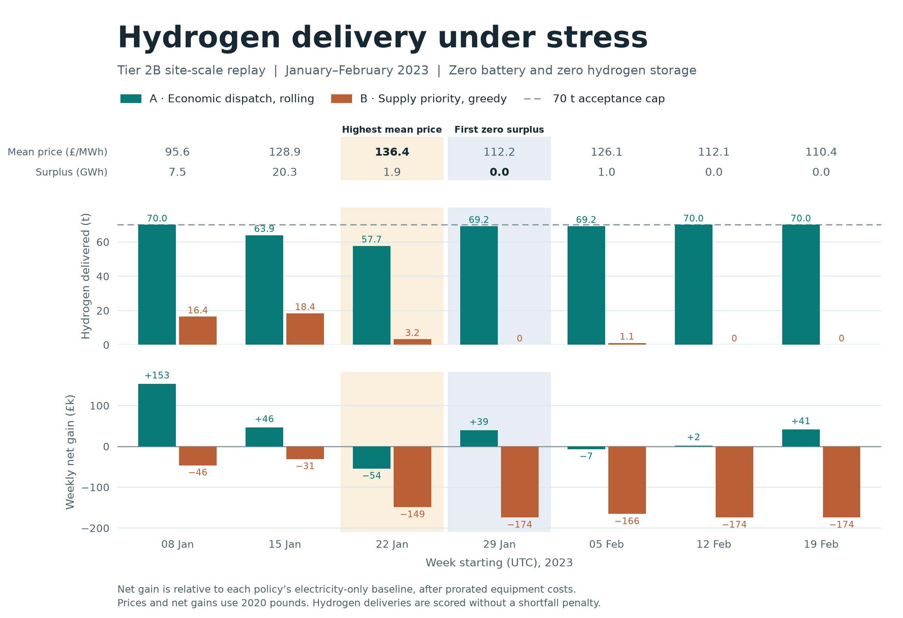

# Tier 2B delivery stress test

[中文版](README_ZH.md) · [Policy B storage and backup supply](../delivery-options/README.md)

The surplus-only policy **B cannot support a positive firm weekly delivery floor** at the tested site. Under flexible half-hour switching, its greedy rule achieves the same weekly delivery as perfect foresight in all 156 complete test weeks. Eighteen weeks still have zero delivery. A weekly acceptance cap gives the operator flexibility over delivery timing. With no hydrogen inventory or backup supply, it provides no physical buffer.



[Vector PDF](delivery-stress-en.pdf) · [Full weekly results and stress indicators](weekly_stress_metrics.csv)

## Stress episode

The chart shows the first full week with zero physical surplus and three settlement weeks on either side. The preceding week has the highest mean electricity price of the 2023–2025 holdout, **£136.37/MWh**. The windows are identical for both policies. A uses rolling scheduling at 9 modules (45.279 MW). B uses greedy dispatch at 12 modules (60.372 MW). The buyer accepts up to 70 tonnes per complete week. Both policies have zero battery and hydrogen storage and no grid imports.

| UTC settlement week | Market condition | A delivery (t) | A net gain (£k) | B delivery (t) | B net gain (£k) |
|---|---|---:|---:|---:|---:|
| 22–28 January 2023 | Highest weekly mean power price | 57.72 | −54.31 | 3.24 | −148.84 |
| 29 January–4 February 2023 | First week with zero physical surplus | 69.19 | +39.19 | 0.00 | −174.11 |

A can divert saleable electricity to keep production running. During the highest-price week, foregone sales and equipment costs leave a negative net gain despite 57.72 tonnes of delivery. In the first zero-surplus week, B earns no incremental operating cash and still carries the equipment charge.

Weekly net gain uses the original same-policy electricity-only baseline. It is the published operating gain less the equipment charges accrued over the week, including annualised capital, fixed maintenance and stack replacements. Each day's charge is one 365th or 366th of the annual cost as applicable. Power prices and net gains are in real 2020 pounds. The original exercise treats deliveries as optional up to the cap, with no contractual shortfall penalty. Physical surplus is the half-hour energy by which generation exceeds demand, summed within the window. [Matched Tier 2B backtest and source assumptions](https://github.com/MocryMin/mmcs-group15-project/tree/91d3b27/Tier2/workspaces/julian/codex/studies/tier2b-site-backtest/20261123-v1)

## Implication for a firm delivery floor

| Candidate minimum | B weeks meeting the minimum | Share of full weeks |
|---|---:|---:|
| Any positive delivery | 138 / 156 | 88.5% |
| 10 t | 117 / 156 | 75.0% |
| 35 t | 73 / 156 | 46.8% |
| 70 t | 31 / 156 | 19.9% |

Each row reports historical fulfilment with the existing greedy dispatch, which matches the perfect-foresight delivery in these weeks. The final four-day, 40 t window is excluded from the full-week denominator. At the alternative v6 site sizing of 11 modules, B also has 18 zero-delivery weeks. [Weekly replay table](https://github.com/MocryMin/mmcs-group15-project/blob/91d3b27/Tier2/workspaces/julian/codex/studies/tier2b-site-backtest/20261123-v1/results/contract_windows.csv)

The existing minimum-run sensitivity adds a separate physical test. At a 20% minimum load, the longest uninterrupted surplus sufficient for one module is **56 hours** over 2020–2025. A four-day run requires **96 hours** and a five-day run **120 hours**. Either requirement rules out starting even one module under surplus-only operation. The finding applies to the weekly contract as well because a longer acceptance window cannot extend a period of available electricity. The multi-day rule is a supplier sensitivity and should be confirmed before procurement. [Electrolyser operating sensitivity](https://github.com/MocryMin/mmcs-group15-project/tree/7e798e4/Tier1/workspaces/julian/codex/electrolyser-sensitivity/20261122-v1)

Under the tested conditions, negotiate an interruptible weekly offtake with no firm minimum. If the buyer requires a floor, model the required buffer or contracted backup supply and the cost of shortfalls before committing.

## Reproduction

Run with the existing backtest's Python dependencies. The program reads the archived result files, verifies the frozen half-hour input hash, and uses half-hour prices and surplus to select the stress episode. It does not re-optimise the historical orders.

```sh
python delivery_stress.py --replay-results ../results \
  --halfhour /path/to/tier1-halfhour-20261113-v7/inputs/halfhour.csv.gz --output .
```
