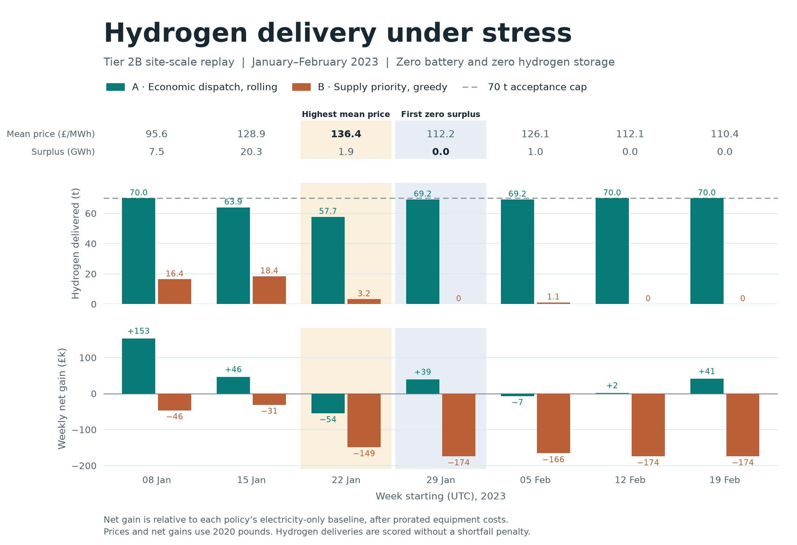

# Tier 2B 交付压力测试

[English](README.md) · [B 方案的储氢与补供优化](../delivery-options/README_ZH.md)

在测试站点的无库存配置下，**B 供电优先方案无法支撑任何正的每周保底交付量**。允许每半小时启停时，简单贪心在全部 156 个完整测试周的交付量都与完美预见相同，其中仍有 18 周零交付。周承购上限允许在窗口内灵活交付。应对跨周缺口还需要氢库存或外部供给。

[英文矢量图](delivery-stress-en.pdf) · [逐周回测结果及压力指标](weekly_stress_metrics.csv)

## 压力周

图中以测试期内首个物理余电为零的完整结算周为中心，前后各展示三个周窗口。紧邻其前的 1 月 22–28 日是 2023–2025 年测试期内周均电价最高的一周，均价 **£136.37/MWh**。A 用 **9 台（45.279 MW）**并采用滚动调度，B 用 **12 台（60.372 MW）**并采用贪心规则。两种策略共用相同测试周和 **70 吨/完整周**的承购上限，均无电池、无氢库存、无外购电。

| UTC 结算周 | 市场条件 | A 交付量（吨） | A 净增益（千英镑） | B 交付量（吨） | B 净增益（千英镑） |
|---|---|---:|---:|---:|---:|
| 2023 年 1 月 22–28 日 | 周均电价最高 | 57.72 | −54.31 | 3.24 | −148.84 |
| 2023 年 1 月 29 日–2 月 4 日 | 首个零余电周 | 69.19 | +39.19 | 0.00 | −174.11 |

A 可将原本可售的电调给电解槽，因此零余电周仍能制氢。最高电价周即使交付了 57.72 吨，扣除被挤占的售电收入和设备费后仍亏损。B 在首个零余电周没有新增运营收入，仍承担设备费。

周净增益以各自的纯售电策略为基准，按日分摊年化资本、固定维护和堆栈更换费用。平年每日计入年化费用的 1/365，闰年计 1/366。金额均为 2020 年不变价。承购合同只有接受上限，未设强制最低交付量或短供罚金。物理余电为各半小时内发电超出需求的电量之和。[同口径回测](../README_ZH.md)

## 每周保底交付

| 每周最低量 | B 达标完整周数 | 达标比例 |
|---|---:|---:|
| 有正交付 | 138 / 156 | 88.5% |
| 10 吨 | 117 / 156 | 75.0% |
| 35 吨 | 73 / 156 | 46.8% |
| 70 吨 | 31 / 156 | 19.9% |

最后一个四天窗口的承购上限为 40 吨，未计入完整周。按 v6 站点建议的 11 台复算，B 也有 18 个完整周零交付。

最低连续运行敏感性提供了独立的物理约束。在 **20%** 最低负荷下，2020–2025 年可供一台模块连续运行的余电最长为 **56 小时**。四天和五天的连续运行要求分别为 **96 小时**和 **120 小时**，两者均超过这一上限。延长承购结算窗口不会延长余电可用时段。多日最短运行时间属于供应商条件敏感性，采购前需核实。[电解槽运行敏感性](https://github.com/MocryMin/mmcs-group15-project/tree/7e798e4/Tier1/workspaces/julian/codex/electrolyser-sensitivity/20261122-v1)

在现有配置下，可谈判允许中断的周承购。若买方要求保底，应把缓冲库存、外部补供及短供代价一同纳入签约评估。[B 方案的储氢与补供优化](../delivery-options/README_ZH.md)

## 复现

使用最终回测的 Python 依赖。程序核对冻结半小时输入的哈希，从存档回测提取交付量和净增益，并按实绩选择压力周。运行参数见[英文说明](README.md#reproduction)。
