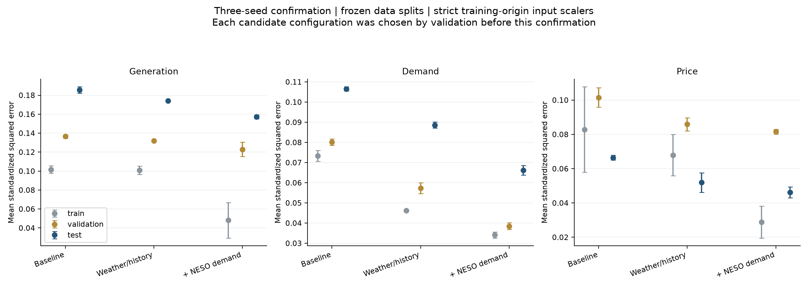
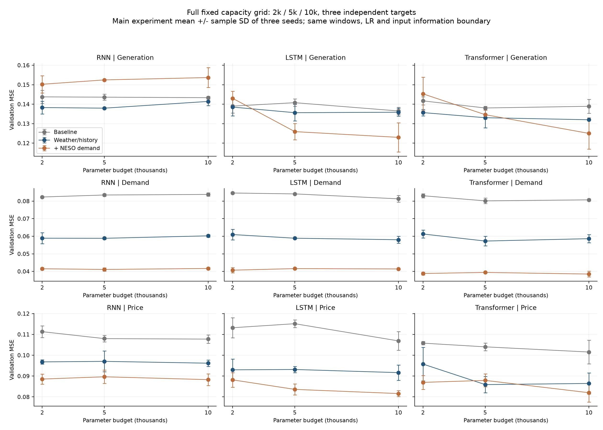

# Tier2B 临时基线与特征工程研究：2026-11-10

本轮已达到研究启动时预先记录的停止判据：三个目标分别出现至少5%的验证集MSE改善，至少2/3个匹配种子改善，且测试MSE没有变差。实际最终候选均为3/3种子改善。停止原因是明确收益已经复现；最后额度工具显示剩余约71%，没有达到30%的额度阈值。没有安排继续运行的后台任务，也没有发布仓库或修改正式报告。

## 1. 冻结的临时基线

三个目标分别建模，各自输入仍包含发电、需求、电价的历史与日期信息；独立指三个目标不共享模型权重，并不指每个模型只看一条序列。

- 神经模型：RNN、LSTM、Transformer，各约2k／5k／10k参数。9个结构×3目标×3种子，共81个全新基线拟合。
- 传统方法：保留岭回归、LASSO、梯度提升树、日历＋残差AR，以及旧OLS、历史窗岭回归和朴素基准。传统方法是确定性拟合，不报告虚构的种子波动。
- 训练目标：仅次日的样本平均标准化MSE。没有修改数据划分或引入多日训练损失。
- Train：2022-01-01—2024-12-31，1,096天；val：2025-01-01—2025-08-31，243天；test：2025-09-01—2026-08-31，365天。2021仅作历史上下文。
- 窗口和学习率按此前结果冻结，不随特征修改：RNN窗口14／7／30天，LSTM为30／14／14天，Transformer为7／7／182天，依次对应发电／需求／价格。AdamW、batch64、每epoch18step、最多120epoch、完整epoch早停15、dropout0.1、weight decay0.0001。
- 每次参数更新完整评估train、val、test，检查点和模型选择只用val。test仍是此前已反复监测的同一测试期。

实际神经基线参数量：

| 模型 | 2k档 | 5k档 | 10k档 |
|---|---:|---:|---:|
| LSTM | 2035 | 5116 | 9946 |
| RNN | 2041 | 4941 | 10071 |
| Transformer | 1989 | 5015 | 9970 |

添加输入后重新选择最接近同一参数预算的整数隐层宽度；全部实验最远偏差4.35%，不是通过不断增加参数取得收益。所有网络保持一个目标输出。

$$
L_{j,S}=\frac{1}{|S|}\sum_{t+1\in S}
\left(\frac{\widehat y_{t+1,j}-y_{t+1,j}}{s_{j,\mathrm{train}}}\right)^2.
$$

目标尺度始终来自2022—2024训练标签。发电与需求原单位为日均MW，电价为名义GBP/MWh。数据和已有修复版本保持不变，没有删除不利的测试日期。

## 2. 调研如何变成验证任务

先用机制和可知时间定义组，再对每组做独立加入或有理由的组合。CPU拟合传统方法，GPU训练神经模型；筛选种子17，主要候选再用17／29／43三种子确认。神经共477次主实验拟合，另18次更严格的标准化边界确认，共495次；25个传统特征配置覆盖三目标，含225个选定配置的重新拟合核验和72个日历AR权重重放。

候选包括次日日历、节假日、周周期、近期水平与波动、供需余额、价格稳健表达、发电构成、温度预报、风速预报、云量／日照代理，以及第三方电力系统预测。完整任务理由、正负结果见[特征任务记录](research/FEATURE_LEDGER.md)。未确认的单种子结果不能替代最终候选。

外部信息有两类，分开报告：

1. **气象和日期特征**：GOV.UK节假日；Open-Meteo汇集的GFS温度与JMA风速、云量历史预报。采用固定48h提前量：目标日最后一小时的气象预报也至少在预测起点日结束前24小时已产生。没有使用目标日事后真实天气。
2. **第三方电力预测**：NESO已发布的日前需求预测，保留其供需系统信息。这不是独立从零预测电力需求的结果。其原数据是日内特征点预测，均值不是日均实际需求，模型把它作为辅助输入学习校准。

天气城市／区域点是英国尺度的代理，不是假设客户拥有这些地点的具体风场。风速立方是风能潜力指标；云量与日照几何交互是启发式特征，均不是某座发电厂的准确功率曲线。

GFS四地点各有1,982个完整日，少量缺档采用过去预报前向延续并附缺失标记；JMA风速、云量所取各点的2,087个有效日均有24小时值。NESO需求加入本模型的2,086个origin中缺1天，前向延续并标注。NESO风电档案按严格发布时间过滤后缺341天、最长连续148天，因此排除最终选择，即使其中部分探索分数较好。精确分集覆盖见[DATA_COVERAGE.csv](results/DATA_COVERAGE.csv)。

## 3. 神经模型的完整确认结果

下表基线按冻结的val均值选模型；新特征方案同样按val选择后冻结，再补做严格确认。数值为三个种子平均±样本标准差。MAE／RMSE为各种子的分数再平均。

| 目标 | 方案／模型 | 输入维度 | Train loss | Val loss | Test loss | Test MAE | Test RMSE |
|---|---|---:|---:|---:|---:|---:|---:|
| 发电 | 原始神经基线／LSTM 10k | 8 | 0.101685 ± 0.003898 | 0.136521 ± 0.001882 | 0.185641 ± 0.003340 | 1753.04 ± 18.58 | 2256.83 ± 20.31 |
| 发电 | 天气／日历／历史特征／Transformer 10k | 14 | 0.100904 ± 0.004488 | 0.132022 ± 0.000252 | 0.174274 ± 0.000615 | 1740.15 ± 7.72 | 2186.70 ± 3.85 |
| 发电 | 加入第三方电力预测／LSTM 10k | 20 | 0.048093 ± 0.018877 | 0.122841 ± 0.007597 | 0.157179 ± 0.002031 | 1603.54 ± 19.18 | 2076.66 ± 13.41 |
| 需求 | 原始神经基线／Transformer 5k | 8 | 0.073362 ± 0.002689 | 0.080145 ± 0.001571 | 0.106549 ± 0.001066 | 1006.77 ± 2.96 | 1306.74 ± 6.54 |
| 需求 | 天气／日历／历史特征／Transformer 5k | 22 | 0.046295 ± 0.000471 | 0.057288 ± 0.002691 | 0.088625 ± 0.001476 | 948.46 ± 8.69 | 1191.75 ± 9.95 |
| 需求 | 加入第三方电力预测／Transformer 10k | 14 | 0.034082 ± 0.001564 | 0.038495 ± 0.001663 | 0.066245 ± 0.002393 | 784.45 ± 12.33 | 1030.26 ± 18.69 |
| 电价 | 原始神经基线／Transformer 10k | 8 | 0.082886 ± 0.024917 | 0.101551 ± 0.005641 | 0.066427 ± 0.001408 | 15.59 ± 0.29 | 20.59 ± 0.22 |
| 电价 | 天气／日历／历史特征／Transformer 5k | 14 | 0.067885 ± 0.012044 | 0.085912 ± 0.003881 | 0.051921 ± 0.005772 | 13.88 ± 0.86 | 18.19 ± 1.00 |
| 电价 | 加入第三方电力预测／LSTM 10k | 20 | 0.028832 ± 0.009370 | 0.081630 ± 0.001410 | 0.046201 ± 0.003213 | 12.82 ± 0.41 | 17.17 ± 0.59 |

“天气／日历／历史特征”各目标使用：发电为余额特征，需求为节假日＋温度预测，价格为风速预测。“加入第三方电力预测”各目标使用：发电与价格为NESO需求预测＋JMA风速预测，需求为NESO需求预测。各组具体变量和来源在`features/`的CSV与JSON中。

相对冻结神经基线，最终第三方预测增强方案的确认结果：

| 目标 | Val MSE下降 | Test MSE下降 | Test下降的95%块重采样区间 |
|---|---:|---:|---:|
| 发电 | 10.02% | 15.33% | [3.47%, 25.64%] |
| 需求 | 51.97% | 37.83% | [22.77%, 49.22%] |
| 电价 | 19.62% | 30.45% | [18.91%, 40.00%] |

所有三个目标在匹配模型家族与参数预算的3个种子上，val均有改善。需求的容量选择从基线5k变成10k，但同10k基线下的改善仍约52.3%，收益不能用容量翻倍解释。发电和价格的最终LSTM保持约10k，实际参数仅从9,946变为9,961。

没有第三方电力预测时，需求和价格已有明显收益；发电余额特征仅约3.3%验证改善，14日块重采样的测试改善区间仍跨零，不把它单独称作强证据。发电的明确收益来自引入预先已知的系统需求与风速信息。

## 4. 与强传统基线的比较

传统方法仍有必要保留：

| 目标／基线 | Val loss | Test loss | 改善后固定方案 | Val loss | Test loss |
|---|---:|---:|---|---:|---:|
| 发电／LSTM 10k | 0.136521 | 0.185641 | LSTM 10k | 0.122841 | 0.157179 |
| 需求／CalendarAR | 0.079052 | 0.105875 | Transformer 10k | 0.038495 | 0.066245 |
| 电价／HGB | 0.088683 | 0.062267 | HGB | 0.070071 | 0.043680 |

价格的验证候选仍是梯度提升树。加入NESO需求预测和JMA风速后，val MSE约改善21.0%，test约改善29.9%；不必为了使用神经网络而放弃更强的传统方法。神经价格模型也已改善，但不是本轮验证分数最低的方法。

图中是完整三种子的主实验容量比较；最终推荐检查点来自收尾的严格标准化确认目录。小容量有时足够，容量越大不保证误差越小。云量／日照代理和近期统计量等组多次没有稳定收益，保留其记录。

## 5. 时间边界、过拟合与不确定性

主实验新增输入统计量按2022—2024可知日期计算，包含2024-12-31这个边界origin。为避免它与首个val输入重合，收尾又把新增输入统计量的截止严格改为2024-12-30，按已经冻结的六个候选重训18次；没有继续搜索新特征或按test改选。基线输入逐位相同，最终收益保留，表3使用这轮严格确认。明确的输入均值、标准差和检查点指针已导出，不依赖重新估计未来数据。

已核验：全部495个神经检查点可重放；419,571行完整三集评估、419,076次更新及val选点规则正确；主实验额外进行了未来观测／未来特征扰动检查，过去输入逐位不变。297个新传统模型目标配置可重放或重新拟合，另核验7份旧基线来源。保存的预测与独立重算指标一致。

发电增强模型的train loss远低于val loss，价格也有明显训练—验证差距。特征有效不等于过拟合消失。结论依赖跨种子验证与测试期方向，不能仅看train下降。

测试改善区间来自同一已监测测试期的14日块bootstrap，3,000次重采样；反映这段时间中的不确定性，不是新的盲测保证。特殊节假日的原始公告版本、气象机构每一份原始发布文件和精确延迟未逐份重建，日期已知和48h预报可用性按已核元数据与保守时间余量处理。尚未运行MPC，不能把预测MSE改善直接写成投资或调度利润改善。

## 6. 使用入口

- [完整带单位逐案例指标](results/ALL_METRICS_WITH_UNITS.csv)：标准化MSE、原单位MSE／MAE／RMSE。
- [原始容量基线](results/BASELINE_ALL_METRICS.csv)及[实际参数量](results/BASELINE_ACTUAL_PARAMETERS.csv)。
- [主实验各特征对照](results/NEURAL_FEATURE_COMPARISON.csv)和[传统特征对照](results/CLASSICAL_FEATURE_COMPARISON.csv)。
- [最终严格确认指标](results/STRICT_SUMMARY.csv)、[收益与种子确认](results/STRICT_IMPROVEMENTS.csv)。
- [候选检查点与预处理](RECOMMENDED_NEURAL_MODELS.json)：6套方案、18个种子检查点、固定输入统计量。
- `models/CPU_SELECTED_*.joblib`：冻结的强传统价格模型；其输入接口沿用根目录`classical.py`，不是严格确认神经网络的输入接口。
- `research/`、`features/`：来源、取数脚本、冻结输入和定义；`step_logs/`保留每step完整评估。
- `results/AUDIT_NEURAL.json`、`results/AUDIT_CLASSICAL.json`、`strict-confirmation/results/AUDIT_NEURAL.json`：本地核验记录。

在匹配的Python环境安装`requirements.txt`后，可重跑`summarise.py`、`analyse_research.py`与`analyse_strict.py`。重训基线用`fit.py --families RNN,LSTM,Transformer --seeds 17,29,43 --device cuda`，主要确认计划见`strict-confirmation/PLAN_FROZEN.json`。冻结输入与预测已打包，不需要重新访问学校或下载原始课程文件。

调研原件由Playwright匿名访问取得；没有使用个人邮箱或学校登录会话。原始导入基线的重新采集脚本需要旧对照目录，但本包已经包含其冻结预测和来源哈希。全部新实验能从本包的冻结数据重新计算。

## 7. 已读来源

- [GOV.UK bank holidays](https://www.gov.uk/bank-holidays.json)：England/Wales and Scotland target-day and adjacent-day flags. Official calendar fetched; special-announcement vintage assumed known by previous day.
- [Open-Meteo Historical Forecast API](https://open-meteo.com/en/docs/historical-forecast-api)：Archive coverage and distinction between stitched short-lead histories and fixed-lead forecast products.
- [Open-Meteo Previous Runs API](https://open-meteo.com/en/docs/previous-runs-api)：48h fixed-lead GFS temperature and JMA wind/cloud forecasts. Original run files and exact publication latency not independently reconstructed;48h offset leaves at least24h margin before end of origin.
- [NESO Day Ahead Demand Forecast](https://www.neso.energy/data-portal/1-day-ahead-demand-forecast)：Archived cardinal point predictions, issue timestamps and field definitions inspected through official CKAN API. Not a daily actual-demand column.
- [NESO Day Ahead Wind Forecast](https://www.neso.energy/data-portal/day-ahead-wind-forecast)：Inspected and rejected from final pool because strict issue filtering leaves341missing origin dates, including148consecutive days. Kept as a labeled exploratory classical experiment.
- [Lago etal2021, Applied Energy293,116983](https://arxiv.org/abs/2008.08004)：Read abstract and bibliographic record. Supports comparison against strong simpler methods and multi-year common evaluation; no claim to have reproduced its benchmark or read every paper it cites.
- [Hyndman and Athanasopoulos, Forecasting: Principles and Practice, regression forecasting](https://otexts.com/fpp3/regression.html#sec-forecasting-regression)：Read ex-ante/ex-post and predictor availability discussion. Motivation to use calendar, lagged observations and forecasts already issued before origin, rather than realised future weather.
