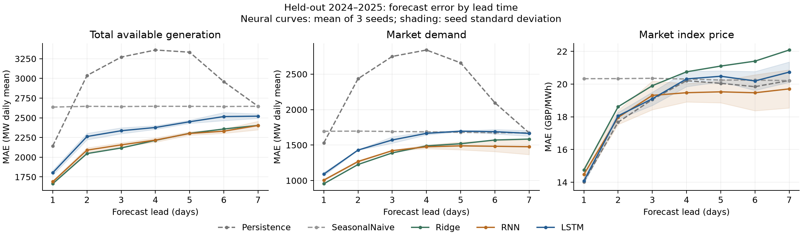

# RNN 与 LSTM 预测试验：2026-11-09

本轮只比较预测，不计算 MPC 收益；不包含 attention、Transformer 或外部特征。

## 数据与划分

使用冻结的修复数据。总供给为课程总发电加独立风场；供给和需求均预测每日平均功率（MW），电价为名义英镑/MWh。保留负电价，不使用事后全月 CPI 构造预测输入。

| 分区 | 目标日期范围 | 原始日数 | 完整七日预测样本数 |
|---|---|---:|---:|
| 训练 | 2020-01-01–2022-12-31 | 1,096 | 1,034 |
| 验证 | 2023-01-01–2023-12-31 | 365 | 359 |
| 测试 | 2024-01-01–2025-12-31 | 731 | 725 |

预测起点为当天输入已知之后，目标为未来第 1–7 日；目标日期不跨分区。各次预测可使用截至当日已经观测到的历史，包括前一分区的过去数据。所有配置使用共同的预测起点集合。2026 年部分年未用于选型或测试。

## 模型与验证选型

单层传统 tanh RNN：64 隐藏单元、6,101 参数；单层 LSTM：32 隐藏单元、6,069 参数。两者有相同的残差预测头：以当天值为起点，预测未来变化；输入为三条标准化序列和五个日历特征。没有 attention。

两种模型均比较 28/56 日窗口及 0.001/0.003 学习率，每配置使用 17、29、43 三个随机种子，共 24 次训练。AdamW、batch 64、weight decay 0.0001、梯度裁剪 1；最多 120 epoch，验证集连续 15 epoch 无实质改善则停止。以三变量、七跨度等权标准化验证 MSE 的种子均值选配置。验证集还用于早停，不作为独立最终结论。

| 模型 | 选中窗口 | 学习率 | 验证标准化 MSE：三种子均值 |
|---|---:|---:|---:|
| RNN | 56 | 0.003 | 0.25019 |
| LSTM | 28 | 0.001 | 0.28245 |
| Ridge 基准 | 56 | alpha=100 | 0.24384 |

## 独立测试结果

神经模型列为三个随机种子的指标均值 ± 种子标准差，非置信区间；基准模型为单一确定性结果。MAE/RMSE 使用原始单位。主表没有把三模型集成误差当成单模型结果；集成预测另存于导出文件及示例图。

| 模型 | 电价 1 日 MAE（£/MWh） | 电价 1 日 RMSE（£/MWh） | 电价 7 日 MAE（£/MWh） | 供给 1 日 MAE（MW） | 需求 1 日 MAE（MW） |
|---|---:|---:|---:|---:|---:|
| Persistence | 14.03 | 22.98 | 20.22 | 2,143.89 | 1,531.18 |
| SeasonalNaive | 20.33 | 30.70 | 20.22 | 2,636.24 | 1,694.57 |
| Ridge | 14.75 | 21.93 | 22.08 | 1,663.53 | 955.26 |
| RNN | 14.48 ± 0.43 | 21.67 ± 0.41 | 19.71 ± 1.17 | 1,689.35 ± 11.44 | 1,006.78 ± 11.42 |
| LSTM | 14.09 ± 0.18 | 22.27 ± 0.08 | 20.73 ± 0.62 | 1,803.06 ± 30.45 | 1,091.28 ± 24.42 |

完整各跨度 MAE/RMSE 见 [MODEL_COMPARISON.csv](results/MODEL_COMPARISON.csv)；原始预测及逐种子指标见 results。另提供仅在 strict_no_imputation 为真的目标日上的误差，但同一输入窗口内仍可能含修复估计值。

## 本轮发现

在两个神经模型之间，普通 RNN 的三变量综合验证/测试标准化 MSE 更低，且供给和需求的预测误差较低。LSTM 的次日电价 MAE 略低于 RNN，但次日持续值基准的 MAE 仍略低于两者。RNN 的次日电价 RMSE 与第七日电价 MAE 优于本轮 LSTM；较低 MAE 和较低 RMSE 的赢家并不完全一致。

当前结果支持将传统 RNN 留作后续控制实验候选，没有证据因模型名称更复杂便优先选用 LSTM。Ridge 在供给和需求的一日预测上更好，也应保留。正式接入 MPC 后还要评价实际收益，预测误差排序不自动等于调度收益排序。

## 解释边界

这是一个固定修复历史数据集上的回顾性预测试验。模型训练/标准化/调参按时间隔离，原始数据修复中的来源发布延迟、后验校准和插值没有重建为逐日版本；不能宣称完成了真实实时数据可得性的审计。

日均数据和八维基础输入限定了本轮结论。结果不证明某一架构在所有配置、外部天气或官方预测特征下都更好。最终测试结果已经查看，后续模型迭代若反复使用这一测试结果选型，应把它标为已使用的比较期或建立新的最终检验，不能继续宣称它完全未参与研究。

## 复现与文件

运行 run_experiment.py 完成训练与预测；运行 analyse_results.py 独立复算指标、检查划分并生成本说明和图表。训练按 CPU 两线程执行。run.log 保留原始训练日志，末尾的首次导出异常来自把 0/1 质量标签当成 true/false 读取；修正后使用同一组权重完成评估，记录在 evaluation.log。修正前后全部预测值的最大差为 0，没有重新选型。

主要文件：PROTOCOL.json（协议）、splits.csv、scalers.json、inputs/MANIFEST.json、results/validation_grid.csv、results/training_runs.csv、results/RESULTS.json、results/AUDIT.json、checkpoints。

环境：Python 3.12.14；PyTorch 2.15.0+cpu；NumPy 2.3.5；pandas 3.0.1；SciPy 1.18.1；Matplotlib 3.11.2。环境文件夹 .venv 不属于交付包。
