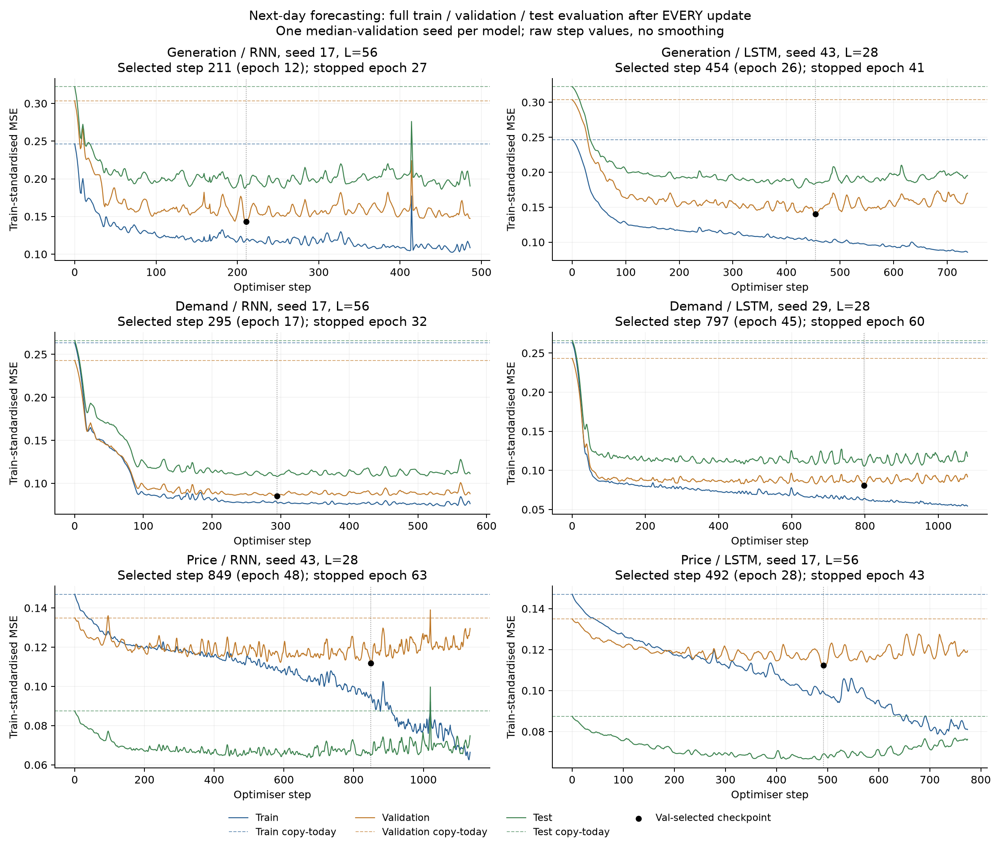
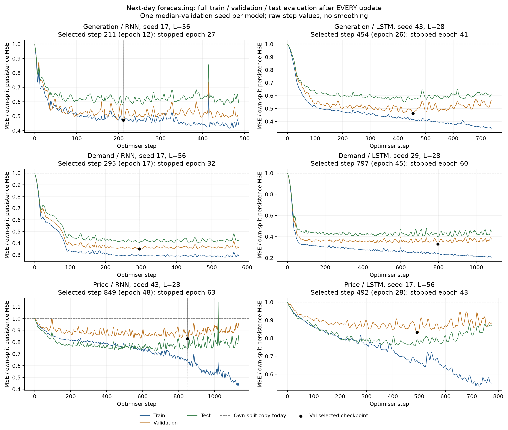

# 独立次日 RNN/LSTM：三段时间划分与逐 step 轨迹

供给、需求、电价分别训练独立网络，各自预测下一天。每个 optimizer step 更新参数后，完整评估 train、val、test；所有 loss 均逐行保存并立即刷新文件。输入仍为三条历史序列及日历特征，每个模型只输出一个目标，不共享权重。

## 日期与样本

日期按预测目标日划分，边界互不重叠。用户原述的 2025 年 9 月作为 test 起点；test 取完整一年，末端多出的 17 天未纳入。

| 分区 | 目标日期 | 样本数 | 用途 |
|---|---|---:|---|
| Train | 2022-01-01—2024-12-31 | 1,096 | 梯度更新；拟合标准化参数 |
| Val | 2025-01-01—2025-08-31 | 243 | 逐 step 选择 checkpoint；提前停止 |
| Test | 2025-09-01—2026-08-31 | 365 | 逐 step 监测；不参与选择 |

2021-11-06—12-31 仅供训练最开始的历史输入窗口使用，不作为训练标签。预测某天时可用到前一天为止的真实历史；跨分区窗口保留过去可观察的信息，不把未来目标输入网络。冻结数据中供给为课程总发电加独立风场，单位为日均 MW；电价为名义 £/MWh。

## 训练安排与记录粒度

每个 epoch 将 1,096 个训练窗口重新打乱分批，但不改变单个窗口内部时间顺序。batch size 为 64；每 epoch 共 18 step，即 17×64 + 8。最多 120 epoch、2,160 step/fit。AdamW、weight decay 0.0001、梯度范数截断 1、dropout 0.1。

step 0 是未训练模型的初始评估，预测与照抄今天一致。每次更新后切到 eval 模式，用同一组权重评估三个完整分区，再恢复 train 模式继续更新。train_batch_loss 单独记录，不能与无 dropout 的完整 train_eval_loss 混用。

每个 step 都可成为最佳 checkpoint：只看 val MSE，改善阈值为 0.00001。连续 15 个完整 epoch 没有新的 val 改善才提前停止，不是连续 15 step。test 曲线不参与梯度、checkpoint、早停或本轮配置选择。

沿用上一轮已选出的六组窗口和学习率，从零初始化重新训练，三个随机种子 17、29、43，共 18 fits。本轮没有重新调参。RNN 为单层 tanh、68 隐藏单元、5,373 参数；LSTM 为单层、32 隐藏单元、5,409 参数。

| 目标 | 模型 | 输入窗口/天 | 学习率 | 最佳 step 范围 | 实际停止 epoch 范围 |
|---|---|---:|---:|---:|---:|
| 供给 | RNN | 56 | 0.003 | 211—289 | 27—32 |
| 供给 | LSTM | 28 | 0.003 | 454—604 | 41—49 |
| 需求 | RNN | 56 | 0.001 | 295—825 | 32—61 |
| 需求 | LSTM | 28 | 0.003 | 281—797 | 31—60 |
| 电价 | RNN | 28 | 0.001 | 667—1004 | 53—71 |
| 电价 | LSTM | 56 | 0.003 | 492—1034 | 43—73 |

## 最佳验证 checkpoint 的三个分区 loss

loss 为单目标标准化均方误差（MSE），是每个样本误差的平均值，不是求和。标准差只由 2022–2024 年拟合，三个分区使用同一标准差：

$$
L_S=\frac{1}{|S|}\sum_{t\in S}\left(\frac{\hat y_t-y_t}{s_{\mathrm{train}}}\right)^2.
$$

下表为每个种子各自 val 最优 checkpoint 的指标，± 为三个种子的标准差，不是置信区间或集成模型。Test 使用同一个 val 所选 checkpoint，没有另外挑 test 最优点。

| 目标 | 模型 | Train loss | Val loss | Test loss | Test 相对照抄误差降幅 |
|---|---|---:|---:|---:|---:|
| 供给 | Persistence | 0.246449 | 0.303554 | 0.322207 | 0.00% |
| 供给 | RNN | 0.117461 ± 0.002835 | 0.143444 ± 0.001312 | 0.193111 ± 0.003245 | 40.07% |
| 供给 | LSTM | 0.099900 ± 0.006965 | 0.139597 ± 0.002579 | 0.184417 ± 0.003666 | 42.76% |
| 需求 | Persistence | 0.263293 | 0.243003 | 0.266117 | 0.00% |
| 需求 | RNN | 0.075129 ± 0.002581 | 0.085176 ± 0.000618 | 0.107700 ± 0.001098 | 59.53% |
| 需求 | LSTM | 0.070286 ± 0.006589 | 0.081300 ± 0.001233 | 0.108801 ± 0.002856 | 59.12% |
| 电价 | Persistence | 0.147014 | 0.134970 | 0.087454 | 0.00% |
| 电价 | RNN | 0.099537 ± 0.008682 | 0.110343 ± 0.003653 | 0.065081 ± 0.000277 | 25.58% |
| 电价 | LSTM | 0.083977 ± 0.017963 | 0.110058 ± 0.005237 | 0.071708 ± 0.005393 | 18.01% |

图中展示每个目标、家族内按 val 排序居中的种子，未根据 test 选择。每个点是一整套分区的平均误差；没有平滑，也没有只取 epoch 末尾。黑点为实际保存的 val checkpoint。全部种子的曲线另存 figures，各 step 原始记录见 results/ALL_STEP_LOSSES.csv。

## 相对照抄与过拟合

不同年份的波动强弱不同，直接比较跨分区 loss 高低不足以判断过拟合。以下曲线分别除以各分区自己的照抄 loss；1 表示等于照抄，低于 1 表示预测改善。过拟合主要观察固定 val 在后续训练中的变化，并与持续下降的 train 对照。

| 目标 | 模型 | 所选 train | 最后 train | 所选 val | 最后 val | Val 后续变化 | Test 后续变化 |
|---|---|---:|---:|---:|---:|---:|---:|
| 供给 | RNN | 0.117461 | 0.106183 | 0.143444 | 0.154979 | +8.04% | +2.57% |
| 供给 | LSTM | 0.099900 | 0.082131 | 0.139597 | 0.163510 | +17.13% | +8.30% |
| 需求 | RNN | 0.075129 | 0.073008 | 0.085176 | 0.087847 | +3.14% | +2.15% |
| 需求 | LSTM | 0.070286 | 0.061348 | 0.081300 | 0.092418 | +13.67% | +9.71% |
| 电价 | RNN | 0.099537 | 0.081591 | 0.110343 | 0.120410 | +9.12% | +10.49% |
| 电价 | LSTM | 0.083977 | 0.066647 | 0.110058 | 0.118713 | +7.86% | +7.78% |

六组配置中，6 组的种子平均呈现所选 checkpoint 后 train 继续下降、val 上升。Test 轨迹用于查看这种变化是否延续至后一时段；没有因为某个 test 点较好而换 checkpoint。由于选择的是逐 step 最低 val，后续 val 回升本身还包含选点效应，应结合整段曲线判断其持续程度。

## 原始单位指标

供给和需求的 MSE 单位为 MW²，RMSE 为 MW；电价 MSE 单位为 (£/MWh)²，RMSE 为 £/MWh。

| 目标 | 模型 | Train MSE | Val MSE | Test MSE | Test RMSE | Test MAE |
|---|---|---:|---:|---:|---:|---:|
| 供给 | Persistence | 6,761,998.234 | 8,328,811.630 | 8,840,604.840 | 2,973.315 | 2,314.292 |
| 供给 | RNN | 3,222,867.700 | 3,935,783.690 | 5,298,519.970 | 2,301.797 | 1,776.712 |
| 供给 | LSTM | 2,741,027.409 | 3,830,207.849 | 5,059,968.892 | 2,249.363 | 1,753.712 |
| 需求 | Persistence | 4,219,639.636 | 3,894,467.008 | 4,264,900.241 | 2,065.163 | 1,603.189 |
| 需求 | RNN | 1,204,046.965 | 1,365,066.769 | 1,726,050.130 | 1,313.781 | 1,006.978 |
| 需求 | LSTM | 1,126,434.785 | 1,302,953.424 | 1,743,690.191 | 1,320.412 | 1,013.051 |
| 电价 | Persistence | 938.430 | 861.546 | 558.243 | 23.627 | 16.673 |
| 电价 | RNN | 635.369 | 704.348 | 415.428 | 20.382 | 15.140 |
| 电价 | LSTM | 536.049 | 702.525 | 457.729 | 21.385 | 15.950 |

若只按本轮平均 val loss 比较两个家族，排序为：供给：LSTM；需求：LSTM；电价：LSTM。电价的 val 均值仅差约 0.000285，小于两个家族各自的种子波动；不能据此宣称 LSTM 稳定优胜。Test 上，供给 LSTM 较好，需求两者接近，电价 RNN 较好。这个 test 排序只用于报告，没有据此改选配置或重跑训练。

电价 RNN 的 test RMSE 为 20.38 £/MWh、MAE 为 15.14 £/MWh，照抄分别为 23.63 和 16.67。Test 电价 loss 低于 train/val，与 test 本身较容易预测一致：照抄 loss 也从 train 的 0.147014、val 的 0.134970 降到 test 的 0.087454。不同年份的标准化参数保持一致，差异不是样本数量或分区分别缩放造成的。新实验的训练期标准差与旧实验不同，应避免直接用两轮归一化 loss 的绝对值评价进步。预测改善对 MPC 收益的影响尚未评估。

## 审计、文件和复现

完成 18 次拟合，累计 15,336 次权重更新；含各模型 step 0 共 15,354 行完整评估，三分区共 46,062 个平均 loss 数值。每行三项齐全且 finite；step 连续、批次大小、样本计数、15 epoch 早停、仅 val 选点、初始照抄、单输出目标映射、训练期 scaler、冻结代码/输入及 checkpoint 重放检查全部通过。最大标准化 loss 复算差 2.12e-08。详见 results/AUDIT.json。

- run_monitored.py：训练、逐 step 完整评估、checkpoint 与指标导出。
- summarise_monitored.py：读取所有日志，重放 18 个 checkpoint、复算指标、绘图。
- step_logs/：18 份独立 CSV，训练时每行刷新；results/ALL_STEP_LOSSES.csv 为合并记录。
- results/LOSS_COMPARISON.csv：各目标、各分区的平均 loss、原始 MSE/RMSE/MAE、种子标准差。
- checkpoints/：18 份最佳 val 权重；inputs/、splits.csv、scalers.json、REFERENCE_CONFIGS.json、PROTOCOL.json：数据和配置。

复现：安装 requirements.txt 后，先运行 python run_monitored.py，再运行 python summarise_monitored.py。训练过程会更新本文件夹中的结果；如需保留本次产物，请在新副本中复现。

本轮 test 是按用户要求逐 step 查看损失的留出集，不是全程不可见的盲测集；旧实验也曾查看过部分 2025 年数据。它未参与本轮模型配置、梯度、checkpoint 或早停，但未来若依据这条曲线继续改模型，就不能再把同一段称为全新独立测试。当前输入为事后修复历史，尚未审计逐日发布版本；本轮没有新增外部特征、Ridge、MPC 收益、合同罚则或远程上传。
