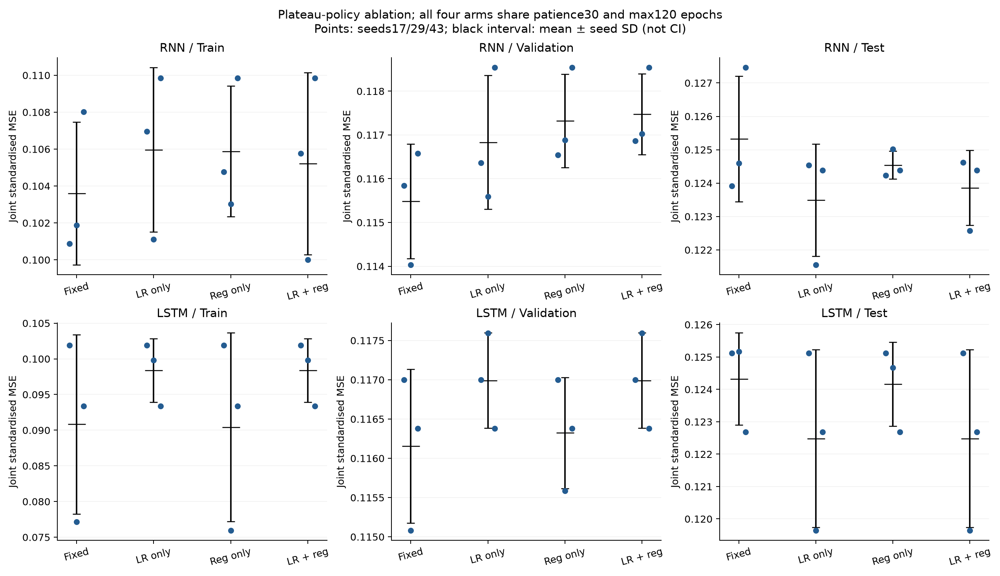
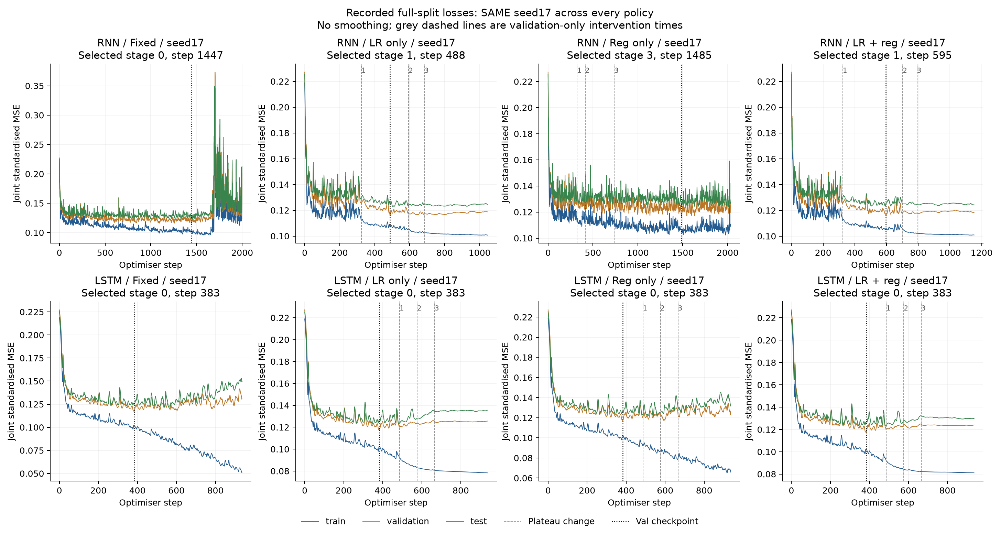
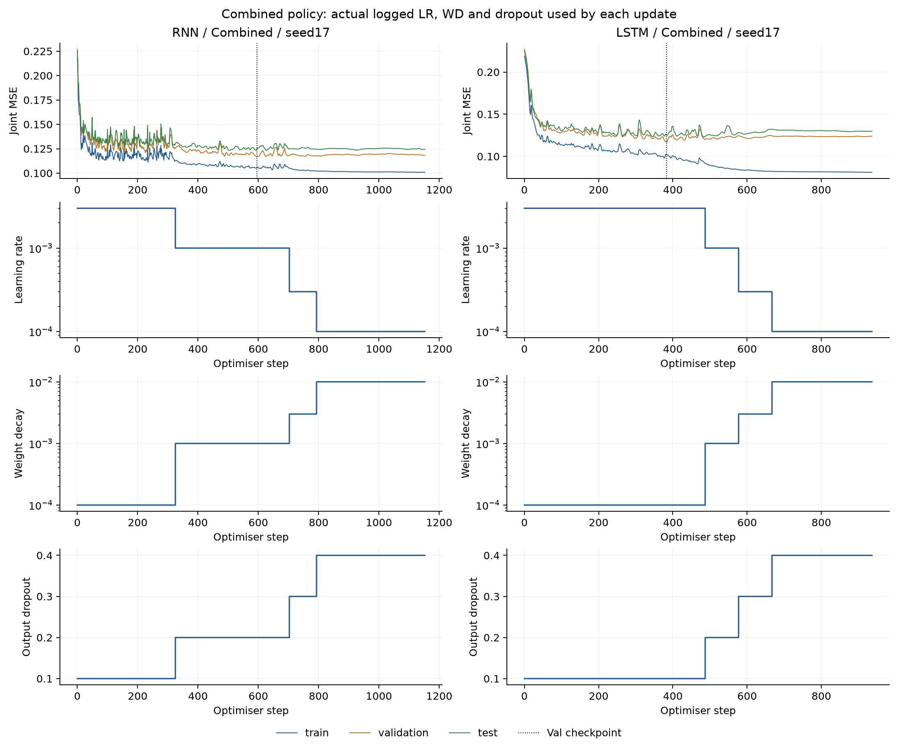

# 联合大模型：平台期学习率与正则化实验

RNN54951参数/28日窗口，LSTM54995参数/56日窗口，联合预测次日供给、需求、电价。输入8维、数据与train-only scaler完全沿用；train2022–24、val2025Jan–Aug、test2025Sep–2026Aug，样本1096/243/365。

本轮只按三种子平均综合val选策略，两家族均选fixed。调度后的test均值有约0.1%—1.5%的改善，但val未改善；不能据此反向用test选择。更平稳的训练轨迹值得保留，却没有转化为当前验证协议下的新胜出策略。

## 预先固定的四组策略

初始LR0.003、AdamW WD0.0001、输出dropout0.1。综合val连续5个完整epoch无新checkpoint改善时，最多进入3个新档位。训练从当前权重和AdamW动量继续，不回滚权重或重启优化器。

|档位|LR（lr_only/combined）|WD（reg_only/combined）|Dropout（reg_only/combined）|
|---:|---:|---:|---:|
|0|0.003|0.0001|0.1|
|1|0.001|0.001|0.2|
|2|0.0003|0.003|0.3|
|3|0.0001|0.01|0.4|

fixed三项均固定；lr_only只改LR；reg_only只改WD和dropout；combined三项同改。dropout仍只在输出头前，循环层结构不变。AdamW覆盖全部参数。综合loss不加入权重惩罚，三个分区评估均关闭dropout。日志额外记录LR×WD，以免只看名义WD忽略LR降低也会减小每次更新的直接衰减。

四组统一early-stop耐心30个完整epoch、最多120epoch。调度不重置这个全局早停时钟；最早3次调整发生于连续平台的第5/10/15个epoch，最后一档至少还有15个平台epoch可训练。旧实验耐心15，因此本轮fixed也从零重训，不将延长训练带来的变化直接归因于新策略。24次新GPU拟合（2家族×4策略×3种子），每step全量评估综合及三个分项。

## 综合loss：三种子均值与标准差

每个seed取单一综合val最优checkpoint。±是种子样本标准差，不是置信区间。

|模型|策略|Train|Val|Test|选中调整后checkpoint次数|
|---|---|---:|---:|---:|---:|
|RNN|固定策略|0.103592 ± 0.003868|0.115483 ± 0.001311|0.125326 ± 0.001882|0/3|
|RNN|仅降LR|0.105967 ± 0.004455|0.116832 ± 0.001529|0.123490 ± 0.001682|2/3|
|RNN|仅增强正则|0.105882 ± 0.003542|0.117322 ± 0.001069|0.124541 ± 0.000418|2/3|
|RNN|LR＋正则|0.105211 ± 0.004939|0.117477 ± 0.000925|0.123859 ± 0.001122|2/3|
|LSTM|固定策略|0.090820 ± 0.012573|0.116154 ± 0.000977|0.124325 ± 0.001422|0/3|
|LSTM|仅降LR|0.098360 ± 0.004457|0.116991 ± 0.000606|0.122484 ± 0.002742|0/3|
|LSTM|仅增强正则|0.090420 ± 0.013227|0.116322 ± 0.000707|0.124157 ± 0.001297|1/3|
|LSTM|LR＋正则|0.098360 ± 0.004457|0.116991 ± 0.000606|0.122484 ± 0.002742|0/3|

仅按三种子平均综合val选择策略：RNN=固定策略；LSTM=固定策略。test不参与选择。完整分项指标、逐seed变化和原始单位误差见结果文件，不从test反选一个看起来更好的策略。

## 逐step回放与实际参数变化

蓝train、橙val、绿test；黑点线是选中checkpoint，灰虚线为调度动作，数字为新档位。统一展示seed17，没有按test挑图。

## 解释边界

RNN仅降LR相对同耐心fixed的test均值降低1.46%，结合正则降低1.17%，单加正则降低0.63%；三种策略的val均值均较差。LR下降后后段尖峰明显减少，额外增强正则没有在这个试验中显示出超过仅降LR的收益。

LSTM仅降LR与结合正则的所选结果完全相同，三个seed都选中stage0，即首次平台动作前的checkpoint。它们相对新fixed30的test均值低1.48%，主要因为seed29没有继续选择fixed后期的新val低点，而不是调度后训练出了更好的checkpoint。单加正则只有一个seed选到stage3，整体val仍未胜过fixed。

一个策略最终选择的checkpoint可能在首次调度之前；此时不能把该预测结果称为增强正则化或降LR之后训练出的提升。平台动作虽按规则执行，是否形成更优checkpoint需看best_stage。固定窗口和一套预先声明的分档只是探索，不能代表各方法调参后的最优能力。

当前val/test年份存在分布差异，val更低不保证test更低。Test已在之前多轮实验中监测，不是新的盲测；三种子只检查训练随机性，不是未来年份的置信区间。

## 核验与复现

24checkpoint重放、参数/数据/划分/scaler/批次覆盖、每次平台动作、早停/选点和每step参数使用均通过。旧fixed15与新fixed30的共同前缀，以及每个新策略首次动作前与fixed的前缀逐值一致。共27,360次更新、27,384行全量评估。最大重放标准化预测差0；最大指标/日志loss差3.16e-09。

- SUMMARY.csv：三种子分区/目标均值与SD；VERSUS_MATCHED_FIXED.csv：逐seed和均值变化。
- SELECTION_BY_VALIDATION.json：只按val选出的策略；training_runs.csv记录每seed所选档位。
- ALL_STEP_LOSSES.csv、events/、PLATEAU_EVENTS.json：完整原始轨迹和调度动作。
- checkpoints/、predictions/：24组权重和三集原始单位预测。

requirements.txt与前轮相同。运行preflight.py、run.py、analyse.py可复现；bootstrap.py是一次性本地来源准备记录。旧release随reference保存。无外部特征、无MPC、未审计数据修复的历史发布版本，未上传或修改正式报告。
