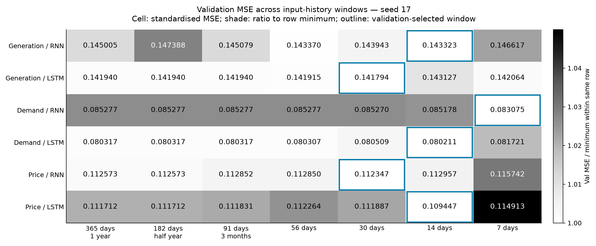
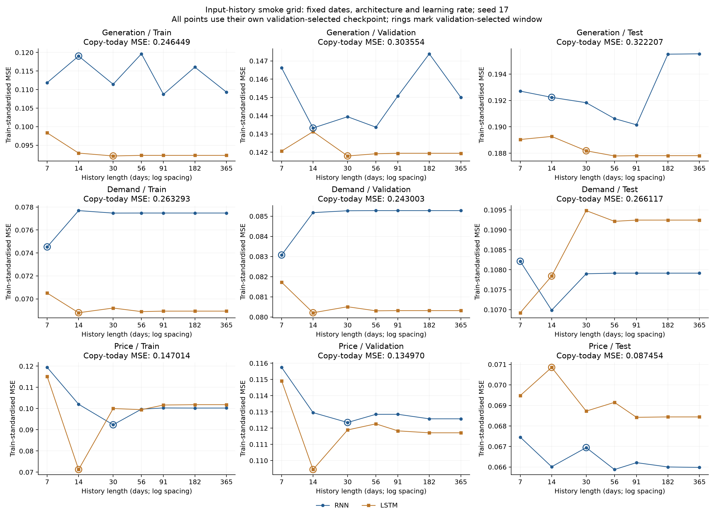
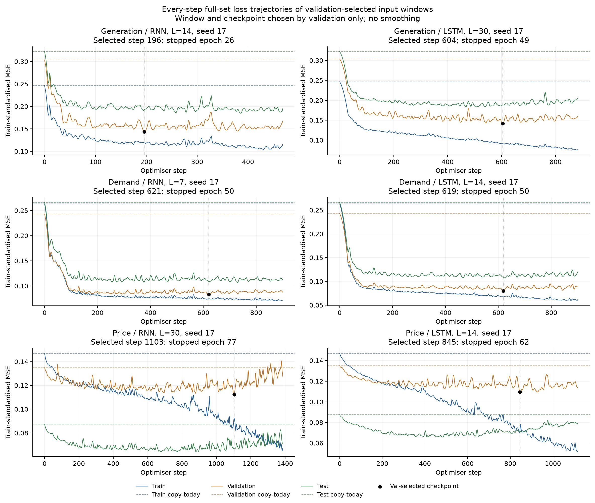
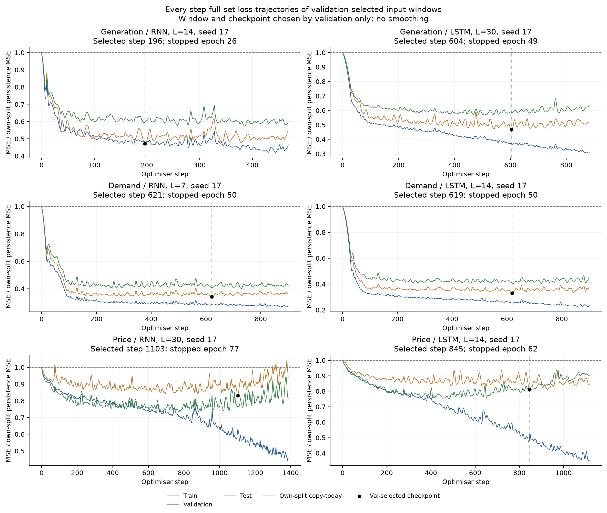

# 输入历史长度 grid smoke：独立次日 RNN/LSTM

按照用户指定的七种历史长度，分别测试供给、需求、电价的独立 RNN 与 LSTM。每个目标/模型有七个窗口，共 42 个配置。固定随机种子 17，本轮用于筛选窗口，不估计跨种子的稳定性。

## 控制变量与数据划分

窗口分别为 365、182、91、56、30、14、7 天。年、半年、三个月按固定天数解释，没有按日历月改变窗口长度。所有窗口均预测下一天，使用完全相同的训练、验证、测试目标日期。

| 分区 | 目标日期 | 样本数 |
|---|---|---:|
| Train | 2022-01-01—2024-12-31 | 1,096 |
| Val | 2025-01-01—2025-08-31 | 243 |
| Test | 2025-09-01—2026-08-31 | 365 |

补入 2021-01-01—12-31 作为历史输入，保证 365 天窗口也不减少训练目标日。2021 年不作为训练标签，不参与 scaler 拟合。三个分区共用 2022–2024 年拟合的均值和标准差。供给为课程总发电加独立风场，日均 MW；电价为名义 £/MWh。

每个模型输入窗口内的供给、需求、电价历史及五个日历特征，独立输出自己的次日目标，不共享参数。RNN 为单层 tanh，68 隐藏单元、5,373 参数；LSTM 为单层，32 隐藏单元、5,409 参数。增加窗口不增加网络参数。

| 目标 | RNN 学习率 | LSTM 学习率 |
|---|---:|---:|
| 供给 | 0.003 | 0.003 |
| 需求 | 0.001 | 0.003 |
| 电价 | 0.001 | 0.003 |

学习率沿用此前每目标/家族的配置，不随窗口重新调参。其余保持 batch size 64、18 step/epoch、AdamW、weight decay 0.0001、dropout 0.1、梯度范数截断 1、最多 120 epoch、连续 15 个完整 epoch 无 val 改善早停。

每次权重更新后完整评估 train、val、test，写入并刷新 CSV。checkpoint 只根据 val MSE 选择，改善阈值 0.00001；窗口排序同样只用最佳 val。测试曲线只记录和报告。三个已有的 56 天、seed 17 实验，经逐元素验证三个分区的 float32 输入、标签及 scaler 完全相同后，直接复用原 checkpoint 和完整日志；其余 39 个配置从头训练。

三个目标使用独立进程计算，每进程两线程；完整日志、权重和预测汇总后统一重放核验。执行记录保留在 EXECUTION.json 与 execution_logs/，不影响训练和选点规则。

## 七种窗口的 Val loss

loss 为单目标标准化 MSE，即每个样本的平均误差平方除以训练期方差。以下每个数字对应该窗口自己的 val 最优 checkpoint；加粗为该目标/家族中按 val 选中的窗口。

| 目标 | 模型 | 365 天 | 182 天 | 91 天 | 56 天 | 30 天 | 14 天 | 7 天 |
|---|---|---:|---:|---:|---:|---:|---:|---:|
| 供给 | RNN | 0.145005 | 0.147388 | 0.145079 | 0.143370 | 0.143943 | **0.143323** | 0.146617 |
| 供给 | LSTM | 0.141940 | 0.141940 | 0.141940 | 0.141915 | **0.141794** | 0.143127 | 0.142064 |
| 需求 | RNN | 0.085277 | 0.085277 | 0.085277 | 0.085277 | 0.085270 | 0.085178 | **0.083075** |
| 需求 | LSTM | 0.080317 | 0.080317 | 0.080317 | 0.080307 | 0.080509 | **0.080211** | 0.081721 |
| 电价 | RNN | 0.112573 | 0.112573 | 0.112852 | 0.112850 | **0.112347** | 0.112957 | 0.115742 |
| 电价 | LSTM | 0.111712 | 0.111712 | 0.111831 | 0.112264 | 0.111887 | **0.109447** | 0.114913 |

图中的空心圈标出 val 所选窗口在三个分区的位置。Test 面板没有另选最低点；横轴按天数对数间距显示。

## 每个目标/模型的 Val 所选窗口

以下均为单种子结果，不是三种子均值。Test 相对改善为 1 − 模型 MSE / 同分区照抄今天 MSE。

| 目标 | 模型 | 窗口/天 | Train loss | Val loss | Test loss | Test 相对照抄改善 | 最佳 step | 停止 epoch |
|---|---|---:|---:|---:|---:|---:|---:|---:|
| 供给 | RNN | 14 | 0.119036 | 0.143323 | 0.192235 | 40.34% | 196 | 26 |
| 供给 | LSTM | 30 | 0.092107 | 0.141794 | 0.188182 | 41.60% | 604 | 49 |
| 需求 | RNN | 7 | 0.074528 | 0.083075 | 0.108214 | 59.34% | 621 | 50 |
| 需求 | LSTM | 14 | 0.068790 | 0.080211 | 0.107843 | 59.48% | 619 | 50 |
| 电价 | RNN | 30 | 0.092346 | 0.112347 | 0.066947 | 23.45% | 1103 | 77 |
| 电价 | LSTM | 14 | 0.071237 | 0.109447 | 0.070854 | 18.98% | 845 | 62 |

## 相对上一轮窗口的变化

只比较同一 seed 17、同一学习率的 val 最优 checkpoint。上一轮窗口不一定在本轮候选中：28 天替换为本轮要求的 30 天，因此这里列明原窗口。此表仅供追踪窗口搜索的增益，不用 Test 选择窗口。

| 目标 | 模型 | 原窗口/天 | 原 Val loss | 本轮所选/天 | 本轮 Val loss | Val 相对变化 | Test 相对变化 |
|---|---|---:|---:|---:|---:|---:|---:|
| 供给 | RNN | 56 | 0.143370 | 14 | 0.143323 | -0.03% | +0.85% |
| 供给 | LSTM | 28 | 0.141825 | 30 | 0.141794 | -0.02% | -0.04% |
| 需求 | RNN | 56 | 0.085277 | 7 | 0.083075 | -2.58% | +0.28% |
| 需求 | LSTM | 28 | 0.080466 | 14 | 0.080211 | -0.32% | -1.62% |
| 电价 | RNN | 28 | 0.112936 | 30 | 0.112347 | -0.52% | +3.03% |
| 电价 | LSTM | 56 | 0.112264 | 14 | 0.109447 | -2.51% | +2.46% |

## 原始单位的 Test 误差

供给、需求的 RMSE/MAE 为 MW；电价为 £/MWh。

| 目标 | 方法 | 窗口/天 | Test MSE | Test RMSE | Test MAE |
|---|---|---:|---:|---:|---:|
| 供给 | 照抄今天 | 1 | 8,840,604.840 | 2,973.315 | 2,314.292 |
| 供给 | RNN | 14 | 5,274,475.858 | 2,296.623 | 1,792.425 |
| 供给 | LSTM | 30 | 5,163,273.056 | 2,272.284 | 1,774.920 |
| 需求 | 照抄今天 | 1 | 4,264,900.241 | 2,065.163 | 1,603.189 |
| 需求 | RNN | 7 | 1,734,276.521 | 1,316.919 | 1,007.465 |
| 需求 | LSTM | 14 | 1,728,343.298 | 1,314.665 | 1,015.936 |
| 电价 | 照抄今天 | 1 | 558.243 | 23.627 | 16.673 |
| 电价 | RNN | 30 | 427.339 | 20.672 | 15.327 |
| 电价 | LSTM | 14 | 452.281 | 21.267 | 15.883 |

## 全部配置的 Train / Val / Test loss

| 目标 | 模型 | 窗口/天 | Train | Val | Test | 最佳 epoch | 停止 epoch |
|---|---|---:|---:|---:|---:|---:|---:|
| 供给 | RNN | 365 | 0.109325 | 0.145005 | 0.195537 | 23 | 38 |
| 供给 | RNN | 182 | 0.116046 | 0.147388 | 0.195510 | 11 | 26 |
| 供给 | RNN | 91 | 0.108716 | 0.145079 | 0.190152 | 22 | 37 |
| 供给 | RNN | 56 | 0.119637 | 0.143370 | 0.190624 | 12 | 27 |
| 供给 | RNN | 30 | 0.111436 | 0.143943 | 0.191829 | 23 | 38 |
| 供给 | RNN | 14 | 0.119036 | 0.143323 | 0.192235 | 11 | 26 |
| 供给 | RNN | 7 | 0.111874 | 0.146617 | 0.192707 | 12 | 27 |
| 供给 | LSTM | 365 | 0.092264 | 0.141940 | 0.187811 | 34 | 49 |
| 供给 | LSTM | 182 | 0.092264 | 0.141940 | 0.187811 | 34 | 49 |
| 供给 | LSTM | 91 | 0.092264 | 0.141940 | 0.187811 | 34 | 49 |
| 供给 | LSTM | 56 | 0.092267 | 0.141915 | 0.187789 | 34 | 49 |
| 供给 | LSTM | 30 | 0.092107 | 0.141794 | 0.188182 | 34 | 49 |
| 供给 | LSTM | 14 | 0.092878 | 0.143127 | 0.189271 | 34 | 49 |
| 供给 | LSTM | 7 | 0.098332 | 0.142064 | 0.189038 | 31 | 46 |
| 需求 | RNN | 365 | 0.077479 | 0.085277 | 0.107916 | 17 | 32 |
| 需求 | RNN | 182 | 0.077479 | 0.085277 | 0.107916 | 17 | 32 |
| 需求 | RNN | 91 | 0.077479 | 0.085277 | 0.107916 | 17 | 32 |
| 需求 | RNN | 56 | 0.077479 | 0.085277 | 0.107916 | 17 | 32 |
| 需求 | RNN | 30 | 0.077474 | 0.085270 | 0.107901 | 17 | 32 |
| 需求 | RNN | 14 | 0.077690 | 0.085178 | 0.106988 | 17 | 32 |
| 需求 | RNN | 7 | 0.074528 | 0.083075 | 0.108214 | 35 | 50 |
| 需求 | LSTM | 365 | 0.068933 | 0.080317 | 0.109245 | 35 | 50 |
| 需求 | LSTM | 182 | 0.068933 | 0.080317 | 0.109245 | 35 | 50 |
| 需求 | LSTM | 91 | 0.068932 | 0.080317 | 0.109245 | 35 | 50 |
| 需求 | LSTM | 56 | 0.068889 | 0.080307 | 0.109214 | 35 | 50 |
| 需求 | LSTM | 30 | 0.069201 | 0.080509 | 0.109483 | 35 | 50 |
| 需求 | LSTM | 14 | 0.068790 | 0.080211 | 0.107843 | 35 | 50 |
| 需求 | LSTM | 7 | 0.070505 | 0.081721 | 0.106924 | 35 | 50 |
| 电价 | RNN | 365 | 0.100240 | 0.112573 | 0.065981 | 51 | 66 |
| 电价 | RNN | 182 | 0.100229 | 0.112573 | 0.066003 | 51 | 66 |
| 电价 | RNN | 91 | 0.100286 | 0.112852 | 0.066214 | 51 | 66 |
| 电价 | RNN | 56 | 0.099717 | 0.112850 | 0.065877 | 51 | 66 |
| 电价 | RNN | 30 | 0.092346 | 0.112347 | 0.066947 | 62 | 77 |
| 电价 | RNN | 14 | 0.102033 | 0.112957 | 0.066013 | 42 | 57 |
| 电价 | RNN | 7 | 0.119405 | 0.115742 | 0.067456 | 13 | 28 |
| 电价 | LSTM | 365 | 0.101823 | 0.111712 | 0.068442 | 28 | 43 |
| 电价 | LSTM | 182 | 0.101824 | 0.111712 | 0.068442 | 28 | 43 |
| 电价 | LSTM | 91 | 0.101661 | 0.111831 | 0.068422 | 28 | 43 |
| 电价 | LSTM | 56 | 0.099470 | 0.112264 | 0.069151 | 28 | 43 |
| 电价 | LSTM | 30 | 0.100016 | 0.111887 | 0.068724 | 28 | 43 |
| 电价 | LSTM | 14 | 0.071237 | 0.109447 | 0.070854 | 47 | 62 |
| 电价 | LSTM | 7 | 0.115119 | 0.114913 | 0.069482 | 18 | 33 |

## 解释与下一步

六组按 val 选出的窗口均为 7–30 天，没有半年或一年窗口胜出。供给两组相对原窗口的 val 改善都不足 0.04%，基本持平。需求 RNN 的 7 天和电价 LSTM 的 14 天分别降低 val 约 2.58% 和 2.51%，是这轮较明显的验证集变化。

相对原来同一 seed 17 的配置，六组中只有 2 组的 test MSE 下降。需求 RNN 的 7 天 val 更低，test 却增加约 0.28%；电价 LSTM 的 14 天 val 更低，test 增加约 2.46%。窗口搜索降低 val 最小值，不保证外推到后一年的误差也下降。本轮结果适合作为多种子复核的候选，不能仅凭这一次排序认定换窗口已经提高泛化表现。表中正的 Test 变化表示误差增加。

365 天窗口的 val loss 在六组中有 5 组低于 7 天窗口。应结合全部七个点判断长历史是否带来稳定趋势；单次最小值仅作为候选。延长输入意味着模型可以看到更远的过去，不等于已经证明网络有效利用了全年规律。窗口、网络家族和学习率之间仍可能有交互，本轮固定学习率，未进行联合搜索。

所选窗口需要多种子复核，特别是差距小的情况。本轮 test 沿用用户要求的逐 step 监测方式，已在前几轮查看，不是新的盲测；后续若据这些 test 结果改模型，应将它视为开发过程中反复查看的数据。所有 checkpoint、早停和本轮窗口选择均只用 val。预测对 MPC 经济收益的影响本轮尚未计算。

## 文件、复现与审计

42 个配置（39 次新拟合、3 次严格等价复用）；累计 33,966 次更新记录，其中本轮新训练 32,130 次。含初始 step 0 共 34,008 行评估、102,024 个完整分区平均 loss。代码与数据哈希、固定日期与 scaler、逐 step 完整性、批次计数、仅 val 选点、早停、复用原件哈希及全部 42 个 checkpoint 重放均通过。预测重放最大差 0，标准化 loss 独立复算最大差 2.2e-08。

- results/GRID_METRICS.csv：全部配置的三分区 MSE/RMSE/MAE。
- results/VALIDATION_RANKING.csv、SELECTION_FROZEN.json：按 val 排序和冻结的窗口选择。
- results/SELECTED_SUMMARY.csv：所选六组的完整指标；PERSISTENCE.csv 为照抄基准。
- step_logs/ 与 results/ALL_STEP_LOSSES.csv：每 step 完整 train/val/test 日志。
- checkpoints/、predictions/：42 个最佳 val 权重和三分区预测。
- inputs/、splits.csv、scalers.json、PROTOCOL.json、REUSE_EQUIVALENCE.json：数据、边界、配置与复用验证。

安装 requirements.txt 后，在副本中运行 python reproduce.py，可使用包内 reference_previous 复用三组严格等价的实验并从头完成其余训练和分析。若只检查已有产物，运行 python analyse_grid.py；原文件夹不在时自动使用包内参考文件。完整数据、所有 checkpoint、日志和预测已随本包保存。事后修复历史的逐日发布版本尚未审计。实验保留在本地，未修改正式候选报告或上传仓库。
