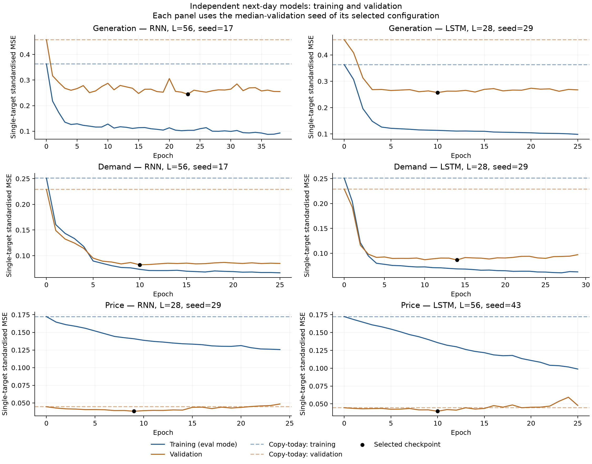
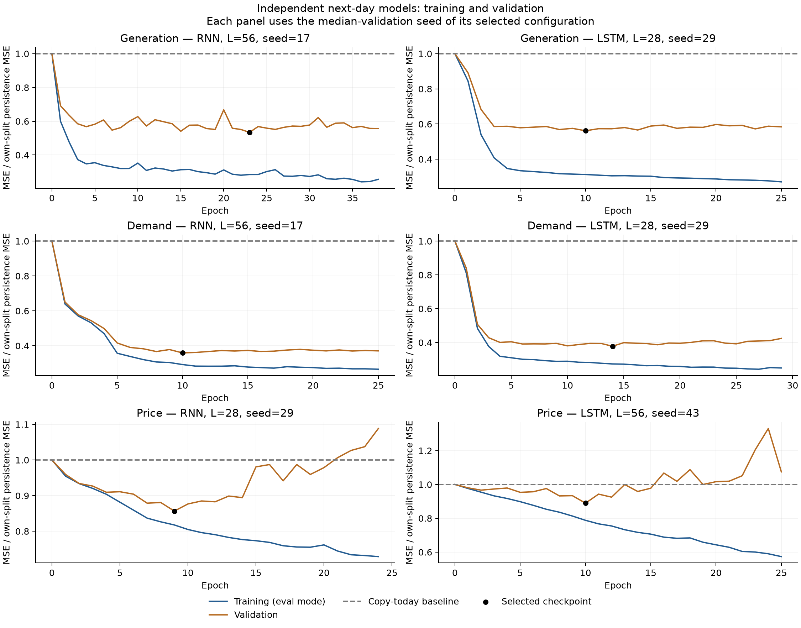

# 独立单目标 RNN/LSTM：次日预测与过拟合检查

供给、需求、电价分别训练独立网络；每个目标分别有 RNN 与 LSTM，不共享参数，loss 只包含自己的次日 MSE。输入仍保留三条历史序列与五个日历特征，因此本轮是独立目标训练，不是纯单变量输入试验。

训练目标日期 2020–2022 年，1,040 个预测样本；验证目标日期 2023 年，365 个样本。本轮未使用 2024 年后的目标。训练期标准化参数用于两个分区。总供给含独立风场，电价为名义 £/MWh。

## 配置

RNN 为单层 tanh、68 隐藏单元、每模型 5,373 参数；LSTM 为单层、32 隐藏单元、每模型 5,409 参数。输出为相对当日值的次日变化。每目标×每家族分别比较两个窗口、两个学习率、三个随机种子，共 72 次训练。

train/val loss 均由同一检查点在 eval 模式下计算，不包含 dropout 或额外权重惩罚。每个分区的照抄基准在相同预测起点上计算。验证集参与早停和选配置，不是新的独立测试集。

| 目标 | 模型 | 窗口 | 学习率 |
|---|---|---:|---:|
| 供给 | RNN | 56 | 0.003 |
| 供给 | LSTM | 28 | 0.003 |
| 需求 | RNN | 56 | 0.001 |
| 需求 | LSTM | 28 | 0.003 |
| 电价 | RNN | 28 | 0.001 |
| 电价 | LSTM | 56 | 0.003 |

## 每个目标的 train / val loss

loss 为相应目标用训练期标准差归一化后的 MSE，三个目标不再合并。± 是随机种子标准差，非置信区间。结果是各种子最佳验证检查点的指标均值，不是三模型集成。

| 目标 | 模型 | Train loss | Val loss | 相对照抄的验证误差降幅 |
|---|---|---:|---:|---:|
| 供给 | Persistence | 0.363113 | 0.457790 | 0.00% |
| 供给 | RNN | 0.112168 ± 0.010064 | 0.244418 ± 0.002511 | 46.61% |
| 供给 | LSTM | 0.108545 ± 0.013519 | 0.253947 ± 0.006057 | 44.53% |
| 需求 | Persistence | 0.250953 | 0.228921 | 0.00% |
| 需求 | RNN | 0.074465 ± 0.001428 | 0.081842 ± 0.000690 | 64.25% |
| 需求 | LSTM | 0.067257 ± 0.003946 | 0.086527 ± 0.000248 | 62.20% |
| 电价 | Persistence | 0.172330 | 0.044562 | 0.00% |
| 电价 | RNN | 0.142748 ± 0.004347 | 0.038269 ± 0.000512 | 14.12% |
| 电价 | LSTM | 0.133789 ± 0.003355 | 0.039742 ± 0.000568 | 10.82% |

## 过拟合诊断

每一组均保留了完整 epoch 曲线。下表比较验证最优检查点和早停前最后一个 epoch，检查后续训练是否仍降低 train loss、同时抬高 val loss。

| 目标 | 模型 | 最优处 train | 最优处 val | 最后 train | 最后 val | val 回升 |
|---|---|---:|---:|---:|---:|---:|
| 供给 | RNN | 0.112168 | 0.244418 | 0.101127 | 0.261359 | 6.93% |
| 供给 | LSTM | 0.108545 | 0.253947 | 0.095643 | 0.263543 | 3.78% |
| 需求 | RNN | 0.074465 | 0.081842 | 0.067881 | 0.084378 | 3.10% |
| 需求 | LSTM | 0.067257 | 0.086527 | 0.059985 | 0.097997 | 13.26% |
| 电价 | RNN | 0.142748 | 0.038269 | 0.126181 | 0.048951 | 27.91% |
| 电价 | LSTM | 0.133789 | 0.039742 | 0.097636 | 0.046954 | 18.15% |

所选六组配置的种子平均均出现：最佳验证点之后 train loss 继续降低，而 val loss 回升。这符合继续训练后过拟合的典型形态，支持保留验证早停检查点。电价最明显：RNN 平均 val loss 从 0.038269 回升到 0.048951，LSTM 从 0.039742 回升到 0.046954，最后都高于照抄基准 0.044562。

不同年份的基础波动不同，不能仅凭 train loss 大于或小于 val loss 判断过拟合。特别是电价，应同时看曲线和各分区照抄基准。下图将每个分区 loss 除以本分区照抄 loss，辅助比较相对预测能力。

## 原始单位 MSE

供给和需求单位为 MW²；电价为 (£/MWh)²。

| 目标 | 模型 | Train MSE | Val MSE | Val RMSE |
|---|---|---:|---:|---:|
| 供给 | Persistence | 5,021,041.641 | 6,330,208.256 | 2,515.991 |
| 供给 | RNN | 1,551,038.804 | 3,379,746.321 | 1,838.392 |
| 供给 | LSTM | 1,500,927.630 | 3,511,521.469 | 1,873.816 |
| 需求 | Persistence | 4,192,096.359 | 3,824,052.852 | 1,955.519 |
| 需求 | RNN | 1,243,922.459 | 1,367,147.951 | 1,169.244 |
| 需求 | LSTM | 1,123,511.117 | 1,445,403.594 | 1,202.249 |
| 电价 | Persistence | 1,551.437 | 401.177 | 20.029 |
| 电价 | RNN | 1,285.120 | 344.524 | 18.561 |
| 电价 | LSTM | 1,204.467 | 357.788 | 18.915 |

## 与此前联合训练的参考对照

只作开发集参考：三个独立模型的总参数量约为一个联合模型的三倍，因此不能把差异完全解释成消除了任务干扰。两组使用相同输入、目标日期及每家族调参范围。

| 目标 | 模型 | 联合 val loss | 独立 val loss | 独立相对变化 |
|---|---|---:|---:|---:|
| 供给 | RNN | 0.242238 | 0.244418 | 0.90% |
| 供给 | LSTM | 0.252323 | 0.253947 | 0.64% |
| 需求 | RNN | 0.088139 | 0.081842 | -7.14% |
| 需求 | LSTM | 0.094708 | 0.086527 | -8.64% |
| 电价 | RNN | 0.042816 | 0.038269 | -10.62% |
| 电价 | LSTM | 0.045347 | 0.039742 | -12.36% |

## 文件与边界

run_independent.py 训练与导出；summarise_independent.py 重放检查点、独立复算 loss 和绘图。PROTOCOL.json、splits.csv、scalers.json 固定协议；results/LOSS_COMPARISON.csv 和 OVERFIT_DIAGNOSTICS.csv 保存详细结果，checkpoints 包含全部模型。

数据为当前冻结的事后修复历史，尚未重建逐日发布版本；没有新增外部特征、Ridge、合同罚则或 MPC 收益计算。此前联合模型与七日试验均保留，未覆盖或上传。
