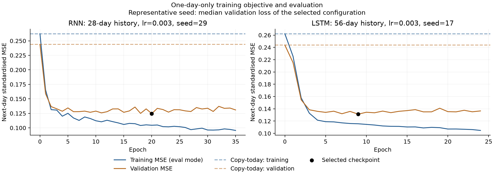

# 次日 RNN/LSTM：训练、验证与照抄基准

只训练 RNN 和 LSTM；不拟合 Ridge。本轮每个样本只预测次日的总供给、需求、电价三个值。目标中没有未来第 2–7 天。2024 年以后的数据未在本轮评估。

## 数据与目标

训练目标日期 2020–2022 年，验证目标日期 2023 年。共 1,040 个训练样本和 365 个验证样本，均有完整历史窗口。输入保持三条序列与五个日历特征；总供给包含独立风场，电价单位为名义 £/MWh。

损失是三个目标使用训练集均值/标准差标准化后的次日 MSE 等权均值。两个分区使用同一套训练期标准差。AdamW 的 weight decay 为训练规则的一部分，不另加进展示的 MSE。展示 train loss 和 val loss 时均关闭 dropout，使用同一模型权重和完全相同的计算公式。

照抄基准为次日预测等于当日观测。它不训练，但在完全相同的预测起点和目标上计算同样的 MSE。神经模型以当日值加预测变化作读出；初始零读出等于照抄基准，并在 epoch 0 验证。

## 配置与选型

单层 tanh RNN 隐藏宽度 68，5,511 参数；单层 LSTM 宽度 32，5,475 参数。缩短输出跨度后重新匹配参数规模。每种模型比较 28/56 日窗口、0.001/0.003 学习率和三个随机种子，共 24 次拟合。验证平均 loss 决定配置，每个种子保存最低验证 loss 检查点。

| 模型 | 选中窗口 | 学习率 |
|---|---:|---:|
| RNN | 28 | 0.003 |
| LSTM | 56 | 0.003 |

## 综合 loss

以下为三个种子的指标均值 ± 种子标准差，不是统计置信区间；展示的是各自最佳验证检查点的训练/验证 loss，没有将集成预测当成单模型。

| 模型 | Train loss | Val loss | 相对照抄基准的验证 MSE 降幅 |
|---|---:|---:|---:|
| Persistence | 0.262132 | 0.243757 | 0.00% |
| RNN | 0.112511 ± 0.006942 | 0.124398 ± 0.001902 | 48.97% |
| LSTM | 0.108880 ± 0.010625 | 0.130792 ± 0.001358 | 46.34% |

## 各变量的标准化 MSE

| 变量 | 分区 | 照抄 | RNN | LSTM |
|---|---|---:|---:|---:|
| generation_MW | train | 0.363113 | 0.118640 | 0.111448 |
| generation_MW | validation | 0.457790 | 0.242238 | 0.252323 |
| demand_MW | train | 0.250953 | 0.073732 | 0.071099 |
| demand_MW | validation | 0.228921 | 0.088139 | 0.094708 |
| price_GBP_MWh | train | 0.172330 | 0.145160 | 0.144094 |
| price_GBP_MWh | validation | 0.044562 | 0.042816 | 0.045347 |

## 电价的原始单位 MSE

MSE 单位为 (£/MWh)²，开平方得到 RMSE。

| 模型 | 训练电价 MSE | 验证电价 MSE |
|---|---:|---:|
| Persistence | 1551.437 | 401.177 |
| RNN | 1306.835 | 385.458 |
| LSTM | 1297.239 | 408.243 |

## 解释与复现

这些是用于早停和选型的验证结果，不是新的独立测试结果。不同年份的波动水平不同，train/val 的高低同时受行情影响，应结合各分区照抄基准判断。当前数据是事后修复历史，尚未完成逐日发布版本审计；没有新增外部特征或合同罚则，也没有计算 MPC 收益。

run_nextday.py 完成数据划分、训练和导出；summarise_nextday.py 独立复算 loss、重放检查点并生成图表。本轮使用前一试验的隔离 PyTorch 环境，依赖见 requirements.txt。原七日试验未改动。

Ridge 即岭回归，是带 L2 正则化的线性预测模型；拟合它可以调用线性方程求解方法。RNN/LSTM 则通过 AdamW 拟合。Xpress 是后续能源调度求解器。这些角色不同。
