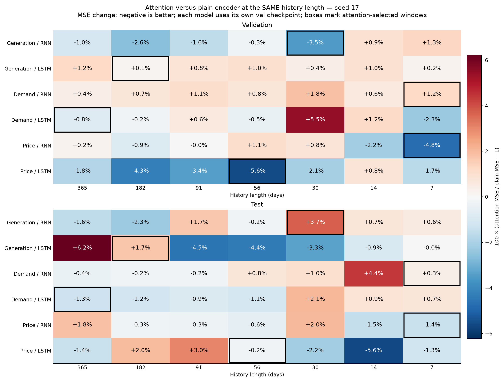
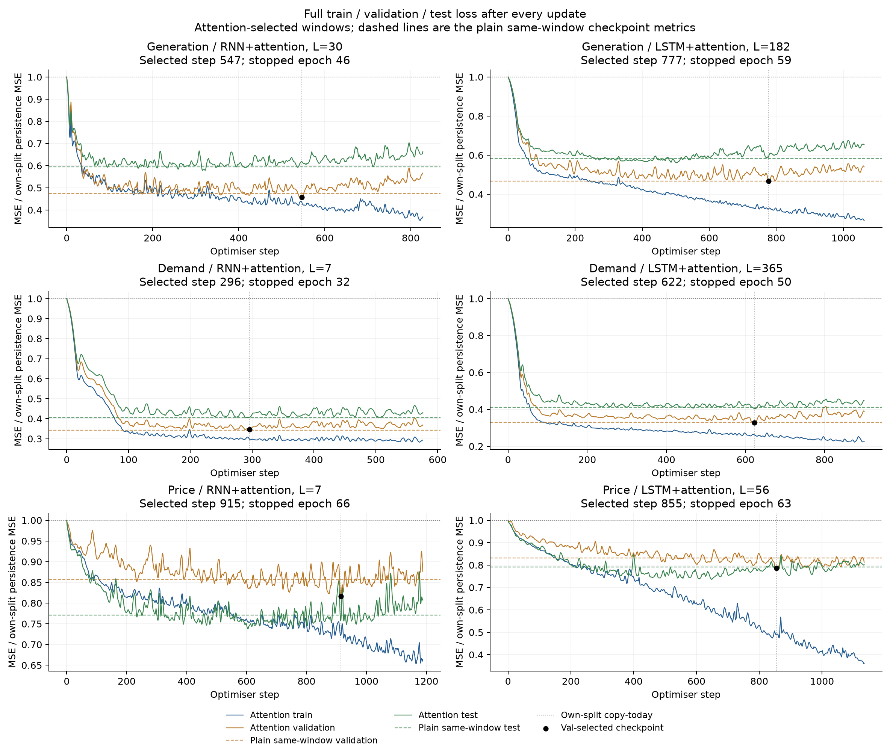
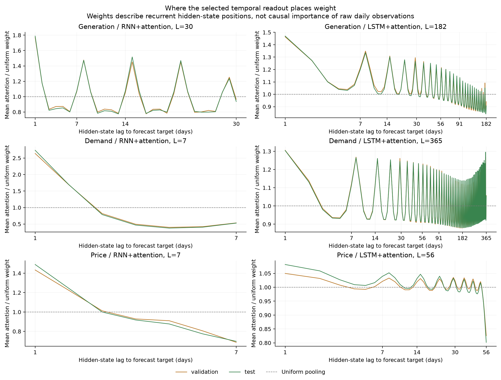

# RNN/LSTM 加入时间注意力：七窗口对照

供给、需求、电价分别训练独立的 RNN+attention 和 LSTM+attention，固定 seed 17，七个历史窗口，共 42 次新拟合。与冻结的普通模型比较：相同窗口下，val MSE 在 19/42 个配置中降低，test 在 25/42 个配置中降低。两种架构各自按 val 选窗口后，六组中 4 组 val 更低，3 组 test 更低。以下均为单种子实验，42 个窗口配置不是 42 个独立随机重复。

## 机制与参数量

普通模型用最后一个循环隐藏状态输出预测。本轮保留这个通道，同时让最后状态查询窗口内各天的隐藏状态，得到加权上下文，再一起输出次日变化。模型输入仍为历史供给、需求、电价和日历特征；循环层及隐藏维度不变。

设窗口为第 $t-L+1$ 天至第 $t$ 天，编码器输出为 $h_i\in\mathbb R^H$。最后状态 $h_t$ 是 query（查询向量），各位置状态是 key/value（用于打分和汇总的向量）：

$$
s_i=\frac{h_i^\top h_t}{\sqrt H},\qquad \alpha_i=\frac{\exp(s_i)}{\sum_{j=t-L+1}^{t}\exp(s_j)},\qquad r_t=\sum_{i=t-L+1}^{t}\alpha_i h_i.
$$

以训练期标准化后的目标 $z_t$ 为持续值基准，输出层的权重和偏置分别为 $w$、$b$：

$$
\widehat z_{t+1}=z_t+w^\top[h_t;r_t]+b.
$$

采用单查询 scaled dot-product attention（缩放点积注意力），没有单独的 Q/K/V 投影矩阵；打分依赖循环层学到的表示，梯度可沿加权汇总直接传到较早位置。注意力权重随输入变化，整个模型端到端训练。注意力计算为 $O(LH)$，没有 $L\times L$ 的自注意力矩阵。

| 家族 | 隐藏维度 | 普通模型参数 | 加注意力后参数 | 增加 |
|---|---:|---:|---:|---:|
| RNN | 68 | 5,373 | 5,441 | 68（1.27%） |
| LSTM | 32 | 5,409 | 5,441 | 32（0.59%） |

增加的参数来自输出层新增的上下文通道。两个模型的规模仍约为 5.4k。初始循环层权重与对应普通模型在同一种子下逐元素一致；输出层初始化为零，所以 step 0 都等于照抄今天。

## 数据、训练和选择规则

| 分区 | 预测目标日期 | 样本数 |
|---|---|---:|
| Train | 2022-01-01—2024-12-31 | 1,096 |
| Val | 2025-01-01—2025-08-31 | 243 |
| Test | 2025-09-01—2026-08-31 | 365 |

窗口为 365、182、91、56、30、14、7 天。2021 年仅提供历史输入，所有窗口训练目标日期一致；scaler 只拟合 2022–2024 年。冻结输入和普通模型完全相同，总供给包含独立风场，电价为名义 £/MWh。

固定上一轮目标/家族的学习率：供给 RNN/LSTM 0.003/0.003，需求 0.001/0.003，电价 0.001/0.003。每模型独立训练，batch64、18 step/epoch；AdamW、weight decay 0.0001、dropout 0.1、梯度范数截断 1。最多 120 epoch，连续 15 个完整 epoch 无 val 改善则停止。

每次更新后关闭 dropout，完整评估 train、val、test 并刷新 CSV。checkpoint 只用 val MSE，最小改善阈值 0.00001；各家族的窗口也只按 val 选择。Test 只记录和报告。本轮 test 已在多轮开发中监测，不是新的盲测。三个目标在独立 CPU 进程计算，每进程两线程。

## 相同窗口下的注意力增量

下图比较相同目标、模型家族和历史长度，双方各自使用 val 最优 checkpoint。数值为 100 ×（注意力 MSE / 普通模型 MSE − 1）：负值表示注意力误差更低。方框仅标出注意力架构按 val 选中的窗口，在 test 面板沿用同一选择。

## 双方各自选窗口后的比较

以下按各自七窗口搜索的 val 最优结果比较。Loss 是单目标、每样本平均的标准化 MSE；三个分区使用相同训练期标准差。

| 目标 | 家族 | 普通窗口 | 注意力窗口 | 普通 Val | 注意力 Val | Val 变化 | 普通 Test | 注意力 Test | Test 变化 |
|---|---|---:|---:|---:|---:|---:|---:|---:|---:|
| 供给 | RNN | 14 | 30 | 0.143323 | 0.138853 | -3.12% | 0.192235 | 0.199001 | +3.52% |
| 供给 | LSTM | 30 | 182 | 0.141794 | 0.142151 | +0.25% | 0.188182 | 0.191032 | +1.51% |
| 需求 | RNN | 7 | 7 | 0.083075 | 0.084106 | +1.24% | 0.108214 | 0.108585 | +0.34% |
| 需求 | LSTM | 14 | 365 | 0.080211 | 0.079665 | -0.68% | 0.107843 | 0.107827 | -0.01% |
| 电价 | RNN | 30 | 7 | 0.112347 | 0.110242 | -1.87% | 0.066947 | 0.066537 | -0.61% |
| 电价 | LSTM | 14 | 56 | 0.109447 | 0.106026 | -3.13% | 0.070854 | 0.069009 | -2.60% |

| 目标 | 家族 | 注意力 Train | 注意力 Val | 注意力 Test | Test 相对照抄改善 | 最佳 step | 停止 epoch |
|---|---|---:|---:|---:|---:|---:|---:|
| 供给 | RNN | 0.106642 | 0.138853 | 0.199001 | 38.24% | 547 | 46 |
| 供给 | LSTM | 0.080087 | 0.142151 | 0.191032 | 40.71% | 777 | 59 |
| 需求 | RNN | 0.078196 | 0.084106 | 0.108585 | 59.20% | 296 | 32 |
| 需求 | LSTM | 0.069218 | 0.079665 | 0.107827 | 59.48% | 622 | 50 |
| 电价 | RNN | 0.106334 | 0.110242 | 0.066537 | 23.92% | 915 | 66 |
| 电价 | LSTM | 0.072167 | 0.106026 | 0.069009 | 21.09% | 855 | 63 |

六组注意力模型中，2 组选中至少 91 天的窗口。注意力是否改善泛化，需要同时查看相同窗口的配对结果和各自选窗口后的 test；增加早期状态的读取通道不自动保证长历史有益。

本轮的主要变化集中在电价。双方各自按 val 选窗后，电价 RNN 的 val/test MSE 分别下降约 1.87%/0.61%，电价 LSTM 下降约 3.13%/2.60%；供给两组的 test 反而增加。需求 LSTM 的 test 仅下降约 0.015%，可视为基本持平。它们是本轮单种子的观察，不能据此把六组都替换为注意力模型。

曲线为完整分区的逐 step 平均 loss，分别除以该分区照抄今天的 MSE；1 表示照抄水平。虚线给出普通模型在相同窗口下的 val 最优 checkpoint 的 val/test 水平，不是普通模型的完整训练曲线。

## 注意力读取方式诊断

对已训练、已按 val 选定的 checkpoint 保持所有参数不变，只在推理时将动态权重替换为均匀权重，或只读取最后一个状态。它检验当前权重对聚合方式的依赖，没有重新训练，不能把它当成另一种架构的公平训练结果。也未用这些诊断重新选择模型。

| 目标 | 家族 | 窗口 | 均匀读取 Val 变化 | 均匀读取 Test 变化 | 仅末状态 Val 变化 | 仅末状态 Test 变化 |
|---|---|---:|---:|---:|---:|---:|
| 供给 | RNN | 30 | -0.69% | +0.13% | +22.05% | +14.19% |
| 供给 | LSTM | 182 | +0.16% | +0.15% | +2.17% | +0.67% |
| 需求 | RNN | 7 | +6.63% | +5.85% | +9.03% | +3.47% |
| 需求 | LSTM | 365 | -0.07% | +0.05% | +7.30% | +2.87% |
| 电价 | RNN | 7 | +1.34% | +0.24% | +8.63% | +8.58% |
| 电价 | LSTM | 56 | -0.12% | +0.10% | +4.18% | +1.14% |

正值表示替换读取方式后误差增加；负值表示该固定 checkpoint 在替换后误差反而下降。

所选电价 LSTM 改用均匀权重后 test MSE 仅增加约 0.10%，说明这个已训练模型的预测对细致权重分配并不敏感。相对地，需求 RNN 改用均匀权重后 test MSE 增加约 5.85%，表明它对动态分配更敏感，尽管它仍未超过普通 RNN。注意力参与预测与注意力提高泛化表现是两个需要分别检验的问题。

横轴是隐藏状态位置距预测目标日的天数，1 表示最后已知日。纵轴为该位置平均权重除以均匀权重；1 表示等于均匀分配。循环隐藏状态本身包含其此前的信息，因此这张图不能直接解释为原始某一天的因果贡献。逐样本 val/test 权重保存在 selected_attention/。

## 全部窗口的三分区误差

| 目标 | 家族 | 历史/天 | Train | Val | Test | 同窗 Val 变化 | 同窗 Test 变化 |
|---|---|---:|---:|---:|---:|---:|---:|
| 供给 | RNN | 365 | 0.104831 | 0.143525 | 0.192472 | -1.02% | -1.57% |
| 供给 | RNN | 182 | 0.108022 | 0.143551 | 0.191065 | -2.60% | -2.27% |
| 供给 | RNN | 91 | 0.107350 | 0.142823 | 0.193332 | -1.56% | +1.67% |
| 供给 | RNN | 56 | 0.109229 | 0.143010 | 0.190176 | -0.25% | -0.23% |
| 供给 | RNN | 30 | 0.106642 | 0.138853 | 0.199001 | -3.54% | +3.74% |
| 供给 | RNN | 14 | 0.116675 | 0.144676 | 0.193649 | +0.94% | +0.74% |
| 供给 | RNN | 7 | 0.111739 | 0.148511 | 0.193828 | +1.29% | +0.58% |
| 供给 | LSTM | 365 | 0.093471 | 0.143664 | 0.199492 | +1.22% | +6.22% |
| 供给 | LSTM | 182 | 0.080087 | 0.142151 | 0.191032 | +0.15% | +1.71% |
| 供给 | LSTM | 91 | 0.099424 | 0.143125 | 0.179293 | +0.83% | -4.54% |
| 供给 | LSTM | 56 | 0.100059 | 0.143358 | 0.179495 | +1.02% | -4.42% |
| 供给 | LSTM | 30 | 0.099155 | 0.142380 | 0.181912 | +0.41% | -3.33% |
| 供给 | LSTM | 14 | 0.096273 | 0.144504 | 0.187495 | +0.96% | -0.94% |
| 供给 | LSTM | 7 | 0.098276 | 0.142365 | 0.188954 | +0.21% | -0.04% |
| 需求 | RNN | 365 | 0.077317 | 0.085636 | 0.107451 | +0.42% | -0.43% |
| 需求 | RNN | 182 | 0.077351 | 0.085901 | 0.107694 | +0.73% | -0.21% |
| 需求 | RNN | 91 | 0.077547 | 0.086210 | 0.107699 | +1.09% | -0.20% |
| 需求 | RNN | 56 | 0.074701 | 0.085933 | 0.108730 | +0.77% | +0.75% |
| 需求 | RNN | 30 | 0.078539 | 0.086806 | 0.108965 | +1.80% | +0.99% |
| 需求 | RNN | 14 | 0.081347 | 0.085693 | 0.111685 | +0.61% | +4.39% |
| 需求 | RNN | 7 | 0.078196 | 0.084106 | 0.108585 | +1.24% | +0.34% |
| 需求 | LSTM | 365 | 0.069218 | 0.079665 | 0.107827 | -0.81% | -1.30% |
| 需求 | LSTM | 182 | 0.069927 | 0.080132 | 0.107942 | -0.23% | -1.19% |
| 需求 | LSTM | 91 | 0.069638 | 0.080821 | 0.108264 | +0.63% | -0.90% |
| 需求 | LSTM | 56 | 0.069916 | 0.079944 | 0.108024 | -0.45% | -1.09% |
| 需求 | LSTM | 30 | 0.072858 | 0.084903 | 0.111729 | +5.46% | +2.05% |
| 需求 | LSTM | 14 | 0.067972 | 0.081163 | 0.108782 | +1.19% | +0.87% |
| 需求 | LSTM | 7 | 0.071348 | 0.079835 | 0.107722 | -2.31% | +0.75% |
| 电价 | RNN | 365 | 0.111071 | 0.112843 | 0.067189 | +0.24% | +1.83% |
| 电价 | RNN | 182 | 0.094100 | 0.111603 | 0.065833 | -0.86% | -0.26% |
| 电价 | RNN | 91 | 0.109953 | 0.112806 | 0.066004 | -0.04% | -0.32% |
| 电价 | RNN | 56 | 0.109671 | 0.114104 | 0.065477 | +1.11% | -0.61% |
| 电价 | RNN | 30 | 0.112033 | 0.113227 | 0.068307 | +0.78% | +2.03% |
| 电价 | RNN | 14 | 0.090519 | 0.110526 | 0.065045 | -2.15% | -1.47% |
| 电价 | RNN | 7 | 0.106334 | 0.110242 | 0.066537 | -4.75% | -1.36% |
| 电价 | LSTM | 365 | 0.091960 | 0.109668 | 0.067478 | -1.83% | -1.41% |
| 电价 | LSTM | 182 | 0.080669 | 0.106955 | 0.069776 | -4.26% | +1.95% |
| 电价 | LSTM | 91 | 0.067351 | 0.107989 | 0.070506 | -3.44% | +3.05% |
| 电价 | LSTM | 56 | 0.072167 | 0.106026 | 0.069009 | -5.56% | -0.21% |
| 电价 | LSTM | 30 | 0.098848 | 0.109550 | 0.067245 | -2.09% | -2.15% |
| 电价 | LSTM | 14 | 0.105114 | 0.110346 | 0.066881 | +0.82% | -5.61% |
| 电价 | LSTM | 7 | 0.107505 | 0.112978 | 0.068609 | -1.68% | -1.26% |

## 原始单位的所选模型 Test 指标

供给、需求的 RMSE/MAE 为 MW；电价为 £/MWh。

| 目标 | 家族 | 窗口 | Test MSE | Test RMSE | Test MAE |
|---|---|---:|---:|---:|---:|
| 供给 | RNN+attention | 30 | 5,460,125.892 | 2,336.691 | 1,826.076 |
| 供给 | LSTM+attention | 182 | 5,241,470.933 | 2,289.426 | 1,800.293 |
| 需求 | RNN+attention | 7 | 1,740,229.563 | 1,319.178 | 1,014.331 |
| 需求 | LSTM+attention | 365 | 1,728,089.318 | 1,314.568 | 1,002.117 |
| 电价 | RNN+attention | 7 | 424.722 | 20.609 | 15.611 |
| 电价 | LSTM+attention | 56 | 440.500 | 20.988 | 15.559 |

## 审计与复现

完成 42 次新拟合、35,064 次权重更新。含 step 0 共 35,106 行完整评估、105,318 个分区平均 loss。注意力打分经独立 NumPy 复算，初始循环层与普通模型一致、早期位置梯度、权重和/非负性、冻结数据与基准、同一 scaler、真实窗口形状、逐 step 日志、val 选点/选窗及早停检查通过。全部 42 个 checkpoint 重放最大预测差 0，标准化 loss 最大复算差 1.76e-08。

- model.py：循环编码器、时间注意力和输出；preflight.py：计算、梯度和初始状态检查。
- run.py、fit_core.py、data.py：三目标进程、训练和逐 step 评估、冻结数据划分。
- results/MATCHED_WINDOW_COMPARISON.csv：同窗口配对；SELECTED_COMPARISON.csv：各自选窗后的比较。
- results/GRID_METRICS.csv、ALL_STEP_LOSSES.csv：全部模型指标与逐 step 三集 loss。
- results/READOUT_DIAGNOSTICS.csv、ATTENTION_SUMMARY.csv、ALL_ATTENTION_SUMMARY.csv：读取方式、所选模型和全部配置的权重摘要。
- checkpoints/、predictions/、attention_profiles/、selected_attention/：权重、预测、平均和逐样本注意力。
- baseline/：冻结的普通模型数据；BASELINE_MANIFEST.json、PROTOCOL.json、PREFLIGHT.json、results/AUDIT.json：证据与核验。

安装 requirements.txt 后，在新副本运行 python preflight.py、python run.py、python analyse.py。已有产物可直接运行分析脚本。训练时 test 可见且已多轮使用，本轮只做探索性单种子对照；尚未审计历史数据的逐日发布版本，未增加外部数据、MPC 收益、上传或修改正式候选报告。
