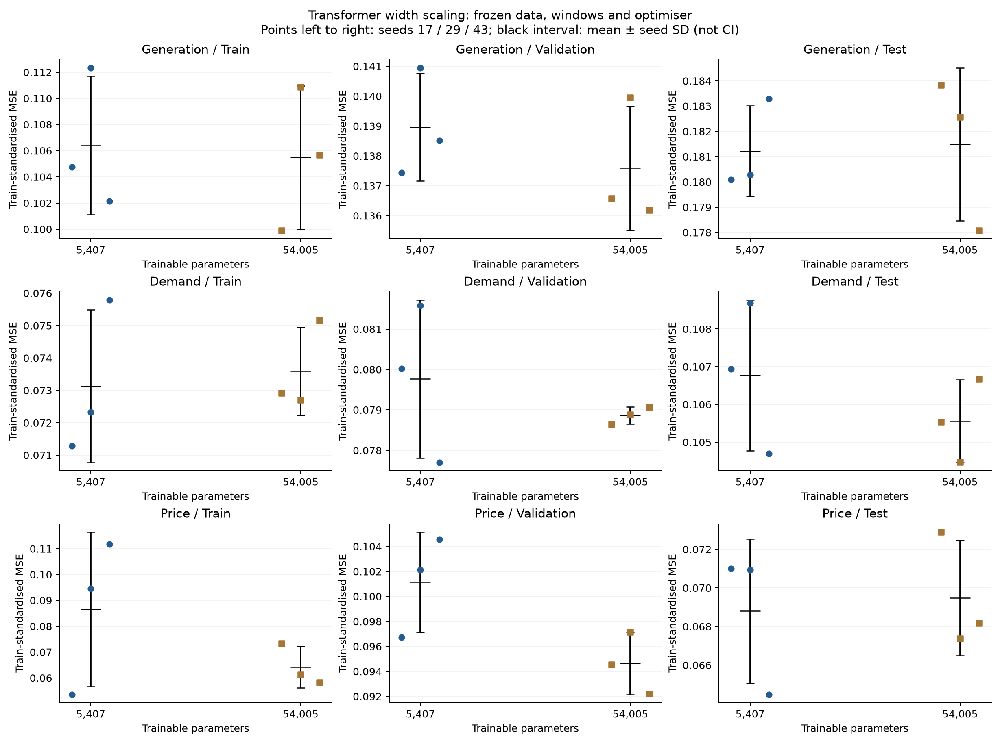
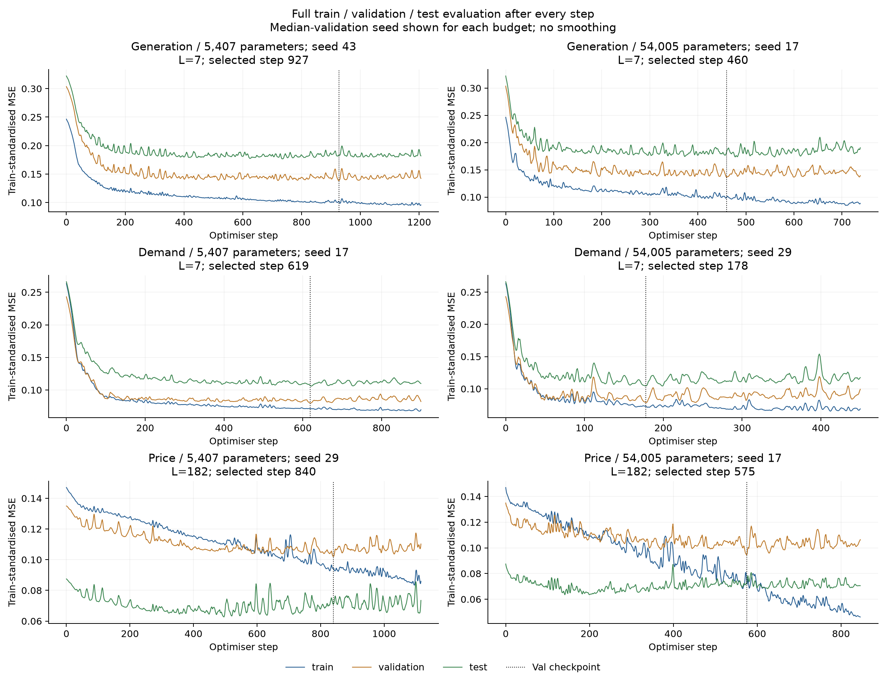

# Transformer 扩至约10倍参数：固定配置的三种子比较

本轮只扩大模型宽度：5,407 → 54,005参数（9.988倍）。单层编码器、3个注意力头保持不变，隐藏维度24 → 72、前馈层54 → 220；固定相对滞后正弦位置编码、pre-LayerNorm、GELU、dropout0.1和最后token的persistence residual输出均沿用。

固定配置下，供给平均test loss变化+0.15%，需求−1.14%，电价+0.99%；没有出现普遍的测试收益。供给种子波动增加，需求及电价种子波动缩小。保留小模型作为默认候选更有依据，当前不因更低val loss直接把电价模型替换成大模型。

供给和需求仍输入7天，电价输入182天；三个目标分别训练，均为次日预测，学习率均为0.001。窗口和学习率来自上一轮小模型的val选择，本轮不重新搜索。seeds为17、29、43，共9次新训练；小模型、RNN和LSTM对照从上一轮已核验的不可变release读取，不重新筛选。

## 固定数据和训练过程

Train目标2022-01-01—2024-12-31，共1096；val目标2025-01-01—2025-08-31，共243；test目标2025-09-01—2026-08-31，共365。2021年只提供历史。输入仍是三条已观察的标准化供给/需求/电价和5个日历特征，共8维；三个模型之间无参数共享。冻结修复数据、目标日期和仅train拟合的scaler均与旧release逐字节/哈希核对一致。

Transformer在RTX5090 Laptop GPU上以float32/math SDPA运行，AMP/TF32关闭，确定性算法开启。AdamW、weight decay0.0001、clip norm1、batch64，每epoch18step，最多120epoch；连续15个完整epoch无val改善则停止，改善阈值0.00001。每次更新后完整评估train/val/test并即时记录，仅val选checkpoint/早停。所有这些训练算术代码与上一轮完全一致，只改参数量校验常数。

Loss是每个样本平均的标准化MSE，三个分区均除以同一个train标准差的平方。±为三个种子的样本标准差，不是置信区间；下表来自各seed自己的val最优checkpoint，不是三模型集成。

## Train / Val / Test及种子波动

|目标|模型|参数量|窗口/天|Train loss|Val loss|Test loss|
|---|---|---:|---:|---:|---:|---:|
|供给|RNN|5,373|14|0.114900 ± 0.006543|0.144766 ± 0.001267|0.190618 ± 0.002268|
|供给|LSTM|5,409|30|0.099921 ± 0.006900|0.139543 ± 0.002554|0.184371 ± 0.003621|
|供给|TF-5k|5,407|7|0.106402 ± 0.005298|0.138962 ± 0.001801|0.181218 ± 0.001794|
|供给|TF-54k|54,005|7|0.105482 ± 0.005494|0.137575 ± 0.002071|0.181491 ± 0.003025|
|需求|RNN|5,373|7|0.077758 ± 0.002810|0.083427 ± 0.000370|0.108635 ± 0.000365|
|需求|LSTM|5,409|14|0.072137 ± 0.004063|0.081941 ± 0.001499|0.109138 ± 0.001822|
|需求|TF-5k|5,407|7|0.073135 ± 0.002362|0.079767 ± 0.001955|0.106773 ± 0.002000|
|需求|TF-54k|54,005|7|0.073592 ± 0.001361|0.078863 ± 0.000209|0.105558 ± 0.001098|
|电价|RNN|5,373|30|0.098176 ± 0.008161|0.110324 ± 0.003498|0.065712 ± 0.001095|
|电价|LSTM|5,409|14|0.061602 ± 0.009108|0.106860 ± 0.002779|0.075593 ± 0.004115|
|电价|TF-5k|5,407|182|0.086620 ± 0.029912|0.101141 ± 0.004026|0.068800 ± 0.003749|
|电价|TF-54k|54,005|182|0.064251 ± 0.008022|0.094628 ± 0.002486|0.069483 ± 0.002991|

## 扩大模型相对小Transformer的变化

负百分比表示大模型更好，均值变化为100×(大模型三个seed的平均MSE/小模型平均MSE−1)。相同seed仅是实验标识，网络维度变化后初始化及dropout随机数消费不同，不构成相同随机扰动或独立数据重采样。

|目标|分区|平均MSE变化|Seed17|Seed29|Seed43|大模型更好次数|
|---|---|---:|---:|---:|---:|---:|
|供给|train|-0.87%|-4.62%|-1.29%|+3.46%|2/3|
|供给|validation|-1.00%|-0.62%|-0.70%|-1.67%|3/3|
|供给|test|+0.15%|+2.08%|+1.27%|-2.84%|1/3|
|需求|train|+0.62%|+2.29%|+0.52%|-0.84%|1/3|
|需求|validation|-1.13%|-1.72%|-3.31%|+1.75%|2/3|
|需求|test|-1.14%|-1.31%|-3.88%|+1.88%|2/3|
|电价|train|-25.82%|+37.08%|-35.38%|-47.86%|2/3|
|电价|validation|-6.44%|-2.25%|-4.86%|-11.85%|3/3|
|电价|test|+0.99%|+2.69%|-5.02%|+5.74%|1/3|

## 训练轨迹

每种参数预算展示val误差居中的seed，没有按test挑图，曲线不平滑。每个seed的完整轨迹见step_logs及results/ALL_STEP_LOSSES.csv；旧模型日志包含在reference中的原始release。训练末尾相对val最优点的三集变化见OVERFIT_DIAGNOSTICS.csv。最佳点后train下降而val上升，说明继续拟合训练集没有对应的验证收益；不能仅凭两个年份上的loss差值全部归因于过拟合，年份分布也不同。

## 结果判断

供给：扩大后的平均test MSE相对小Transformer变化+0.15%，三个对应seed中有1次更好。test种子标准差由0.001794变为0.003025。
需求：扩大后的平均test MSE相对小Transformer变化-1.14%，三个对应seed中有2次更好。test种子标准差由0.002000变为0.001098。
电价：扩大后的平均test MSE相对小Transformer变化+0.99%，三个对应seed中有1次更好。test种子标准差由0.003749变为0.002991。

电价的三种子平均train loss下降25.82%、val loss下降6.44%，但test loss增加0.99%。三个seed的val均改善，test却仅一个改善；因此验证集上的进步没有在这一测试年份上延续。这个现象与训练期之外的泛化受限相容，但不能单独区分训练过拟合、验证选择影响和年份分布变化。

供给/需求在各自val最优checkpoint处的train平均loss几乎未变；checkpoint出现时刻不同，早停会使模型尚未达到最低train loss就被选中，不能从所选点的train loss断言模型容量没有增加或训练失效。9次新训练继续到末尾时train均下降、val均上升，早停仍有作用。

本轮回答的是固定窗口、学习率和训练预算下扩宽模型的效果，不代表大模型重新调参后的最好能力。三个seed只衡量训练随机性；test已被此前多轮监测，不是新的盲测。数据修复的历史发布版本未审计，未增加外部特征、未运行MPC、未上传或修改正式报告。

## 核验与复现

9次新拟合、6,138次权重更新；含step0共6,147行完整三集评估。冻结旧release全部文件、数据/划分/scaler、模型宽度差异和未变训练代码、逐step样本覆盖、val选点与早停、9个checkpoint重放、原始单位预测及MSE/MAE/RMSE独立复算全部通过。最大标准化预测重放差0，预测复算loss与日志最大差3.6e-09。

- results/SUMMARY.csv：四类候选的各分区均值和种子标准差。
- results/LARGE_VS_SMALL.csv：逐种子/均值变化及三种子范围。
- results/ALL_METRICS.csv、training_runs.csv、ALL_STEP_LOSSES.csv：新模型全部指标和逐step日志。
- checkpoints/、predictions/：9个val最优权重及三分区原始单位预测。
- CONFIGS_FROZEN.json、PROTOCOL.json、PREFLIGHT.json、REFERENCE.json：固定配置、训练协议及GPU和引用核验。

新环境安装requirements.txt后，依次运行python preflight.py、python run.py、python analyse.py。代码默认CUDAGPU；包内reference已包含冻结原release，无需访问远程仓库。bootstrap.py是一次性的本地来源准备记录，不是正常复现的必要步骤。
