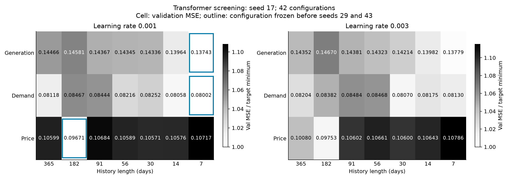
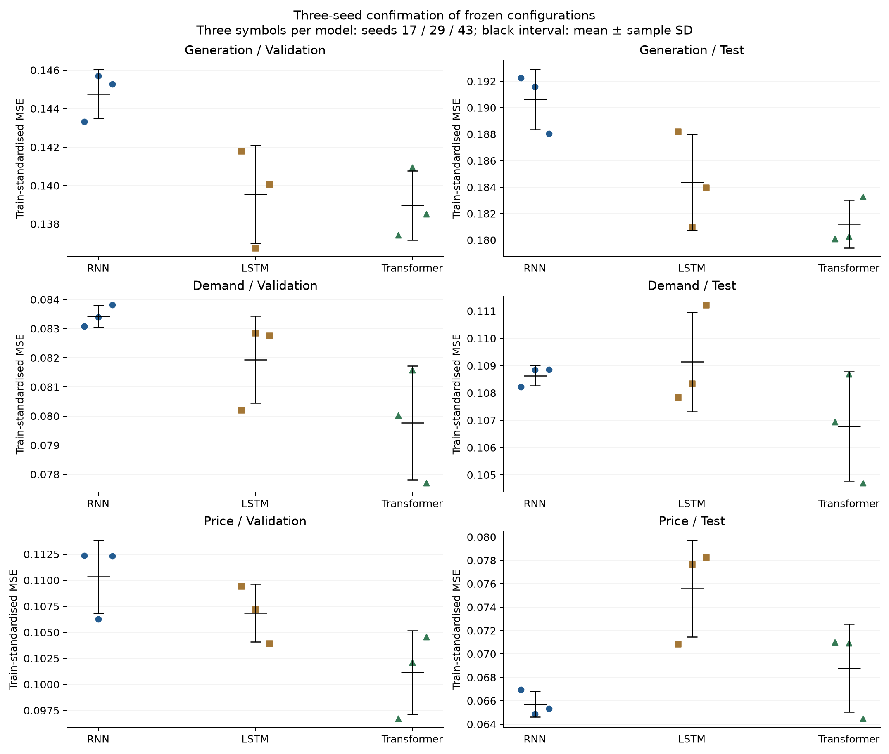
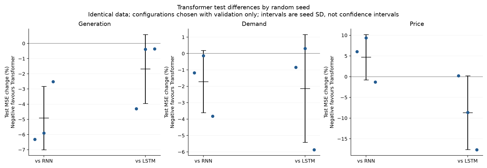
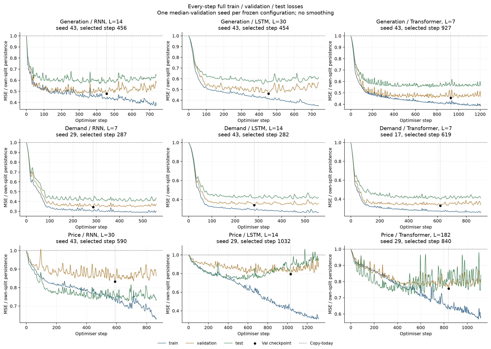

# 约 5.4k 参数 Transformer：次日预测与三种子复核

本轮使用小型 Transformer 编码器预测次日供给、需求或电价，每个目标单独训练。重点是将架构变化与训练随机性分开观察：先用 seed 17 初筛七个窗口、两个学习率，再固定每个目标的配置，补齐 seeds 29、43。普通 RNN/LSTM 的原候选配置也在本轮软件环境重新训练三个种子。

完成日期：2026-11-10；实验目录中的20261109保留启动日期。

## 结果判断

同等参数预算下，没有出现三个目标普遍明显优于循环模型的结果。供给和需求的Transformer平均test MSE相对LSTM分别降低1.71%、2.17%，但三种子的误差范围均与LSTM重叠。供给三次对应seed都改善，其中两次仅约0.4%；需求两次改善、一次略差。因此这两项属于小幅改善的候选证据，不能仅凭均值称为稳定的明显优势。

电价Transformer相对LSTM的平均test MSE降低8.99%，但相对RNN增加4.70%，三个对应seed中只有一个优于RNN。Transformer电价的seed标准差为0.003749，RNN为0.001095；其较低val误差没有转化为本段test中最好的平均表现。应保留RNN这个更强的电价对照，而不是只报告相对LSTM的提升。

供给相对RNN的改善较一致：平均test MSE降低4.93%，且三个Transformer结果均低于三个RNN结果。不过，较强的LSTM已经缩小了这个差距。整体上，Transformer值得保留为供给/需求候选，但本轮不足以支持把全部预测器统一替换为Transformer。上一轮注意力只测一个seed，不能由本轮直接断定其提升全部来自噪声。

## 网络结构与参数预算

每个历史日有 8 个特征：三条标准化历史序列，以及星期/年内相位的正余弦和周末标志。输入先投影到 24 维，再加固定正弦位置编码，经过一层 Transformer encoder，最后一个 token 接线性头预测次日相对当日的变化。

| 部件 | 配置 | 可训练参数 |
|---|---|---:|
| 输入投影 | 8 → 24 | 216 |
| 多头自注意力 | 3 heads，每 head 8 维 | 2,400 |
| 前馈网络 | 24 → 54 → 24，GELU | 2,670 |
| 两个 LayerNorm | pre-LayerNorm | 96 |
| 输出头 | 24 → 1 | 25 |
| 固定位置编码 | 按相对滞后天数编码 | 0 |
| 合计 | 一层编码器 | **5,407** |

同轮普通 RNN 为 5,373 参数，LSTM 为 5,409 参数。Transformer 没有预训练、没有可学习的 365×24 位置嵌入，也没有新增输入信息。各模型输出头初始化为零，因此 step 0 都等于照抄今天。

相对位置零始终对应最后已知日，不随窗口长度改变。窗口内的 token 全部是预测时已知的历史，允许它们相互做双向自注意力；次日目标没有放入窗口。设标准化目标为 $z_t$、最后 token 输出为 $h_t$，预测为 $\widehat z_{t+1}=z_t+w^\top h_t+b$。

编码器按 [PyTorch TransformerEncoderLayer 官方结构](https://docs.pytorch.org/docs/stable/generated/torch.nn.TransformerEncoderLayer.html) 实现；上述参数数由实际模型逐项统计。

## 数据与选择过程

| 分区 | 预测目标日期 | 样本数 |
|---|---|---:|
| Train | 2022-01-01—2024-12-31 | 1,096 |
| Val | 2025-01-01—2025-08-31 | 243 |
| Test | 2025-09-01—2026-08-31 | 365 |

使用冻结的修复数据：总供给为课程总发电加独立风场，单位为日均 MW；电价为名义 £/MWh。2021 年只提供历史输入，所有窗口共享相同目标日期；均值和标准差只由 2022–2024 年拟合。保留原来三序列加日历的输入，没有加入天气、燃料、外部预测或其他新特征。

Transformer 初筛窗口为 365、182、91、56、30、14、7 天，学习率为 0.001、0.003。每个目标有 14 个 seed17 配置，共 42 次拟合。仅按该目标最佳 val MSE 选窗口/学习率，选择文件先冻结，再从零训练选定配置的 seeds29、43；这六次补充训练与原 seed17 共形成九个确认模型。

RNN/LSTM 不在本轮重新搜索窗口或学习率，使用上一轮已按 val 选出的六组配置，每组三个种子，共十八次新拟合。因此，本轮 Transformer 搜索预算与固定的循环模型对照不同，结果比较的是这些实际候选，不单独证明架构优劣。全部唯一拟合为 42 + 6 + 18 = 66 次。

每个 seed 的 checkpoint 仍只按 val 选择；test 不用于选择窗口、学习率、checkpoint 或停止时刻。Test 已在前几轮反复监测，不是新的盲测。三种子主要检验训练随机性，不覆盖未来年份和数据来源的不确定性。

## 训练与硬件

所有模型统一使用本轮 PyTorch 2.14.1+cu130 环境，避免将旧 CPU 版与新 GPU 版的差异混入直接对照。Transformer 在 RTX 5090 Laptop GPU 上训练，RNN/LSTM 三目标在 CPU 独立进程中并行，每进程两线程。模型均为 float32，关闭 AMP、TF32，使用确定性算法；Transformer 用 math SDPA。

AdamW、weight decay 0.0001、梯度范数截断 1、dropout 0.1；batch size64，每 epoch18 step（17×64+8），最多120 epoch、连续15个完整 epoch 无新 val 改善则停止。没有 warmup 或学习率调度。checkpoint 可在任意 step 保存，改善阈值为0.00001。

每次更新后完整评估 train、val、test，关闭 dropout，逐行刷新日志。长窗口评估分块以控制显存，短窗口使用较大块降低调用开销；所有样本都计入均值，不是抽样。Transformer 的分块上限随 $L^{-2}$ 调整，范围64–2048；训练 batch 始终64。

初始测量一年窗口的一次更新加完整三集评估：CPU约2.67秒、GPU约0.11秒；重复测量约2.35/0.16秒。测量受到当时其他GPU负载影响，详见两份 PREFLIGHT_BENCHMARK 文件。GPU进程内存上限设为总显存25%，这不是预先占满该显存。短序列的循环模型在CPU上的吞吐也有竞争力。

初始导出曾将版本号保存为 TorchVersion 对象，安全读取因此报错。只修改了将版本号转为普通字符串这一项元数据；四次已完成训练由完整日志和checkpoint恢复，数值权重哈希及对应 loss 均验证不变，没有重训或更改选择。原错误日志和 METADATA_RECOVERY.json 保留。

## Transformer 初筛结果

以下配置只由 seed17 的 val 决定，不用 test 排序。

| 目标 | 窗口/天 | 学习率 | 初筛最佳 Val loss |
|---|---:|---:|---:|
| 供给 | 7 | 0.001 | 0.137432 |
| 需求 | 7 | 0.001 | 0.080023 |
| 电价 | 182 | 0.001 | 0.096714 |

## 三种子 Train / Val / Test loss

Loss 为相应目标的每样本平均标准化 MSE。± 是三个随机种子的样本标准差，不是置信区间；结果来自各 seed 自己的 val 最优 checkpoint，不是模型集成。每个窗口没有都训练三个种子，三种子复核仅针对冻结配置。

| 目标 | 模型 | 窗口/天 | 学习率 | Train loss | Val loss | Test loss |
|---|---|---:|---:|---:|---:|---:|
| 供给 | RNN | 14 | 0.003 | 0.114900 ± 0.006543 | 0.144766 ± 0.001267 | 0.190618 ± 0.002268 |
| 供给 | LSTM | 30 | 0.003 | 0.099921 ± 0.006900 | 0.139543 ± 0.002554 | 0.184371 ± 0.003621 |
| 供给 | Transformer | 7 | 0.001 | 0.106402 ± 0.005298 | 0.138962 ± 0.001801 | 0.181218 ± 0.001794 |
| 需求 | RNN | 7 | 0.001 | 0.077758 ± 0.002810 | 0.083427 ± 0.000370 | 0.108635 ± 0.000365 |
| 需求 | LSTM | 14 | 0.003 | 0.072137 ± 0.004063 | 0.081941 ± 0.001499 | 0.109138 ± 0.001822 |
| 需求 | Transformer | 7 | 0.001 | 0.073135 ± 0.002362 | 0.079767 ± 0.001955 | 0.106773 ± 0.002000 |
| 电价 | RNN | 30 | 0.001 | 0.098176 ± 0.008161 | 0.110324 ± 0.003498 | 0.065712 ± 0.001095 |
| 电价 | LSTM | 14 | 0.003 | 0.061602 ± 0.009108 | 0.106860 ± 0.002779 | 0.075593 ± 0.004115 |
| 电价 | Transformer | 182 | 0.001 | 0.086620 ± 0.029912 | 0.101141 ± 0.004026 | 0.068800 ± 0.003749 |

每组从左到右为 seeds17、29、43，黑线为均值±样本标准差。小幅均值变化应与这些重复结果共同判断，不用最好的一次代表整个模型。

## 相对 RNN/LSTM 的逐种子 Test 变化

百分比为100×（Transformer test MSE / 对照test MSE − 1），负值有利于Transformer。均值比的变化和三个种子的百分比均值不一定相同，表中分别列出。对应seed只是重复实验的标识，不构成三次独立数据重采样。

| 目标 | 对照 | 平均MSE比变化 | Seed17 | Seed29 | Seed43 | Transformer较好次数 |
|---|---|---:|---:|---:|---:|---:|
| 供给 | RNN | -4.93% | -6.32% | -5.91% | -2.52% | 3/3 |
| 供给 | LSTM | -1.71% | -4.30% | -0.39% | -0.36% | 3/3 |
| 需求 | RNN | -1.71% | -1.18% | -0.14% | -3.82% | 3/3 |
| 需求 | LSTM | -2.17% | -0.84% | +0.31% | -5.87% | 2/3 |
| 电价 | RNN | +4.70% | +6.05% | +9.36% | -1.31% | 1/3 |
| 电价 | LSTM | -8.99% | +0.20% | -8.65% | -17.63% | 2/3 |

若需要用一个循环模型作参照，仅依据三种子平均 val 选择，其结果为：供给=LSTM；需求=LSTM；电价=LSTM。表格仍完整保留对另一个家族的结果，不用 test 挑一个更弱的对照。

## 简单基准与原始单位

Persistence 为明天照抄今天，Seasonal7 为明天照抄上周同一天。两者在同一目标日期上计算。供给和需求 RMSE/MAE 单位为MW，电价为£/MWh。

| 目标 | 方法 | Test标准化MSE | Test RMSE | Test MAE |
|---|---|---:|---:|---:|
| 供给 | Persistence | 0.322207 | 2,973.315 | 2,314.292 |
| 供给 | Seasonal7 | 0.536824 | 3,837.864 | 2,969.529 |
| 供给 | RNN | 0.190618 ± 0.002268 | 2,286.915 ± 13.628 | 1,784.785 ± 6.682 |
| 供给 | LSTM | 0.184371 ± 0.003621 | 2,249.089 ± 22.071 | 1,753.719 ± 19.280 |
| 供给 | Transformer | 0.181218 ± 0.001794 | 2,229.825 ± 11.023 | 1,730.452 ± 9.621 |
| 需求 | Persistence | 0.266117 | 2,065.163 | 1,603.189 |
| 需求 | Seasonal7 | 0.383977 | 2,480.682 | 1,874.186 |
| 需求 | RNN | 0.108635 ± 0.000365 | 1,319.479 ± 2.218 | 1,008.280 ± 2.358 |
| 需求 | LSTM | 0.109138 ± 0.001822 | 1,322.501 ± 11.014 | 1,016.600 ± 4.079 |
| 需求 | Transformer | 0.106773 ± 0.002000 | 1,308.089 ± 12.257 | 1,007.480 ± 7.047 |
| 电价 | Persistence | 0.087454 | 23.627 | 16.673 |
| 电价 | Seasonal7 | 0.143878 | 30.305 | 22.516 |
| 电价 | RNN | 0.065712 ± 0.001095 | 20.480 ± 0.170 | 15.143 ± 0.189 |
| 电价 | LSTM | 0.075593 ± 0.004115 | 21.961 ± 0.603 | 16.429 ± 0.476 |
| 电价 | Transformer | 0.068800 ± 0.003749 | 20.951 ± 0.576 | 15.839 ± 0.726 |

## 训练轨迹与边界

每个模型/目标展示按val排序居中的种子，未按test挑选。各分区loss除以本分区照抄今天的MSE后显示，1是照抄水平；横轴为每次optimizer更新，未平滑。完整三种子和初筛的日志均随包保存。

三种子复核比单次最优值更能反映训练随机性，但仍然使用同一训练/验证/测试年份，且Transformer配置先由seed17筛选；小差异不应表述为统计显著。是否值得用于最终MPC，还需要在相同资产、信息和运营规则下比较控制收益。本轮没有运行MPC，也没有加入外部特征或修改正式报告。

## 核验、文件和复现

66 次唯一拟合，确认阶段27个模型；累计 53,010 次权重更新，含 step0 共 53,076 行完整评估、159,228 个分区loss。源文件/输入/基准哈希、固定划分/训练期scaler、参数量、每step全量覆盖、批次计数、val选点/选窗及早停检查通过。checkpoint重放最大标准化预测差 0，独立loss复算最大差 9.71e-17；所选Transformer的CPU/GPU预测也在记录的容差内一致。

- model.py、fit_core.py、data.py、run.py：模型、统一训练/全量评估、划分和运行协调。
- results/SELECTION_FROZEN.json、CONFIRMATION_METRICS.csv、THREE_SEED_SUMMARY.csv：配置、每个种子和均值/标准差。
- results/TRANSFORMER_VS_RECURRENT.csv、PAIRED_SEED_TEST_COMPARISON.csv：平均与逐seed差值。
- results/ALL_METRICS.csv、ALL_STEP_LOSSES.csv、OVERFIT_DIAGNOSTICS.csv：全部初筛/复核和训练轨迹。
- checkpoints/、predictions/、case_results/：66个最佳val权重、三分区预测和完整案例缓存。
- PREFLIGHT_BENCHMARK*.json、EVALUATION_CHUNK_TIMING.json、PROTOCOL.json、results/AUDIT.json：环境、速度和核验。
- METADATA_RECOVERY.json、execution_logs/、fit_core_initial_metadata.txt：历史元数据修复证据；recover_metadata.py为一次性历史恢复脚本，不用于正常复现。

安装requirements.txt后，在新副本依次运行 python preflight_benchmark.py、python run.py、python analyse.py。训练默认需要可用CUDA GPU；checkpoint以CPU张量保存，分析脚本在无GPU时也可用CPU重放。完整数据随包提供，原CPU实验未改写。修复历史的逐日发布版本仍未审计；test已多轮监测，不是新的盲测。

本轮只通过匿名隔离Playwright MCP核对了官方PyTorch安装索引和编码器文档；未查学校平台或邮箱，未上传小组仓库或提交作业。
