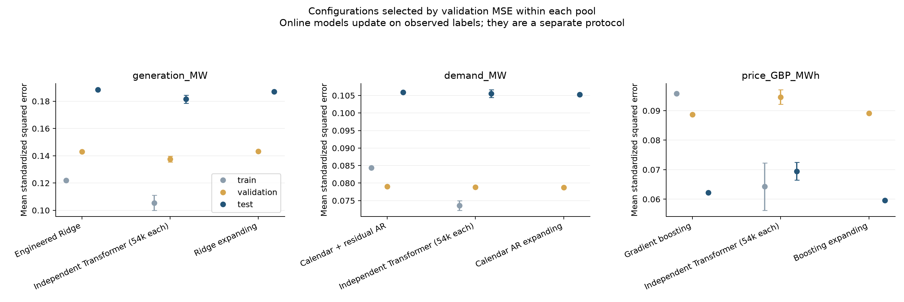

# Tier2B：传统方法与神经网络的统一次日预测比较

本轮重新回测传统方法，并从已冻结的神经网络逐日预测重新计算全部指标。共纳入 **23 个传统／非神经方法配置和 16 个神经网络配置**。后者包括独立 RNN、LSTM、两种规模 Transformer，以及联合 RNN／LSTM 的规模与平台期策略试验。所有结果留在本地，没有上传或发出组内公告。

## 1. 对齐的评价协议

| 部分 | 次日目标日期 | 样本数 |
|---|---|---:|
| Train | 2022-01-01—2024-12-31 | 1,096 |
| Val | 2025-01-01—2025-08-31 | 243 |
| Test | 2025-09-01—2026-08-31 | 365 |

2021 年仅提供历史输入；2026 年 9 月 1—17 日未作为评价目标。每个预测起点 t 使用截至 t 的观测，预测 t+1。发电包含课程总发电和独立风电场，发电与需求单位均为日均 MW，电价为名义 GBP/MWh。输入 CSV 的 SHA256 为 `addc31ee1e01de947c025eb2b47aa7a09e3680e3ca189ea904edf9bd73fae475`。

样本平均标准化均方误差（MSE）为：

$$
L_{j,S}=\frac{1}{|S|}\sum_{t+1\in S}\left(\frac{\widehat y_{t+1,j}-y_{t+1,j}}{s_{j,\mathrm{train}}}\right)^2.
$$

三个目标各自使用 2022—2024 年训练标签的总体标准差，整个比较中固定。这里的 loss 是每个样本平均值，不是全样本误差之和。另给出原单位的 MSE、平均绝对误差（MAE）及均方根误差（RMSE）。同一目标的标准化 MSE 与原单位 MSE 排名完全一致。三个目标的原单位误差不能直接取平均。

传统方法各自按目标的 val MSE 选参数；旧的联合 val 选参结果没有直接照搬。神经模型保留此前已经冻结的配置和各自 val 检查点。联合模型仍使用一个联合检查点，没有为三个输出另行挑选有利的权重。神经网络报告三个种子的分数均值 ± 样本标准差；它们不是三个预测先平均后的集成分数。传统方法为确定性拟合，不虚构种子波动。

新增特征模型仅使用同样的三条历史序列和已知日期：每条序列的 lag 0—6、13，过去 7／28 天均值，加次日星期、年度 Fourier 项及圣诞日期标记，共 44 列。旧 OLS／Ridge 使用与神经网络相同的八类逐日输入及其历史窗。不同方法允许不同特征表达和历史长度，没有加入 Fable 原试验中的额外发电分量、外部天气或燃料价格。

## 2. 固定训练参数：主要比较

下表均使用相同 test 日期，数值越低越好。每个方法家族已经通过 val 选定其参数；表中全部方法用于展示，不根据 test 的最低值重新选模型。

| 方法 | 发电 test loss | 需求 test loss | 电价 test loss |
|---|---:|---:|---:|
| 持续值 | 0.322207 | 0.266117 | 0.087454 |
| 七日季节朴素 | 0.536824 | 0.383977 | 0.143878 |
| 28日均值 | 0.458991 | 0.420732 | 0.086823 |
| 52周同星期均值 | 0.810825 | 1.277867 | 0.127123 |
| 日历回归 | 0.552176 | 0.247382 | 0.297973 |
| OLS 水平 | 0.196387 | 0.111561 | 0.066686 |
| OLS 变化 | 0.196387 | 0.111561 | 0.066686 |
| 岭回归 水平 | 0.191174 | 0.110894 | 0.063413 |
| 岭回归 变化 | 0.192879 | 0.110854 | 0.066389 |
| 日历回归+残差AR | 0.186563 | 0.105875 | 0.069243 |
| 水平＋星期模式（固定） | 0.208510 | 0.121191 | 0.067496 |
| 特征岭回归 | 0.188461 | 0.111829 | 0.062631 |
| LASSO | 0.184864 | 0.106742 | 0.079780 |
| 梯度提升树 | 0.203475 | 0.116481 | 0.062267 |
| 等权集成 | 0.184257 | 0.105168 | 0.060041 |
| 独立 RNN | 0.190618 ± 0.002268 | 0.108635 ± 0.000365 | 0.065712 ± 0.001095 |
| 独立 LSTM | 0.184371 ± 0.003621 | 0.109138 ± 0.001822 | 0.075593 ± 0.004115 |
| 独立 Transformer 5k | 0.181218 ± 0.001794 | 0.106773 ± 0.002000 | 0.068800 ± 0.003749 |
| 独立 Transformer 54k | 0.181491 ± 0.003025 | 0.105558 ± 0.001098 | 0.069483 ± 0.002991 |
| 联合 RNN 55k P15 | 0.190880 ± 0.001377 | 0.112769 ± 0.001724 | 0.070150 ± 0.001563 |
| 联合 LSTM 55k P15 | 0.184519 ± 0.004877 | 0.114853 ± 0.003052 | 0.068080 ± 0.000832 |

OLS 是普通最小二乘回归，Ridge 是岭回归，LASSO 是带 L1 惩罚的线性回归。水平 OLS 与预测变化量的 OLS 在当前输入包含最近值的条件下等价，两个结果只差数值舍入。日历回归单独预测很弱，但加上最近残差及其七日均值后明显改善。新增岭回归／LASSO／梯度提升树各自按 val 选择价格是否使用反双曲正弦（asinh）变换；所有评分先还原原单位。

等权集成为特征岭回归、LASSO、梯度提升树的预测各占三分之一，权重没有根据 test 调整。独立模型每个目标单独拟合；独立 Transformer 54k 是每个目标约 54k 参数，三个模型合计 162,015。联合 55k 是三个输出共用约 55k 参数，参数预算不同。

## 3. 按 val 选出的候选：train／val／test

| 目标 | 由 val 选出的模型 | Train loss | Val loss | Test loss | Test MAE | Test RMSE |
|---|---|---:|---:|---:|---:|---:|
| 发电 | 特征岭回归 | 0.121944 | 0.143094 | 0.188461 | 1787.72 | 2273.97 |
| 发电 | 独立 Transformer 54k | 0.105482 ± 0.005494 | 0.137575 ± 0.002071 | 0.181491 ± 0.003025 | 1723.18 ± 19.99 | 2231.47 ± 18.63 |
| 需求 | 日历回归+残差AR | 0.084390 | 0.079052 | 0.105875 | 1011.28 | 1302.61 |
| 需求 | 独立 Transformer 54k | 0.073592 ± 0.001361 | 0.078863 ± 0.000209 | 0.105558 ± 0.001098 | 1002.64 ± 1.90 | 1300.65 ± 6.76 |
| 电价 | 梯度提升树 | 0.095746 | 0.088683 | 0.062267 | 14.93 | 19.94 |
| 电价 | 独立 Transformer 54k | 0.064251 ± 0.008022 | 0.094628 ± 0.002486 | 0.069483 ± 0.002991 | 15.69 ± 0.36 | 21.06 ± 0.45 |

| 目标／模型 | Test MSE（原单位平方） | Test MAE | Test RMSE |
|---|---:|---:|---:|
| 发电／特征岭回归 | 5170944.00 | 1787.72 | 2273.97 |
| 发电／独立 Transformer 54k | 4979693.02 ± 82989.11 | 1723.18 ± 19.99 | 2231.47 ± 18.63 |
| 需求／日历回归+残差AR | 1696798.74 | 1011.28 | 1302.61 |
| 需求／独立 Transformer 54k | 1691714.89 ± 17594.63 | 1002.64 ± 1.90 | 1300.65 ± 6.76 |
| 电价／梯度提升树 | 397.47 | 14.93 | 19.94 |
| 电价／独立 Transformer 54k | 443.53 ± 19.09 | 15.69 ± 0.36 | 21.06 ± 0.45 |

发电和需求的 MAE／RMSE 单位为 MW，电价为 GBP/MWh。神经网络的 RMSE 是各个种子的 RMSE 再取平均，所以不必恰好等于平均 MSE 的平方根。

**发电：Transformer 小幅领先。** 按 val 选择的是较大 Transformer；其 test loss 为 0.181491，传统候选特征岭回归为 0.188461，MSE 约低 3.7%。小 Transformer 的 test 为 0.181218，与较大模型差异远小于种子波动，扩大参数没有稳定获益。LASSO 和等权集成的 test 也接近神经方法，但它们没有在 val 赢过该传统候选。

**需求：简单模型已经接近神经网络。** 日历＋残差 AR 的 test 为 0.105875，较大 Transformer 为 0.105558，只差约 0.3% MSE，后者三种子标准差为 0.001098。这个幅度不足以宣称有稳定优势。固定等权集成在这段 test 上更低，但不是 val 选中的传统家族，不能据此换成“测试集选模”。

**电价：传统非线性方法更有竞争力。** val 选出的梯度提升树深度为 2，使用 asinh 价格变换，test 为 0.062267，较 val 选出的 Transformer 低约 10.4% MSE；价格 MAE 为 £14.93/MWh。与 test 表现更好的独立 RNN 比较，MSE 也约低 5.2%。固定等权集成的 test 更低，但 val 上梯度提升树更好，因此当前选择仍是树模型。

训练误差与跨年份误差受年份分布影响，尤其 2022 年的价格水平和波动与 test 不同。asinh 模型最小化变换空间误差，也不保证原单位 train MSE 最小。例如 LASSO 的价格原单位 train loss 明显偏高；不能省略这个结果，也不能仅凭 test 低于 train 就判断不过拟合。

## 4. 吸收新观测后重训：单列的滚动回测

每 28 个预测起点重新拟合一次。扩展窗从 2022 年开始累计；730 天窗保留最近 730 个已观测训练标签。每一块的最大训练标签日期不晚于该块第一个预测起点。每次预测依然只能用当前已经观测的数据。

滚动方法也只按 rolling val MSE 选择参数。test 阶段允许使用此前已经发生的 val／test 观测重新拟合；现有神经模型没有这样重训，因此这张表包含更新制度带来的收益。没有一个与固定神经模型相同意义的单一 train 分数；每次拟合的训练误差与日期均存于 `results/FIT_HISTORY_all.csv`。

| 方法 | 发电 test loss | 需求 test loss | 电价 test loss |
|---|---:|---:|---:|
| 水平＋星期模式（动态） | 0.211895 | 0.121979 | 0.070120 |
| 特征岭回归（扩展） | 0.186945 | 0.105632 | 0.061023 |
| 特征岭回归（滚动730） | 0.192510 | 0.106411 | 0.068766 |
| LASSO（滚动730） | 0.186608 | 0.103931 | 0.068503 |
| 梯度提升树（扩展） | 0.195290 | 0.108063 | 0.059635 |
| 日历＋残差 AR（扩展） | 0.185478 | 0.105307 | 0.066738 |
| 日历＋残差 AR（滚动730） | 0.187354 | 0.105064 | 0.072637 |
| 等权集成（滚动） | 0.184021 | 0.099814 | 0.058639 |

动态水平＋星期模式使用过去 364 天更新星期模式，平滑系数在 val 选好后固定。它与周期重新拟合回归权重的方式不同，保留单独的 `online_state` 标签。

价格梯度提升树的 test 从固定方案的 0.062267 降到扩展重训的 0.059635，MSE 约下降 4.2%。扩展日历 AR 的需求 loss 为 0.105307。滚动等权集成在 test 的需求、电价两项更低，但 val 不一定胜出；完整表保留这些结果，未根据 test 改写候选。

## 5. 对 Tier2B 的含义

当前证据支持保留分目标建模：发电以小／大 Transformer 为候选，需求同时保留日历＋残差 AR，电价保留梯度提升树和岭回归。下一步进入模型预测控制（MPC）时，需在同一重训制度和信息边界下比较实际决策收益。单日 MSE 较低并不自动意味着电池／制氢调度收益更高。

这份 test 已被此前多轮试验查看，属于同一研究阶段的重复对比，不能当成新的盲测证明。神经模型与传统模型的搜索空间也不同；这里提供同一数据与评价尺度下的预测比较，不把差异完全归因于模型架构。SARIMA、TBATS 等仅在前期调研中被提及，未在 Fable 已交代码中完成，不列为已回测结果。

## 6. 文件与复现

- `results/COMPLETE_TABLES.md`：39 个配置在三个目标上的完整 train／val／test 表。
- `results/ALL_METRICS.csv`：逐方法、逐种子、逐目标、逐划分的原单位及标准化指标。
- `results/SUMMARY.csv`：均值、种子标准差、相对“明天照抄今天”的改进幅度。
- `results/SELECTED_CONFIGURATIONS.csv`：各传统方法的目标专属选参。
- `results/SELECTION_all.csv`、`IMPORTED_LINEAR_SELECTIONS.csv`：验证集选参记录。
- `results/ROLLING_BOUNDARIES.csv`：全部选中滚动模型的训练截止和预测起点。
- `predictions/`、`methods/`、`models/`：冻结预测、元数据及新拟合的 423 份估计器状态。
- `reference/IMPORT_MANIFEST.json`：133 份既有原始预测的来源及 SHA256。
- `results/AUDIT.json`：预测重放、指标与截止核验结果。

在 Python 3.12 环境安装 `requirements.txt` 后，可以运行 `analyse.py` 与 `audit.py` 重算指标和核验；`traditional.py --part all` 重跑本轮新增传统方法。`prepare.py` 仅用于从同级旧试验归档重新导入冻结预测，需要相应旧目录；已交比较包包含导入后的预测，所以重算比较表不依赖旧目录。神经网络的完整训练代码和权重保留在先前各个试验包，本包不重复打包其训练环境。

本轮为本地代码核验，未额外派遣独立 agent。423 份估计器状态和 414 个滚动块均已重放，最大标准化预测差异小于 2×10⁻¹⁵；三个目标的指标逐项重算通过。直方图树在训练样本的阈值处对浮点微差敏感，因此重放使用同样的补偿式滚动均值，并另验与直接窗口均值一致；未因此更改任何预测。
